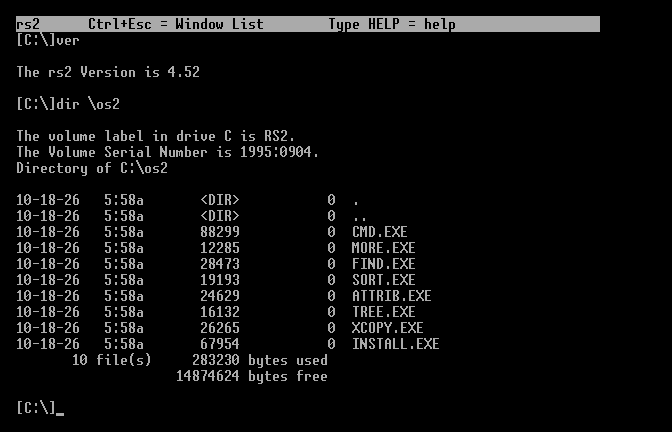
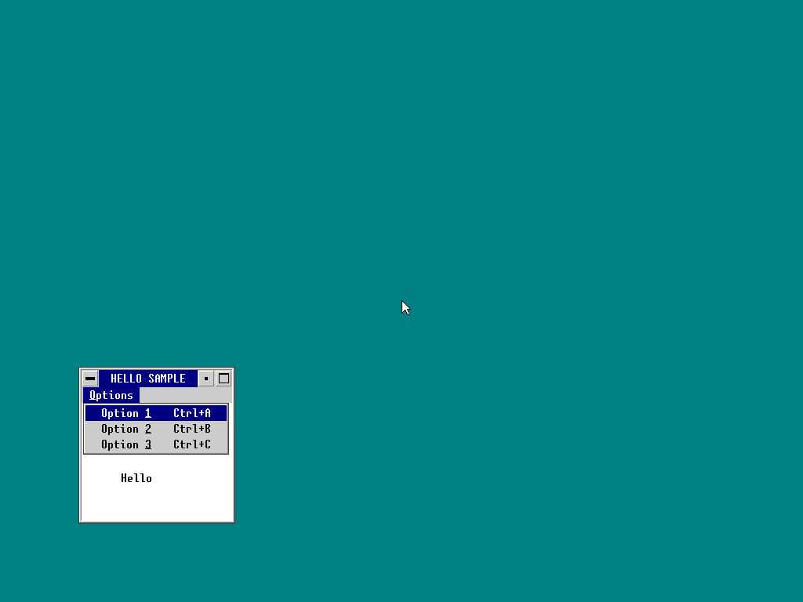
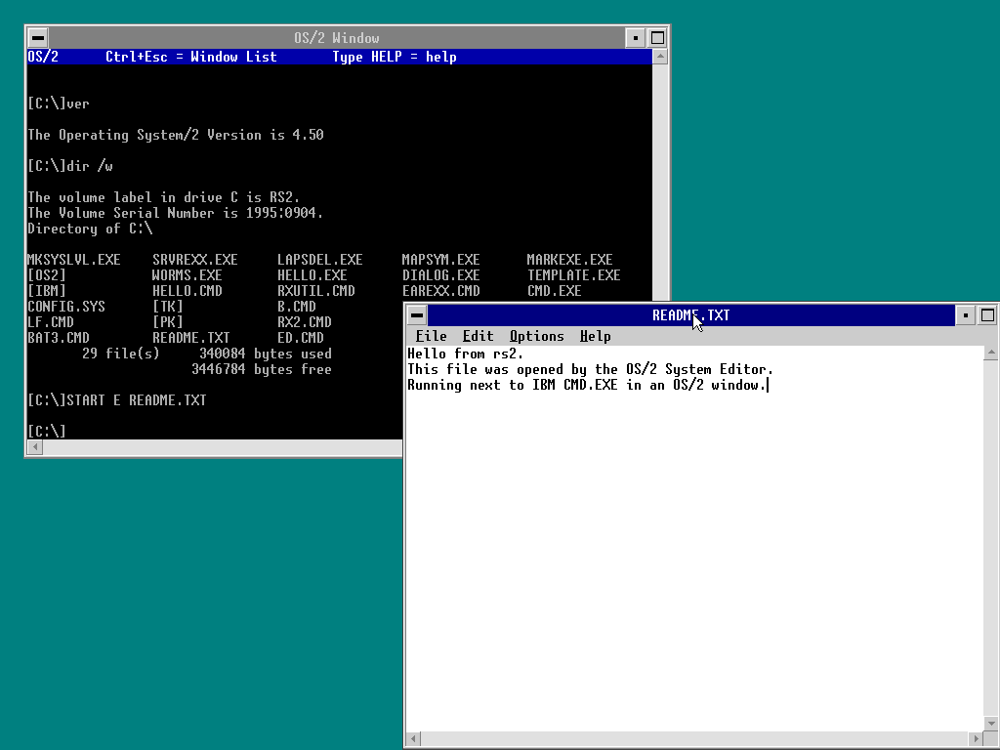
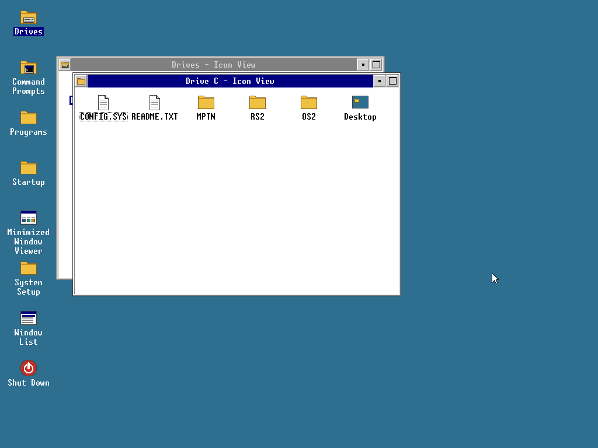

# rs2

A re-implementation of IBM OS/2 Warp 4.52 in Rust that runs existing OS/2
programs unmodified, natively, on 64-bit PCs.

- 64-bit kernel; OS/2 programs (16-bit NE, 16/32-bit LX) run in
  compatibility mode with the original OS/2 address space layout (tiled
  LDT, private/shared arenas), so 16:16 and flat code mix as on OS/2.
- The OS/2 kernel API (DOSCALLS: files, memory, processes, threads,
  semaphores, exceptions, timers, queues, shared memory, pipes, modules,
  resources, signals) plus VIO, KBD, MSG and NLS.
- UEFI boot from CD, USB stick or hard disk; AHCI, NVMe, USB keyboard/mouse (xHCI),
  partitions (MBR/GPT), FAT, HPFS and ISO 9660.
- Runs as a guest in VMware (and QEMU's VMware device models): VMware
  absolute pointer (no mouse capture), PVSCSI and LSI Logic (MPT Fusion)
  SCSI disks and CD-ROMs, SVGA II resolutions (`video=WxH`); see
  [Virtual machines](#virtual-machines).
- virtio devices for KVM/QEMU, Proxmox, UTM and cloud VMs: block and SCSI
  disks (and booting from them), SCSI CD-ROMs, keyboards, mice and tablets
  (absolute pointer), entropy (`\DEV\RANDOM$`), console
  (`\DEV\VIOCON$`) and display (virtio-gpu, any `video=WxH`).
- Networking: a TCP/IP stack of its own (ARP, IPv4, ICMP, UDP, TCP, DHCP,
  DNS) on Intel e1000/e1000e and virtio-net adapters, a kernel socket API
  and OS/2's socket DLLs (TCPIP32, SO32DLL, TCP32DLL and the 16-bit
  TCPIPDLL) on it, so IBM's FTP, TELNET, TFTP and REXX RXSOCK run
  unmodified; `PING`, `IFCONFIG`, `NETSTAT`,
  `HOST`; see [docs/NETWORK.md](docs/NETWORK.md).
- A desktop: rs2's own desktop shell on Presentation Manager (folders,
  drives and file windows, program objects kept in OS2.INI, pop-up
  menus, a settings notebook, shutdown with power off); see
  [Using the desktop](#using-the-desktop).
- Presentation Manager on rs2's own PM DLLs, with text-mode programs
  such as CMD.EXE in PM windows ("OS/2 Window": `START /WIN CMD`,
  Alt+Home to full screen, Mark/Copy/Paste), containers, notebooks,
  icons and pointers, minimizing to desktop icons and profiles in real
  OS/2 INI files; see [docs/PM.md](docs/PM.md).
- Its own user space written in Rust and packed into genuine LX files:
  command interpreter, base utilities, installer.



*The live ISO booted in QEMU.*



*An unmodified Presentation Manager sample on rs2's own PMWIN/PMGPI.*



*Booted straight into PM: IBM's CMD.EXE in an OS/2 window and the System Editor (E.EXE), both unmodified.*

See [docs/ARCHITECTURE.md](docs/ARCHITECTURE.md) for the design,
[docs/ROADMAP.md](docs/ROADMAP.md) for what is done and what is next, and
[docs/COMPATIBILITY.md](docs/COMPATIBILITY.md) for the original OS/2
programs tested so far.

## Building

Requirements: a Rust toolchain (stable) with the `x86_64-unknown-uefi`,
`x86_64-unknown-none` and `i686-unknown-linux-gnu` targets, and QEMU with
OVMF for running it.

```
rustup target add x86_64-unknown-uefi x86_64-unknown-none i686-unknown-linux-gnu
cargo xtask iso --dist --release -o rs2.iso   # bootable install/live ISO
cargo xtask run --iso rs2.iso                 # try it in QEMU
```

The ISO boots into the live system's desktop; open Programs > Install
rs2 (or type `INSTALL` at a command prompt) to install onto a hard disk. Development builds (`cargo xtask run`) take extra files for drive C:
from `work/modules.txt`, which is how original OS/2 programs are tested.

## Using the desktop



*The live ISO's desktop (RS2SHELL) with Drives > C: > OS2 open.*

The live system and installed systems start Presentation Manager with
rs2's desktop shell (`C:\OS2\RS2SHELL.EXE`). Double click an object
(or select it and press Enter) to open it: Command Prompts (an OS/2
window or full screen), Programs, Drives (a window per drive, then per
folder; programs run, text files open in the System Editor when it is
installed), the Minimized Window Viewer, the Window List and Shutdown.
Mouse button 2 opens pop-up menus (Open, Settings, Rename, Delete;
Create program object, System setup, Shut down on the desktop) and
drags icons, whose places are kept; a file dragged onto a folder moves
there. Ctrl+Esc shows the window list. Shutdown closes the programs
(they may ask about unsaved work), flushes the disks and turns the
machine off. Details: [docs/PM.md](docs/PM.md#the-desktop-shell-rs2shell).

**The text-mode command prompt instead:** press T while the boot loader
shows "Press T for a text-mode boot", or put `textmode` in
`\RS2\CMDLINE`, or in CONFIG.SYS replace `PROTSHELL=C:\OS2\RS2SHELL.EXE`
with `PROTSHELL=C:\OS2\CMD.EXE`. Development runs (`cargo xtask run`)
use `work/cmdline.txt` as before; `cargo xtask run --desktop` boots into
the desktop.

## Virtual machines

rs2 boots in any VM with UEFI firmware and a GOP framebuffer. Storage:
SATA (AHCI), NVMe, VMware PVSCSI, LSI Logic Parallel (53c1030) and LSI
Logic SAS (SAS1068), USB sticks. `video=1280x1024` (or any WxH) in
`\RS2\CMDLINE` picks the resolution: through the firmware if it offers
that mode, otherwise through the VMware SVGA II driver. With a virtio-gpu
display the kernel's driver always takes over and sets any size: the
`video=` one, else the firmware's mode, else the display's preferred
size.

- **VMware** (Workstation/ESXi on x86; Fusion on Apple Silicon only runs
  ARM guests): guest OS type **Other 64-bit** with UEFI firmware and
  Secure Boot off; with other guest types VMware's firmware reports "No
  compatible bootloader found". The VMware pointer (vmmouse) follows the
  host cursor without capturing it; the boot log shows "mouse: VMware
  absolute pointer". The live ISO boots and installs on VMware Workstation
  17 (Windows 11 host), and the installed system boots from its disk; QEMU's
  VMware models (`cargo xtask run --vmware --pvscsi IMG --pvscsi-cd ISO`,
  `--scsi-hba mptsas1068`) are what the tests use.
- **Proxmox**: BIOS OVMF (UEFI) with "Pre-Enroll keys" unticked (Secure
  Boot off); VirtIO SCSI, VirtIO Block or SATA disks; VirtIO or E1000
  network. Installing from the live ISO and booting the installed disk
  work there.
- **VirtualBox**: enable EFI; use SATA or NVMe disks (VirtualBox's LSI
  Logic controllers use the same MPT interface and may work too). The
  mouse works in relative (captured) mode: VirtualBox's absolute pointer
  needs its VMMDev guest device, which rs2 does not drive yet.
- **QEMU**: `-machine q35` with OVMF, as `cargo xtask run` does. For
  virtio-gpu use `-vga none -device virtio-vga` (`cargo xtask run
  --virtio-gpu`): OVMF draws on its VGA side until the kernel takes over.
  With `virtio-gpu-pci` (`--virtio-gpu-pci`) the firmware has no
  framebuffer for the loader, so the screen only starts with the driver
  (earlier boot messages are on the serial port).

Network: Intel e1000 (82540EM, 82545EM: QEMU, VirtualBox, VMware's
`e1000`), e1000e (82574L) and virtio-net adapters are configured by DHCP
at boot (`net=off` or `net=ADDR/PREFIX,GATEWAY,DNS` on the kernel command
line, or NETWORK= in CONFIG.SYS, change that); `cargo xtask run --net` or
`--virtio-net` attaches one on QEMU's user network. Other adapters
(vmxnet3, pcnet, ...) are listed in the serial log but not used.

## Repository

| Path | Contents |
|------|----------|
| `kernel/` | the kernel |
| `boot/` | UEFI loader |
| `crates/` | shared libraries: executable formats, FAT, HPFS, installer unpacking, boot hand-off |
| `userland/` | OS/2 programs in Rust (CMD, utilities, installer, tests) |
| `tools/` | `elf2lx`, `lxdump`, Ghidra scripts, analysis scripts |
| `xtask/` | build tool: images, ISO, QEMU |
| `dist/` | files of the distributed system (CONFIG.SYS, README) |
