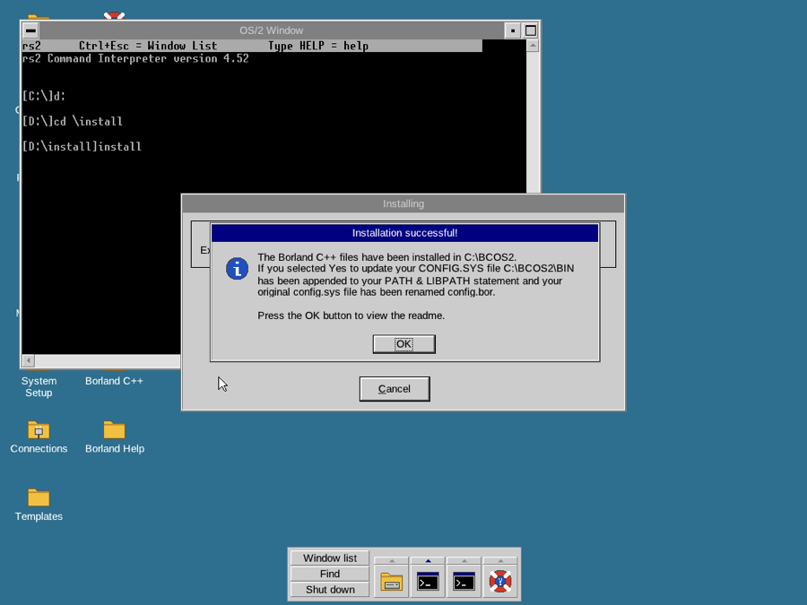
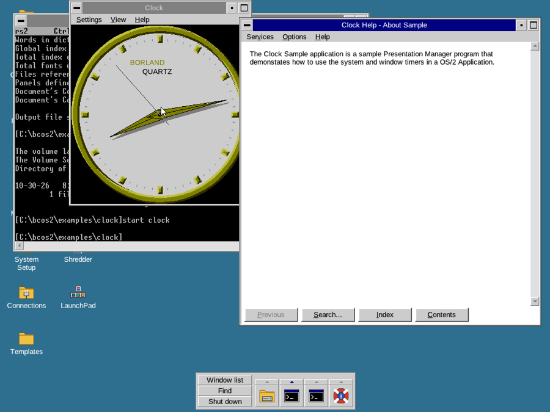

# Compatibility with original OS/2 programs

Text-mode (VIO) programs from OS/2 Warp 4.52 and the OS/2 Toolkit 4.5,
run unmodified under rs2 in QEMU. Presentation Manager programs run on
rs2's own PM DLLs (docs/PM.md); those tested are listed under
[Presentation Manager programs](#presentation-manager-programs).

The test setup is the development C: drive built from `work/modules.txt`:
IBM `CMD.EXE` as the shell, the programs under `C:\IBM` and `C:\TK`, the
REXX DLLs in `C:\OS2\DLL`, and `OSO001.MSG`, `OSO001H.MSG`, `REX.MSG`,
`REXH.MSG` in `C:\OS2\SYSTEM` (the kernel's MSG code looks there and
along `DPATH`). The IBM files are test inputs only and are not part of
the repository or the rs2 ISO. Programs with bound messages (MSGBIND)
also run without OSO001.MSG; see [Messages and national language
support](#messages-and-national-language-support).

Status: **works** = the tested function behaves as on OS/2;
**partial** = runs, but something tested is missing or differs;
**fails** = does not do its job.

## Command interpreter and REXX

| Program | Status | Notes |
|---------|--------|-------|
| CMD.EXE (IBM) | works | Interactive use, internal commands, pipes, redirection, `SET`, batch files (`FOR`, `IF`, `IF ERRORLEVEL`, `GOTO`, `SETLOCAL`/`ENDLOCAL`, `DETACH`), `DATE`/`TIME` set the clock, REXX `.CMD` files. |
| CMD.EXE (IBM) in a window | works | `START /WIN CMD`, the PM window list's "Command prompt (window)", or as the boot shell's window (`PMVIOWIN /SHELL`): DIR and long scrolling output, typing and the line editor, `MODE CO80,43`/`50` (the window follows), Ctrl+C, EXIT closes the window, Close ends it after asking, Alt+Home switches to the full screen and back, Mark/Copy/Copy All/Paste with other PM programs (E.EXE). The command history (`KEYS ON`, Up arrow) recalls only the last command, in a window as on rs2's full screen. |
| CMD.EXE (rs2) | works | Runs REXX `.CMD` files through REXX.DLL when it is installed, and the IBM utilities. |
| REXX (REXX.DLL, REXXAPI.DLL, REXXINIT.DLL) | works | `.CMD` files starting with `/* */` run through CMD. Tested: arithmetic, procedures/recursion, `PARSE`, `PULL` from the keyboard, the external data queue (`QUEUE`/`PUSH`/`PULL`/`QUEUED`), stream I/O (`LINEOUT`, `LINEIN`, `LINES`, `STREAM`), commands sent to CMD (`'dir'`, `rc`), `INTERPRET`, `SIGNAL ON SYNTAX`, `TIME('E')`, `RANDOM`, `VALUE(..., 'OS2ENVIRONMENT')`, error reports (`REX0040: Error 40 running ...`). A file with bare LF line ends gives REX0013, which is REXX's own behaviour. |
| REXXUTIL.DLL | partial | `SysLoadFuncs` works; tested `SysCls`, `SysCurPos`, `SysTextScreenRead`, `SysTextScreenSize`, `SysSleep`, `SysGetKey`, `SysFileTree`, `SysFileDelete`, `SysMkDir`, `SysRmDir`, `SysDriveMap`, `SysTempFileName`, `SysBootDrive`, `SysVersion`, `SysOS2Ver`, `SysSearchPath`, `SysPutEA`, `SysGetEA` (on FAT16, FAT32 and HPFS). `SysIni` on real INI files through rs2's PMSHAPI: `'USER'` set and query, `'ALL:'` keys and applications, `'BOTH'`, `'DELETE:'` of a key and of an application, a profile file by name (`C:\REXXTEST.INI`); the values reach OS2.INI and other processes. |
| REXXTRY.CMD | works | With an expression on the command line and interactively. |
| RXQUEUE.EXE | works | `dir \| rxqueue`, then the queue read from another REXX process. |
| RXSUBCOM.EXE | works | Usage text only. |
| REXXC.EXE | fails | Object REXX's tokenizer: it imports `REXX.24` (`RexxTranslateProgram`) and `REXX.114`, which only Object REXX's interpreter exports. That is OREXX.DLL on the media (module name REXX, installed as REXX.DLL when Object REXX is selected), and it needs the SOM runtime (SOM, SOMD, SOMTC, REXXSOM), which rs2 does not have yet. Not a kernel issue. |
| CALLREXX.EXE (Toolkit sample) | works | 32-bit program calling `RexxStart` with a function file. |

## Base utilities

| Program | Status | Notes |
|---------|--------|-------|
| ATTRIB.EXE | works | List and change attributes. |
| BACKUP.EXE | works | To a FAT disk (`--hdd` image). On QEMU's virtual FAT drive (the ESP directory) QEMU itself stops when the attribute of `\BACKUP\CONTROL.001` is changed right after it was written: its monitor no longer answers either, so the hang is in QEMU's vvfat driver, not in rs2. |
| RESTORE.EXE | works | Restores a deleted file from that backup set. |
| BLDLEVEL.EXE | works | |
| CACHE.EXE | works | Shows and sets the HPFS cache parameters (`DosFSCtl` 0x9001-0x9003); lazy writing is reported off, as rs2's HPFS writes through. |
| CACHEJFS.EXE, DEFRAGFS.EXE, EXTENDFS.EXE, CLRBBLKS.EXE | works | Report that there is no JFS (`DosFSCtl` to the JFS FSD fails with ERROR_INVALID_FSD_NAME). |
| COMP.COM | works | Including the Y/N prompts. |
| DISKCOMP.COM | works | Reports that it cannot use a hard disk (no diskette drive). |
| EAUTIL.EXE | works | Splits a file's EAs into a hold file (`/S`) and joins them back (`/J`) on FAT16, FAT32 and HPFS (16-bit `DosEnumAttribute`, `DosQFileInfo` level 3, `DosSetFileInfo` level 2). |
| EJECT.EXE | works | Usage text. |
| EXECMODE.EXE | works | Usage text. |
| FIND.EXE | works | |
| HELPMSG.EXE | works | Message and explanation from OSO001.MSG/OSO001H.MSG. |
| LABEL.COM | works | Shows and sets the volume label. |
| MAKEINI.EXE | works | `MAKEINI NEW.INI INI.RC` builds a full OS2.INI (39 KB, 26 applications, 366 keys) in 0.4 s and updates an existing one. It does not call PMSHAPI: it carries its own copy of IBM's profile code, so its output is an IBM-written INI file: `crates/inifile` parses it and re-serialises it byte for byte, and MAKEINI updates files rs2's PMSHAPI wrote. Its trace showed IBM's file replacement (`.!!!`, `.###`), which PMSHAPI now follows. An RC file without the ten empty strings at the start of the first STRINGTABLE (as in INI.RC) makes it fault (its own parsing). |
| MODE.COM | works | `MODE CO80`, `MODE CO80,43`/`50`/`60` (the 8x16, 8x14 and 8x8 fonts), `MODE COMn:baud,parity,databits,stopbits` and the COM status display. |
| MORE.COM | works | |
| PATCH.EXE | works | Usage text only. |
| PSTAT.EXE | works | `/C` processes and threads, `/L` libraries (via `DosQuerySysState`). |
| PSFILES.EXE | works | |
| PSSEMS.EXE | works | Shared event and mutex semaphores with their openers. |
| REPLACE.EXE | works | Add (`/A`) and replace. |
| SETBOOT.EXE | works | `/Q`: "Boot Manager is not installed". |
| SORT.EXE | works | |
| STRACE.EXE | works | Usage text (loads `DOSCALL1` by name). |
| TEDIT.EXE | works | Opens, edits (cursor keys, typing in the file and on the command line) and redraws through VIO and KBD. Also in a PM window (it is WINDOWCOMPAT) and switched to the full screen and back with Alt+Home. |
| SYSLEVEL.EXE | works | Finds `SYSLEVEL.OS2` and lists the component, version and CSD levels. |
| TREE.COM | works | `TREE [d:] [/F]`. |
| UNDELETE.COM | works | Reports the missing `DELDIR` setting. |
| UNPACK.EXE, UNPACK2.EXE | works | Unpack IBM packed files (UNPACK hands newer files to UNPACK2). |
| XCOPY.EXE | works | Including `/S /E`, wildcard targets. |
| XDFCOPY.EXE | works | Reports that XDFLOPPY.FLT is not loaded. |
| KEYB.COM | fails | Imports PMMERGE (Presentation Manager). rs2 has its own KEYB.EXE. |
| ANSI.EXE | works | |
| MKSYSLVL.EXE, LAPSDEL.EXE | works | (tested earlier) |

## Toolkit

| Program | Status | Notes |
|---------|--------|-------|
| ALP.EXE | works | Assembles a small source to an object file (needs ALP.MSG). |
| LINK386.EXE | works | Links that object file into an LX executable. |
| NMAKE.EXE | works | Builds a makefile target, running commands through CMD. NMMSG.MSG is not on the media, so error texts are missing. |
| EXEHDR.EXE | partial | NE files are dumped completely. On every LX file (ALP.EXE as well as the LINK386 output) it prints the header and object table, then its C runtime reports an internal error whose text is in DDE4.MSG (not on the media) and faults freeing a heap block whose header holds the text EXE (the VAC heap signature check at 0x2907D). No failing API call precedes it (every DosRead/DosSetFilePtr result checked); not resolved. |
| IMPLIB.EXE | works | |
| MAPSYM.EXE, MARKEXE.EXE | works | |
| MKMSGF.EXE, MSGBIND.EXE | works | Usage text only. |
| RC.EXE, RC16.EXE, RCPP.EXE | partial | RC16 binds a `.RES` into a 32-bit program (Borland's CLOCK example, see [Borland C++](#borland-c-for-os2-20)); RC.EXE needs LIBCM.DLL (VisualAge C runtime, not on the media). |
| GENCAT.EXE, RPCGEN.EXE, FWDSTAMP.EXE | works | Usage text only. |
| PACK.EXE, PACK2.EXE | partial | PACK.MSG is not on the media. |
| WORMS.EXE (sample) | works | Mouse pointer and clicks through MOUCALLS (Exit by clicking), also in a PM window (clicks reach it as cell positions). |
| TIMER0.EXE (sample) | works | Reports that the TIMER0$ sample driver is missing. |
| EAS.EXE (sample) | not tested | The EA editor sample is a Presentation Manager program. |

## Development tools

### Borland C++ for OS/2 2.0

From the user's CD (`BC_OS2.ISO`, Borland C++ 4.11 compiler, Turbo Link
1.5, MAKE 3.7, IBM's IPFC 2.1, the IDE, Resource Workshop, Turbo
Debugger), on a system disk with only rs2's files (`cargo xtask disk
--system --size 300`, booted with `--hdd IMG --boot-hdd --virtio-cd
BC_OS2.ISO`; the CD is drive D:).

| Program | Status | Notes |
|---------|--------|-------|
| INSTALL\INSTALL.EXE (the installer) | works | A 16-bit PM program built with Microsoft C 6 (multithread runtime). From a command prompt (`D:`, `CD \INSTALL`, `INSTALL`): its main window, the Tools and Library / Miscellaneous / Directory options dialogs, Install. A worker thread unpacks the 158 `.PAK` archives (about 64 MB, the "speedometer" counting up; some 7 minutes under QEMU), converts the `.HLP` files to `.INF` with HLP2INF, rewrites CONFIG.SYS (the original kept as CONFIG.BOR: `C:\BCOS2\BIN` added to LIBPATH, PATH, HELP and BOOKSHELF, `SET IPFC=C:\BCOS2\IPFC` added) and makes its groups with the OS/2 1.x program list calls (`PrfCreateGroup`, `PrfAddProgram`), which appear on the desktop as the folders "Borland C++" (Borland C++, Borland Debugger, Resource Workshop, with the programs' icons) and "Borland Help" (16 help books); "Installation successful!", then the README in its own MLE window, and it exits. Both folders are there after a restart. |
| BCC.EXE, TLINK.EXE | works | After the restart: `bcc hello.c` compiles and links a text-mode program, which runs. |
| MAKE.EXE, BRCC.EXE | works | `make` in `C:\BCOS2\EXAMPLES\CLOCK` (the PM clock example) runs BRCC on CLOCK.RC, BCC on the nine C files and TLINK. |
| RC.EXE (binding the resources) | partial | The examples' makefiles and the IDE bind `.RES` files with `rc FILE.RES FILE.EXE`, OS/2's own resource compiler (`\OS2\RC.EXE` on IBM's systems), which is not on Borland's CD and which rs2 does not have yet. Tested with the Toolkit's 16-bit RC16.EXE copied to `C:\OS2\RC.EXE` (the Toolkit's 32-bit RC.EXE needs LIBCM.DLL, the VisualAge C runtime, which is not on the media): the resources are bound and CLOCK.EXE runs (its dial, menus). |
| IPFC.EXE (IBM's IPF compiler 2.1, on Borland's CD) | works | `make clock.hlp` compiles the example's five IPF files; F1 in CLOCK shows the help in rs2's help manager. |
| HLP2INF.EXE | works | Run by the installer, and by hand. |
| BC.EXE (the IDE) | partial | Starts (its window, menu bar, speed bar, an editor window, the status line); its menus open from the keyboard (Alt+letter); Alt+F4 closes it. A mouse click on the editor does not give it the keyboard focus, so typing goes to the IDE's main client window and nothing appears in the editor (IBM's `WinDefWindowProc` passes unhandled mouse button messages to the parent, a frame, which rs2 does not do yet). Project > Open project brings up the file dialog, but with BC's own dialog procedure the directory and file lists stay empty and BC reports `C:\t\*.PRJ` followed by garbage as not accessible. So a project was not built or run from the IDE. |
| Integrated debugger (TDDEBUG.DLL) | partial | Loads with the IDE (after rs2 got PM's debugger calls, below) and runs its event loop (it polls its event queue with `DosQueryQueue` between `WinPeekMsg` calls); a debugging session was not started, as no project could be built in the IDE. |
| TD.EXE, TDOS2.EXE (Turbo Debugger) | not tested | Their imports resolve. |
| WORKSHOP.EXE (Resource Workshop) | not tested | Imports BPMCC.DLL's `BPMCCGETVERSION`, which the installer puts in `\OS2\DLL`. |

What it needed from rs2 (the suite that checks each is named; the huge
resources and the message box line breaks have no check):

- **WinCatch / WinThrow** (PMWIN 248/249, CTLTEST): 16-bit code with
  IBM's CATCHBUF (return address, BP, SP, SI, DI, DS, SS); `WinThrow` of
  0 returns 1. A throw from a 16-bit window procedure that PMWIN called
  leaves 32-bit thunk frames behind: thunk16 forgets them when the next
  call comes from as high or higher on the 16-bit stack.
- **The 16-bit program list calls** (`Prf16AddProgram` ... PMSHAPI 50-60,
  with IBM's 16-bit PROGDETAILS and PROGTITLE: byte-sized PROGTYPE, a
  16-bit SWP), and **program list groups and programs shown on the
  desktop**: a change to the user profile's list makes or removes a
  Workplace Shell folder or program object (WPSTEST).
- **NE resources larger than 64 KB** (the installer's 640x480 bitmap):
  consecutive segments with the same type and name, loaded into
  consecutive tiles (a huge segment), their total size reported.
- **16-bit `DosCreateThread` starts the thread with the creator's
  registers** (Microsoft C's and Borland's `_beginthread` pass the thread
  function in CX:DX and its argument in SI:DI), and **the local
  information segment's `tidCurrent` follows the running thread** (MSC's
  multithread `_chkstk` looks up the thread's stack limit by it; the
  installer's worker thread stopped with "R6000 stack overflow"). APITEST.
- **`WinDestroyWindow` only from the window's own thread**
  (PMERR_CALL_FROM_WRONG_THREAD, as IBM's): the installer's worker thread
  tries to destroy the progress dialog and later posts it its "done"
  message; rs2 had destroyed it and the installer never ended (CTLTEST).
- **Dialogs paint under their controls** unless their template has
  WS_CLIPCHILDREN, and frame statics draw only their outline: the
  installer's option dialogs and its gauge control showed other windows
  through them (CTLTEST).
- **`WinMessageBox` breaks long lines** at blanks (up to 2/5 of the
  screen wide, 2/3 high).
- **Guard pages raise `XCPT_GUARD_PAGE_VIOLATION` to the thread's
  handlers** before the default (the stack grows): TLINK grows its heap
  so, and without it reported "General error in module ..." (APITEST).
- **IBM's 16-bit suballocation** (`DosSubSet`, `DosSubAlloc`,
  `DosSubFree`): its own 8-byte header and 4-byte granularity; IPFC sets
  up 22-byte areas, which the 32-bit layout rs2 used refused ("125: Not
  enough memory") (APITEST).
- **PMWIN and PMGPI calls the IDE and its DLLs import**: `WinWaitMsg`,
  `WinGetClipPS`, `WinSetSysModalWindow`/`WinQuerySysModalWindow`, PM's
  debugger calls (`WinQueueFromID`, `WinQuerySendMsg`, `WinReplyMsg`,
  `WinThreadAssocQueue`, `WinLockInput`, PMWIN 990-995, not in the Warp
  4 Toolkit), PMWIN 328 (a 16-bit stub, as IBM's), `GpiPolygons`,
  `GpiQueryBitmapDimension`, `GpiQueryKerningPairs`,
  `GpiQueryFaceString`, `GpiFloodFill` (not done: GPI_ERROR).

Debugging aid added on the way: `apitrace=NAME` on the kernel command
line (`\RS2\CMDLINE`) traces only the programs whose module name
starts with NAME, with the paths of file calls and the offsets and sizes
of `DosSetFilePtr`/`DosRead`.

## Presentation Manager programs

On rs2's PMWIN, PMGPI, PMCTLS, PMSHAPI, PMDRAG, PMMERGE, LIBUNI and
HELPMGR. Tested with keyboard and mouse input from
`xtask run --type` and screenshots.

| Program | Status | Notes |
|---------|--------|-------|
| E.EXE (System Editor) | works | Opens a file from the command line and with File > Open (the standard file dialog); typing, cursor and selection keys, mouse selection; Edit > Cut/Copy/Paste/Clear/Select all, Alt+Backspace undo; Find and Change (MLM_SEARCH); Options > Set font (the font dialog; the MLE redraws in the chosen face and size), Set colors, Word wrap on/off (horizontal scroll bar when off); File > Save with E's "no file type" and Type dialogs (the file written, checked with TYPE), Save as; Autosave (spin button); the "File Changed" prompt when closing with changes. Copy in one E and paste in a second E or in another program's entry field. Needs `EHXDLMRI.DLL` (its resources) in LIBPATH. Help (with IBM's `EHXHP.HLP` along HELP): F1 (E's own help hook creates the help instance on the first request and leaves it to rs2's HELPMGR), Help > Help index, General help, Keys help; the help window's contents, index and search; Using help shows the contents (IBM's help library for help is not shipped). rs2 ships its own `C:\OS2\E.EXE` in its place ([PM.md](PM.md#the-system-editor-eexe)); keep IBM's elsewhere (e.g. `C:\IBM\E.EXE`) to run it. |
| VIEW.EXE, VIEWDOC.EXE (IBM's) | works | `VIEW CMDREF XCOPY`: VIEW finds the topic in the books with HELPMGR's unpublished ordinals and starts VIEWDOC, which opens CMDREF at the panel through WinCreateBookInstance; the contents, links, footnotes and Previous work. Keep them elsewhere (e.g. `C:\IBM`): rs2 ships its own `C:\OS2\VIEW.EXE` ([PM.md](PM.md#the-help-manager-helpmgrdll-and-viewexe)). |
| Toolkit IPF sample (`samples/pm/ipf`: IPF.INF, IPF.DLL) | works | In rs2's VIEW (`VIEW IPF IPF-Controlled`): the heading-placed panel at the left and, by its automatic dependent link, IPF.DLL's application-controlled viewport (`:acviewport.`, IPFMain) animating at the right; it sets itself as the object communication window through the panel window. |
| Programs started from rs2's desktop (RS2SHELL) | works | E.EXE (IBM's, and since then rs2's own) from its program object and with a text file as its parameter (README.TXT opened by its association), its "file changed" question at shutdown (`WM_SAVEAPPLICATION`/`WM_CLOSE`) and minimizing it into the Minimized Window Viewer; rs2's CMD.EXE in an OS/2 window from the Command Prompts folder (closed with its session at shutdown); Toolkit `hello.exe` from a program object made with the settings notebook and by double click in a directory window. |
| Toolkit `hello.exe`, `dialog.exe`, `template.exe`, `palette.exe` | works | As before (menus, accelerators, dialogs, palette animation); `template.exe`'s File > Open/Save as now bring up the file dialog. |
| Toolkit `controls/style.exe` | partial | Its MLE editor, the button, list box, combo box (simple, drop-down, drop-down list), entry field (MLE and entry field), static, slider, spin button (master and servant), value set (its icons drawn) and notebook dialogs (both pages, the tabs, the page buttons, Alt+PgUp/PgDn), the container dialog (its record in the icon, name, text and detail views, switched from the context menu that button 2 brings up), message boxes with their query, warning, information and action icons; the frame's icon (FCF_ICON) on the system menu button and when minimized, minimize and restore. Presentation parameters are ignored. |
| Toolkit `clipbrd.exe` | works | Selecting a rectangle with the mouse (WinTrackRect), Copy/Cut as CF_BITMAP and Paste stretched into another selection. |

### IBM VisualAge Smalltalk Enterprise 6.0 (development tools)

The user's media (`va600_co.zip` client, `va600_mo.zip` manager,
`va600_so.zip` server; an evaluation copy). Everything on them is 32-bit
OS/2 LX. The installer is IBM's own, written in Smalltalk:
`install_o\INSTALL.CMD` sets BEGINLIBPATH and starts `SETUP.EXE` (a VM
launcher) with `ESVM40.DLL` (the Smalltalk VM) and `SETUP.ICX` (a
packaged image). The development environment is `ABT.EXE` with the same
VM, `ABT.ICX` and the `ICSRUN` components, reached through VAWINDOW.CMD
(which sets BEGINLIBPATH and starts ABT.EXE with START /PGM). The source
code lives in the manager library `MGR60.DAT` (122 MB), opened through
`EMNTV50.DLL` (File I/O, standalone) or EMSRV over TCP/IP (team). The VM
calls OS/2 from Smalltalk (`PlatformFunction`: DosLoadModule and
DosQueryProcAddr by ordinal), so a missing API shows as a walkback
("Primitive failed ... OS error 182", written to `C:\TEMP\WALKBACK.LOG`)
rather than a loader error; rs2 logs `DosQueryProcAddr: MOD.n not found`
on the serial port.

Tested in QEMU with a FAT system disk, an HPFS data disk (D:, the client
needs HPFS for its long names) and both CDs as ISOs, the installers run
from an OS/2 window on the desktop.

| Part | Status | Notes |
|------|--------|-------|
| Manager installer (`cd_m\install_o\install.cmd`) | works | Welcome, licence (Accept), features, destination `C:\ibmvast\vast60`, program folder, copying; `MGR60.DAT` arrives identical to the CD. |
| Client installer (`cd_c\install_o\install.cmd`) | works | The same pages plus the folder dialog (Browse, typed `D:\vast60`), Code Management (Standalone, File I/O), the library path; files copied to D:, `ABT.INI` written, its WPS folder (Development Image, Command Prompt, Uninstall, Readme) on the desktop. |
| ABT.EXE (the development image) | partial | Starts (trial notice; `ABTPAY60.DLL`, the licence DLL, is not on the evaluation media), asks whose image it is, connects the image to the library (about 10 minutes the first time), System Transcript, its menus (File, Edit, Tools, Help), File > New opens a Workspace where `3 + 4` displays `7` (Ctrl+D), the ENVY/Smalltalk Debugger opens on errors. Fails: the VisualAge Organizer's icons ("Invalid icon depth": VisualAge builds them from a device pixmap at the depth GpiQueryDeviceBitmapFormats gives first, 24 on rs2's display, and its CgIcon takes 1, 4 or 8 bits). Not yet verified: the class browsers, the Composition Editor, File > Save Image (no visible effect in the test). |
| Manager's EMSRV.EXE, EMADMIN.EXE | not tried | TCP/IP (SO32DLL, TCP32DLL) programs for team development: EMSRV serves the library over the network. |
| Server runtime (`server\`: ESVIO.EXE, ABTVSP40.EXE) | not tried | The headless VM for deployed images (DOSCALLS, ESVM40, a few PMWIN/PMGPI calls) and the Web Connection files; needs a packaged image. |

Fixed for it (each with a suite check): PMWIN `WinGetPhysKeyState`,
`WinWaitMsg`, `WinGetClipPS`; `GpiQueryDevice` of a screen PS (the
font server divided by a 0 resolution); every SYSCLR has Warp 4's default
(labels drawn in SYSCLR_WINDOWSTATICTEXT were grey on grey); a cached PS
gets the window's PP_FONTNAMESIZE font (as IBM's GetCe); combo box entry
fields sized after their selection scroll back; entry fields retry a
character after the owner answers EN_OVERFLOW (the 33rd character typed
was lost); `WinCreateMenu` without a template; submenus made with the
menu bar as parent (and action-bar style) drop down vertically on the
desktop; PMWP `WinQueryActiveDesktopPathname`; CMD's `SET BEGINLIBPATH`
is DosSetExtLIBPATH; keyboard layouts had lost "_"; the loader moves DLLs
flagged "internal fixups removed" that still carry them (EMNTV50,
ABTBMP50 and ABTICO50 are based at 0x10000) and starts a DLL no process
uses any more over from its file's shared data (ABTBMP50's C runtime).

### OS/2's PM applets (survey)

The PM programs of OS/2 itself (from the client CD, with their DLLs,
help files and data), booted one at a time (`xtask run --init`); what
they import that rs2 lacks was listed with `crates/os2-exe`'s
`lximports` example against rs2's export lists. Besides the program,
each needs the files named in its row in `work/modules.txt` (`--init`
starts programs in `C:\`, where IBM's program objects start them in
their own directory). The table also has the CD's other programs that
were tried, text-mode ones among them, including those of the optional
features under `\OS2IMAGE\FI` (system management, printer utilities).

| Program | Status | Notes |
|---------|--------|-------|
| KLONDIKE.EXE (Solitaire) | works | Deals, plays (stock, moves by dragging), menus, window list entry. Imports PM by PMMERGE's own ordinals (rs2's PMMERGE exports them). Needed: CARDSYM.FON on PATH (\OS2\APPS on OS/2), loaded with `GpiLoadFonts` (without it the program asks to continue with system fonts, and its pips use code page 850's suit characters); the frame sized only when first shown (it saves its position from `WM_SIZE`); `WinDrawPointer` into memory PSs; the Helv/Tms Rmn faces. Its opening movie (KLONDIKE.FLC) and sounds play through rs2's MDM.DLL (a memory playlist on the wave audio device). |
| OS2CHESS.EXE (Chess) | works | Set Players dialog, the 3D board, human moves (validated, "Illegal move" otherwise) and computer moves (computer against computer plays a game). CHESSRES.DLL is not on the media and not needed. Network play not tried. The opening movie plays through rs2's MDM.DLL. |
| MAHJONGG.EXE | works | Tiles (masks drawn with `CLR_TRUE`/`CLR_FALSE`), menus, help (MAHJONGG.HLP and DEFAULT.HLP, the layout's help file). Needed: TILEDEF.DLL (the tile set). `WinCreateObject` makes only WPProgram objects on the desktop; Mahjongg's shadow of a saved game in its folder fails quietly. Tiles are selected on WM_BUTTON1CLICK (PM's extended mouse messages); the opening movie and sounds play through rs2's MDM.DLL. |
| ICONEDIT.EXE (Icon Editor) | works | Edit grid, status line and preview (frame controls added through `WM_FORMATFRAME`), palette, drawing with the mouse. Needed: `hdc \| 1` as a PS, `DevQueryCaps` with a PS, `WinDrawText` `DT_QUERYEXTENT`. Saving and loading icon files not tried. |
| PMFORMAT.EXE | works | Needs a drive argument (`PMFORMAT A:`) and PMFORMAT.DLL (its resources; rs2's loader used to hand back the running EXE for that name). The Format dialog, the progress dialog (Stop) and help (WPHELP.HLP) work; formatting itself runs FORMAT.COM and was not tried on a real diskette. |
| AUTOUTL2.EXE (Auto Configurator) | works | Main panel and help; needs \OS2\AUTODRV2.SYS (the driver it configures, as a file) and AUTOUTL2.HLP in the current directory. No PC card scripts were tried. |
| PMREXX.EXE | works | Runs a REXX procedure (`PMREXX PROC`, which must start with a `/*` comment), shows its output and takes input for PULL. Needed: the frame passing PMREXXIO's messages (`WM_USER` and up) to its client, timers no faster than the clock (PMREXXIO asks for 0 ms), a dialog template whose window is an entry field. |
| ATAMNT2.EXE | fails | Starts, then reports that PCMSSDIF.SYS (PC card socket services) is not loaded: rs2 has no PC card support. Its PM calls (window enumeration, `WinQueryClassName`) are there. |
| CLIPOS2.EXE (Clipboard Viewer) | works | Shows the clipboard's text as it changes (tried with CTLTEST putting text there) and metafiles (`CF_METAFILE`, copied from PICVIEW: played at their page size in pels, with scroll bars); the title names the format. Needed: WM_DRAWCLIPBOARD to a new viewer at once (WinSetClipbrdViewer), as IBM's PMWIN sends it; metafiles (GpiCopyMetaFile, GpiPlayMetaFile with RES_RESET and SUP_SUPPRESS to learn the page size); its help is CLIPVIEW.HLP. |
| EPM.EXE (Enhanced Editor) | works | Asks where to keep EPM.INI, then edits: opens a file from the command line, typing, the text cursor, menus, status and message lines, F2 saves ("Saved to C:\CONFIG.SYS"). Needs its DLLs (ETKE603, ETKR603, ETKC603, ETKUCMS, EPMMRI) in LIBPATH and its macros (`*.EX`) beside EPM.EXE. Needed: the text cursor (WinCreateCursor etc.), DDE, WinStoreWindowPos/WinRestoreWindowPos, PMSPL.DLL (rs2's: no printers), DosQueryProcAddr with `#n` names (its macros call DOSCALLS and PMWIN by ordinal), frames of a class derived from WC_FRAME with a client made by WinCreateWindow, per-character GpiQueryWidthTable, the cells' background for text drawn with increments. Spell checking needs LEXAM, which is not on the CD. File > Print file shows the Print document dialog with rs2's queues and the driver's options (OD_INFO DC, DevQueryHardcopyCaps), but formatted printing never finishes: EPM's print loop (ETKE603's EtkBuildNextPage, driven by messages between its threads) waits before it opens the queued DC, not analysed yet; Raw ASCII text writes to the printer's port device, which rs2's kernel does not route into the spooler (docs/PRINTING.md). |
| PICVIEW.EXE (Picture Viewer) | works | Opens a metafile from the command line (`PICVIEW C:\OS2\BITMAP\AAAAA.MET`) and shows it fitted to the window: the CD's AAAAA.MET (gradients, polygons, outline text) and the Toolkit's graphic.met (patterned areas, arcs, logical fonts) and prtsamp.met; Edit > Copy puts it on the clipboard (CLIPOS2 shows it). Needs PICVIEW.DLL (resources), PICV.DLL (its drawing code) and PMPIC.DLL (PIF conversion) in LIBPATH. Needed: metafiles and retained segments ([PM.md](PM.md#metafiles-and-segments)), WinCpTranslateString, PMMERGE's AAB32GetReg/AAB32SetReg. File > Print prints the picture through the spooler (a PM_Q_STD queued DC; checked: AAAAA.MET to an LPD listener on the host, the PostScript rendered by Ghostscript as the screen shows it). PIF files (through PMPIC) and spool files (.SPL) were not tried. |
| GLOCALE.EXE (Locale) | works | On rs2's LIBUNI and UCONV ([PM.md](PM.md#locales-libuni-and-uconv)). Starts with its Country Palette; on the first start it makes the current locale (en_US) a user locale and writes `\LANGUAGE\LOCALE\USER.LOC`. Opening a locale shows its notebook: country/region (language, country, base locale, measurement, list separator), collation, numeric, monetary (`$1,000.11`, `($1,000.11)`), date and time formats with samples from UniStrftime. Create another (from the context menu) asks for a name and makes a new user locale; picking another base locale (de_DE) shows its values. Needs `GLOCMRI.DLL` (its resources) in LIBPATH; PMBIDI is not needed. The notebook shows two tabs at the window's default size and the Decimal digits spin button is empty (rs2's PM). |
| PMSEEK.EXE (Seek and Scan) | works | A 16-bit PM program (16-bit code in an LX module; about 60 of PMWIN's 16-bit ordinals) on rs2's 16-bit PM API ([PM.md](PM.md#16-bit-pm-programs-the-os2-1x-api)). Searches drives for files ("Search Complete... 1 file(s) found" with date, size and path), its menus, F1 help (it finds HELPMGR's `WINCREATEHELPINSTANCE` by name). Needs PMSEEK.DLL (its resources) and IBM's PMSHLTKT.DLL (disk 0) in LIBPATH. Its title comes from the shell's program title, so it is empty when started without one. Opening a found file in the editor and text search not tried. Needed besides the 16-bit entries: WinLoadMenu giving the menu FID_MENU (as IBM's PMWIN), so a dialog frame finds it on WM_UPDATEFRAME. |
| PMCHKDSK.EXE | works | 16-bit PM. "Check Disk - C:" (needs PMCHKDSK.DLL, its resources, and a drive argument) with its help instance (16-bit HELPINIT); Check runs `CHKDSK.COM drive /P` on pipes and fills "Check Disk - Results" (file system type, total and available space, usage pie chart) from rs2's CHKDSK, installed also as OS2\CHKDSK.COM, whose /P sends IBM's `MSG_<n>,<params>` lines (OSO001.MSG numbers). The legend labels stay black: rs2's static controls ignore PP_FOREGROUNDCOLORINDEX, which PMCHKDSK uses to colour them like their slices. "Write corrections" (/F with the lost-cluster question) is untested. |
| MPCPUMON.EXE (Pulse) | works | A moving graph of every processor's load (`--smp 2`), the legend, the grid. It reads the per-processor performance counters through DosConfigurePerf and DosAliasPerfCtrs (DOSCALLS 365, 364; kernel/src/api/perf.rs) and lays itself out with WinDrawText's DT_QUERYEXTENT. Its pop-up menu and dialogs were not tried; processors cannot be taken offline (DosSetProcessorStatus). |
| REGEDIT2.EXE (Registry Editor, disk 13 `OS2\SYSTEM`) | works | On rs2's PMWINX and REGISTRY.DLL ([PM.md](PM.md#open32-and-the-registry-pmwinx-registry)); IBM's PMWINX (Open32) forwards the registry calls to REGISTRY.DLL, and REGEDIT2 needs nothing else of it (PMDDEML neither). Shows My Computer with the two INI profiles and the HKEY_ roots, expands HKEY_LOCAL_MACHINE (SOFTWARE, CONFIG), lists a key's values. It is an Open Class (VisualAge C++) program; what it needed of PM: IBM's upper-case HELPMGR export names (it loads HELPMGR and asks for WIN32CREATEHELPINSTANCE), a help instance made without libraries (the library list comes later; its own help, REGEDIT.HLP, is not on the CD, so its help is not available), `WinQueryQueueInfo(HMQ_CURRENT)` (a queue handle 1 made it believe it had a queue when it was not the first PM program), `WinQueryAnchorBlock` failing for no window, frames made with `WinCreateWindow` and FS_SIZEBORDER/FS_TASKLIST, a client found by its id after it was made, `WinFlashWindow`, `WinGetMaxPosition`, `WinGetMinPosition`, `WinQueryObjectWindow`, the pick aperture calls. |
| TEXTCON1.EXE (Text Converter, disk 1 `OS2\APPS`) | works | The Hebrew code page converter, on rs2's PMBIDI (layout objects: rs2's code pages are not bidirectional, so text keeps its order and shape) and PMMERGE's WinSetLangInfo ([PM.md](PM.md#bidirectional-languages-pmbidi)). Input and output file names, code pages and text types; Convert writes the output file ("Conversion completed successfully."). Its help is `TEXTCONV.HLP` (along HELP). |
| BDVIEWER.EXE (disk 1 `OS2\SYSTEM`) | partial | Loads and starts on rs2's PMBIDI, THAILIB and PMMERGE (WinSetLangInfo, WinSetKbdLayer and friends; WinCreateFrameControls). It is the bidirectional language viewer's helper: it signals the viewer (BDVIEW.DLL of the bidirectional editions, which makes `\SHAREMEM\VIEWER`), and without it reports "DosGetNamedSharedMem ERROR", as it would on a system that is not bidirectional. |
| ARACONV, COMETRUN, REGCONV | fails | Need system DLLs rs2 does not have: CNVTRANS (ARACONV), PMGRE (COMETRUN), an unnamed PMMERGE export (REGCONV). |
| SYSLOGPM.EXE (system log viewer, `\FI\SYSMGT\OS2`) | works | Opens and reports "Cannot open input file" without a log (rs2 has no FFST logging daemon). Needs SYSLOGPM.DLL, LFAPI.DLL, FFST.DLL; UniStrptime (LIBUNI). The older SYSLOGPM.EXE on disk 22 also loads. |
| DMIPM.EXE (DMI browser, `\FI\SYSMGT`) | works | Its window and toolbar; reports that the DMI service layer is not active (DMISL is not running). |
| PMDF.EXE (PM Dump Facility, `\FI\SYSMGT\OS2\PDPSI\PMDF`) | works | Its window and menus; no dump was formatted. |
| FFSTCONF.EXE, FFSTPCT.EXE (FFST configuration, `\FI\SYSMGT`) | fails | Need the FFST daemon's shared memory: FFSTCONF reports "Get shared memory error RC=123" (it asks for a name from an uninitialised buffer after creating `\SHAREMEM\FFSTMEM.DAT`), FFSTPCT that it cannot read the probe control table. |
| MV.EXE (Lexmark MarkVision, `\FI\PRTUTILS\MARKVIS`) | works | Starts from its directory with its full path (it cuts its own path at the last backslash of argv[0]) and reports that the spooler is disabled: rs2 has no printers. Needed: resource-only DLLs whose fixups were removed placed anywhere by the loader. |
| BACKPRN, CHGQUE, RESTPRN, RINSTPRN (printer utilities) | partial | Text-mode programs on PMSPL: BACKPRN `?` prints its syntax and the printers with their queues and drivers, read from OS2SYS.INI (`PRINTER1 PSPRINT PSCRIPT.Generic PostScript Printer`); backing up and restoring job properties and the other utilities were not tried. |
| LVM.EXE (Logical Volume Manager, text) | partial | Its full-screen panels and menus run; it reports the partition table of the QEMU disk as possibly corrupt and lists no volumes. FDISKPM.EXE says it was replaced by LVM.EXE and LVMGUI.CMD (Java). LVMALERT.EXE runs without a window. |
| RMVIEW.EXE, SVDETECT.EXE | fails | RMINFO.DLL fails to initialise: it needs the resource manager driver (RESOURCE.SYS), which rs2 does not have. |
| CALIBRAT.EXE (touch screen) | fails | FSGRAPH.DLL fails to initialise (touch support). |
| TRACEFMT.EXE | fails | Calls 16-bit DOSCALLS.119, which rs2 does not know. |
| QRYMMCD.EXE | works | Ends at once (it checks for the multimedia CD). |
| STPM.EXE, MPPMNEW.EXE, MINSTALL.EXE (multimedia installation) | fails | WinRegisterCircularSlider (PMCTLS), MMPARTS.DLL (in two pieces on the CD) and PMWP's object calls. |
| PMSPOOL.EXE, PMSHELL.EXE | fails | IBM's spooler process and Workplace Shell: rs2 has its own PMSPOOL (IBM's only calls PMSPL's SPL32QMINITIALIZE, which rs2's PMSPL has: [PRINTING.md](PRINTING.md)), and IBM's PMSHELL needs IBM's PMWP; rs2 has its own PMSHELL and PMWP ([WPS.md](WPS.md)). |
| JAVA.EXE, JAVAPM.EXE (Java 1.1, `\FI\PACKAGE`) | not tried | |
| CALC, NOTEPAD, CLOCK, WRITE and the other Windows programs (`disk_w*`) | works (in Win-OS/2) | Windows 3.1 programs: they run in Win-OS/2 (see below and docs/WINOS2.md), seamless as windows on the PM desktop. Natively (docs/WIN16.md, without Win-OS/2) stage 2 has the controls, dialogs, menus and resources they use, stage 3 COMMDLG, printing, DDE and the clipboard. |
| ATMCNTRL.EXE, FASTLOAD.EXE (disk 21), PROMIX.EXE, AUDIOVER.EXE | not supported | Also Windows 3.1 programs (NE modules for Windows, importing KERNEL, USER and GDI), not 16-bit PM ones: WIN-OS/2's Adobe Type Manager control panel, its fast loader and multimedia driver utilities. |

## Workplace Shell classes

Class DLLs built for IBM's Workplace Shell, on rs2's SOM.DLL and
PMWP.DLL ([WPS.md](WPS.md#rs2s-workplace-shell-classes)).

| Class DLL | Status | Notes |
|-----------|--------|-------|
| WPSTUTOR.DLL with SHOWDESC.EXE (Toolkit sample, WPSTutorial) | works | Registered in the running shell with WinRegisterObjectClass (`WPSTEST REGISTER WPSTUTOR WPSTutorial`, as its INSTALL.CMD does with REXXUTIL) and an object made on the desktop. SHOWDESC.EXE (started by the class with DosExecPgm, in the shell's current directory) shows each method the shell calls, read from the class over a named pipe. The menu's Open tutorial, the tutorial view (its default view; opened again it comes to the front through wpSwitchTo), the settings pages. Needed: objects' use lists (wpAllocMem, wpAddToObjUseList, wpFindUseItem), wpSwitchTo, wpRegisterView, PMWIN placing frames made by WinCreateWindow with FCF_SHELLPOSITION. |
| CAR.DLL (Toolkit sample, Car) | works | Its methods and instance data, its menu items and its Dashboard and Horn Beep pages (`WPSHELL CAR`, `WPSTEST CLASS CAR Car`). |
| TEXTFLDR.DLL (Toolkit sample, TextFolder) | works | A WPFolder subclass (`WPSTEST CLASS`). |

## Network programs

On rs2's TCPIP32/SO32DLL/TCP32DLL/TNLS32/PMSHAPI DLLs (see
[NETWORK.md](NETWORK.md#the-os2-socket-api)), QEMU user networking
(`--net` e1000 or `--virtio-net`, also `--smp 4`), the host at 10.0.2.2
running a test FTP/line/echo server. The TCP/IP 4.x applications come
from `cid/server/tcpapps/install/base` on the client CD; MPTN's own
programs (IBM's PING, NETSTAT, IFCONFIG, HOST, the stack DLLs) are not
on the media, so rs2's own utilities take their place.

| Program | Status | Notes |
|---------|--------|-------|
| FTP.EXE | works | Login, `dir`, `get` (ASCII and binary, 300 KB), `put` (byte-identical on the host), `quit`; active-mode data connections (PORT, Raccept/Rbind/Rlisten). About 2-3 MB/s each way under TCG. |
| TELNET.EXE | works | Connects, shows the remote side (TNLS32 16-bit character conversion into its VT emulator), sends typed lines, ends when the host closes. Needed KbdSetStatus to accept binary mode with echo when switching from ASCII, and PMSHAPI for its profile reads (`%ETC%\TCPIP.INI` through `PrfOpenProfile`; still works with the INI-file PMSHAPI, also when that directory does not exist). |
| FINGER.EXE | partial | Runs; names resolve through DNS (10.0.2.3); no finger server was reachable to test the exchange. |
| RXSOCK.DLL (REXX) | works | SockInit, SockGetHostId, SockGetHostByName/ByAddr, SockSocket, SockConnect, SockSend/Recv (TCP echo through the host), SockGetPeerName, SockBind, SockSendTo/RecvFrom (UDP), SockSoClose. |
| PORTMAP.EXE, RPCINFO.EXE (with RPC32DLL.DLL) | works | `rpcinfo -p localhost` lists the registered programs (SO32DLL/TCP32DLL). |
| Toolkit tcps/tcpc, udpc, selects | works | TCP client/server, BSD `select()` server with TCP and UDP clients. |
| Toolkit accept/recv | works | `accept_and_recv()`; the client connects to INADDR_ANY. |
| Toolkit os2ioctl | works | SIOSTATCNTRT/SIOSTATRT routing table, SIOCSSYN. |
| Toolkit rawex, geneserv/genesend | works | Sun RPC over UDP through the portmapper. |
| Toolkit rgs/rgc (rpcgen) | fails | The sample calls RPC32DLL's `_Optlink` `svcudp_create` with `_System` linkage (socket -1 pushed, EAX read): `svcudp_create - cannot getsockname`. |
| Toolkit echos/echoc (HPS) | fails | Need `sysctl()` memory-mapped I/O (OS2_MEMMAPIO), which rs2 does not have. |
| SYSLOGD.EXE | works | Receives a UDP message (sent with RXSOCK to 127.0.0.1:514) and writes it to `%ETC%\\SYSLOG.MSG`. |
| TFTP.EXE | works | 16-bit, on rs2's TCPIPDLL and TNLS16: `status`, `binary`, `get` of 300 KB and a text file from QEMU's TFTP server, byte-identical. Timeouts (`_alarm`) do not fire. |
| INETD.EXE | works | 16-bit; listens for the services of `%ETC%\INETD.LST` and starts the server with the accepted socket's number (tested with a REXX echo server on RXSOCK, reached from the host). |
| TELNETD.EXE, LPD.EXE, BOOTP.EXE | not tried | TELNETD needs pseudo terminals. |

## Messages and national language support

Bound messages, tested with OSO001.MSG removed from the disk: XCOPY,
REPLACE (old-style stub with the header at CS:0), BACKUP, RESTORE and
HELPMSG (16-bit, version 2 segments) and XDFCOPY (32-bit, its own
component XDF) print their messages from the bound segment, as on OS/2.
Messages a program did not bind still need the file: SORT, and EAUTIL
for SYS1003, report `SYS0318: Message file OSO001.MSG cannot be found
for message  1003.` (DOSCALL1 inserts the number with a leading blank).

With `COUNTRY=049`, `CODEPAGE=437,850` and `DEVINFO=KBD,GR,...` in
CONFIG.SYS, IBM CMD.EXE's DATE and DIR use German formats (`dd.mm.yy`,
`10.19`), rs2 CMD's CHCP lists 437 and 850 and switches between them,
and the keyboard types the German layout (dead keys, AltGr).

| Area | Status | Notes |
|------|--------|-------|
| DosGetMessage, DosInsMessage, DosPutMessage | works | Bound segments first, then the file (as named, DPATH, root of the boot drive). Class `?` gives MR_MID_NOT_FOUND; E/W get the `SYSnnnn: ` prefix; `%1`-`%9` up to the count, other `%` sequences are kept (MKMSGF consumes `%0`); truncation ends with CR LF (316); the retriever's own SYS0316-0321 texts on errors. DosPutMessage breaks lines at 80 columns as DOSCALL1 does. |
| DosQueryMessageCP | works | 16- and 32-bit (the stubs append the bound segment as a fifth argument; the 32-bit entry does not pop it). Code pages, language and sublanguage from the bound block or the file's extended header. |
| Country information | works | 87 countries (date order, separators, currency, decimals, clock, list separator). Compared with IBM's COUNTRY.SYS: 209 of 282 tables identical; the others differ in dummy entries of COUNTRY.SYS (country 1 with foreign code pages) and Arabic currency glyphs. |
| Case maps | works | 21 single-byte code pages (437, 850, 852, 855, 857, 860-866, 869, 874, 1125, 813, 819, 912, 915, 921, 1004); DBCS code pages map ASCII only. 263 of 282 identical to COUNTRY.SYS. |
| Collating sequences | partial | Western code pages match IBM's tables (country 1 group, Nordic and Spanish variants); Central European, Turkish, Cyrillic and Greek use alphabet-order weights that sort correctly but are not IBM's numbering (103 of 282 identical). |
| DBCS environment | works | Lead byte ranges for 932/942/943, 934/944, 936/938/946/948, 949, 950, 1381, 1386; empty for single-byte code pages (all identical to COUNTRY.SYS). |
| Code pages | works | DosQueryCp, DosSetProcessCp (prepared code pages only, ERROR_INVALID_CODE_PAGE otherwise), DosSetCp, VioSetCp, KbdSetCp/KbdGetCp, CONFIG.SYS CODEPAGE= and COUNTRY=. The screen shows all single-byte code pages above. |
| Keyboard layouts | works | US UK GR FR BE NL IT SP LA PO SG SF SV SU DK NO IS CF TR PL with AltGr (or Ctrl+Alt) and dead keys; DEVINFO=KBD,xx; rs2 KEYB.EXE. No Cyrillic, Greek or Hebrew layouts yet. |

## Console subsystems and character devices

What VIO, KBD, the device monitors and the character devices do, and how
it is checked (`rs2\apitest` runs the VIO/KBD/monitor/device checks;
`rs2\apitest keys` shows the packets a keyboard monitor sees):

- Text modes 40/80/132 columns by any number of rows that fits the
  framebuffer; the font is the largest of 8x16, 8x14 and 8x8 that fits
  (at 1024x768: 25 and 43 rows 8x16, 50 rows 8x14, 60 rows 8x8). The
  8x14 and 8x8 fonts are derived from unscii-16 (public domain) by
  `tools/scripts/mksmallfonts.py`. VioGetFont/VioSetFont (current and
  built-in fonts, user fonts).
- VioGetState/VioSetState: palette registers, DAC colour registers,
  border colour, blink versus background intensity (blinking is drawn),
  underline location, target display. Cursor shapes in scan lines or
  percentages, hidden cursor.
- VioGetPhysBuf and the SCREEN$ SCR_ALLOCLDT IOCtl map a "video memory"
  buffer with the session's cells in VGA layout; writes appear on the
  screen within a few ticks. VioGetBuf/VioShowBuf (logical buffer),
  VioScrLock/UnLock, VioSavRedrawWait/Undo and VioModeWait/Undo
  (notified on session switches and pop-ups), VioPrtSc/PrtScToggle and
  the PrtSc key (to LPT1, which is a sink).
- VioPopUp/VioEndPopUp: a separate pop-up screen over the foreground
  session (opaque or transparent), keyboard input goes to it, session
  switching is held off; the screen comes back unchanged. The kernel's
  hard-error pop-up (e.g. SYS0021 "The drive is not ready" when a CD is
  ejected) offers Retry, return the error, or end the program;
  DosError(0) turns it off for a process.
- VioWrtTTY ANSI support per session (VioSetAnsi): cursor movement and
  positioning, save/restore, erase display/line, attributes (bold,
  blink, reverse, concealed, colours, bright colours), `ESC[6n` (the
  cursor position report is typed into the keyboard buffer), screen
  modes and line wrap (`ESC[=7h/l`).
- KBD: per-session logical keyboards (KbdOpen/KbdClose, KbdGetFocus/
  KbdFreeFocus), KBDINFO per keyboard (echo, ASCII/binary, turnaround
  character, interim flags, shift reporting), KbdXlate, KbdSetCp/GetCp,
  KbdGetHWID. Line editing for KbdStringIn and cooked DosRead from CON:
  Left/Right, Home/End, Ins (insert/overwrite), Del, Backspace, Esc,
  F1/F3 (copy from the previous line); binary DosRead returns keys as
  typed. In ASCII mode Ctrl+C raises the signal and Ctrl+S suspends
  screen output until the next key; Ctrl+Break always signals. The
  shift state includes Insert and the lock keys held down; PS/2
  keyboards get LED and typematic commands (KBD_SETTYPAMATICRATE, `MODE
  CON RATE= DELAY=`), USB keyboards repeat at the same rate.
- Device monitors (MONCALLS): DosMonOpen/Reg/Read/Write/Close for KBD$
  (14-byte key packets, makes and breaks with the raw scan code) and
  MOUSE$.
- Replacement subsystems: VioRegister/VioGlobalReg/VioDeRegister,
  KbdRegister/KbdDeRegister, MouRegister/MouDeRegister route the chosen
  functions to a 16-bit entry point in a DLL (apitest registers a
  16-bit replacement in TESTDLL.DLL that answers VioGetCurPos and passes
  VioSetCurPos on to the base VIO).
- Devices: `COM1`-`COM4` (16550 UARTs; receive interrupt driven, DCB
  read timeouts; category 1 IOCtls for baud rate, line control, modem
  control, DCB, queues, errors; tested with QEMU's second serial port:
  `-- -chardev socket,id=c2,path=...,server=on,wait=off -serial
  chardev:c2`), `LPT1`-`LPT3` and `PRN` (sinks with printer status
  IOCtls), `CLOCK$` (read/write the clock record), `MOUSE$`/`POINTER$`
  (category 7 queries), `KBD$` category 4 IOCtls (input mode, interim
  flags, shift state, typematic rate, read/peek, code page, translate,
  hardware ID). COM1 also carries the kernel log.

## DOS sessions

DOS programs run in DOS sessions (docs/DOS.md): full screen or in a PM
window, started from CMD (IBM's and rs2's), by DosStartSession, or from
desktop program objects. "dosrun" = on the host with `tools/dosrun`
(the same DOS machine); "QEMU" = in a DOS session of rs2.

| Program | Status | Notes |
|---------|--------|-------|
| rs2 COMMAND.COM | works | QEMU and dosrun: VER, DIR (/W /B /A), CD, MD, RD, COPY (wildcards, `+`), DEL, REN, TYPE, SET, PATH, PROMPT, ECHO, batch files (`%0`-`%9`, `%VAR%`, IF ERRORLEVEL/EXIST/==, FOR, GOTO, CALL, SHIFT, PAUSE), redirection and pipes, /C /K /P. As the "DOS Window" and "DOS Full Screen" desktop objects. |
| tests/dos HELLO.COM | works | QEMU: DOS and BIOS output, the command tail, file create/write/read/delete, the exit code. |
| tests/dos GFX.COM | works | QEMU: mode 13h (256 colours) and mode 12h (VGA write mode 2) full screen (scaled to the framebuffer) and in a window (resized to the mode), keys between them, Alt+Home both ways. |
| tests/dos MOUSE.COM | works | QEMU, full screen: INT 33h reset, the pointer shown, positions from the (VMware absolute) pointer scaled to the 640x200 virtual screen (centre 320,100), left and right buttons. In a window the pointer's position over the window is used. |
| tests/dos BENCH.COM | works | Speed: about 100 million instructions a second on dosrun (Apple M-series host, native), 5.7 million in a DOS session under QEMU's TCG on the same host (QEMU emulating x86-64 costs most of it; native x86 hardware runs VDM.EXE without that). |
| tests/dos SBTEST.COM | works | dosrun (`--wav` captures the output): Sound Blaster 2.0 found at 220h (DSP reset, version 2.01), DMA channel 1 programmed, an 11025-sample block played at ~11 kHz by single-cycle 8-bit DMA, the IRQ 7 at its end. In VDM.EXE the samples go to rs2's audio mixer (not yet listened to in QEMU). |
| tests/dos VESA.COM | works | dosrun: VBE 2.0 controller and mode information, mode 101h (640x480, 256 colours) drawn through the banked window with 4F05h. Modes 100h, 101h, 103h, 105h; the linear framebuffer at E0000000h (DPMI 0800h maps it). |
| tests/dos DPMITEST.COM | works | QEMU, full screen and windowed, and dosrun: a 32-bit DPMI client (INT 31h 0300h output, LDT descriptors, a flat 4 GB selector, 1 MB block, 32-bit code segment, #DE exception handler, protected-mode INT hook, real-mode callback via 0301h, DOS memory, IRQ 0 hooked in protected mode arriving during a real-mode BIOS wait). |
| MEM.EXE (IBM, OS/2's DOS) | works | dosrun: MEM and MEM /C (MCB chain, UMBs, EMS, XMS, HMA). |
| DEBUG.EXE (IBM) | works | dosrun: register dump, D, U, A (assembling), G with INT 3; lowercase commands (it checks each character against DOS's DBCS lead-byte table, which the first memory block used to overlay). |
| EDLIN.COM (IBM) | works | dosrun: listing, editing a line, saving (E). |
| QBASIC.EXE (IBM) | works | QEMU, installed by APPINST from the CD and started from the Workplace Shell's QBasic object (DOS Programs folder): the editor in a DOS window, Shift+F1 help (QBASIC.HLP), Alt+F menus; the QBasic Full Screen object; the DOS Editor object (`QBASIC /EDITOR`, IBM DOS Editor) in a window. Earlier: a typed SCREEN 13 program's output in the window. dosrun: the full-screen editor, typing a program, F5: a SCREEN 13 program (LINE, CIRCLE, text in graphics); `QBASIC /RUN MORTGAGE.BAS` (IBM's sample: menus, floating point; the same figures with the x87 and with QBASIC's own floating point). |
| COMMAND.COM (IBM, OS/2's DOS) | works | dosrun: DIR, MEM (EXEC), `ECHO > file`, TYPE, EXIT. Not shipped (APPINST leaves rs2's COMMAND.COM in place); a test of the DOS kernel's internals. |
| DOSKEY.COM (IBM) | works | dosrun, with rs2's COMMAND.COM (which reads its lines through DOSKEY's INT 2Fh 4810h when DOSKEY answers 4800h) and with IBM's: installs resident, Up recalls commands. |
| GRAFTABL.COM (IBM) | works | dosrun: loads code page 437's graphics characters. |
| BASICA.COM, BASIC.COM (IBM) | fails | dosrun: loops setting the cursor (INT 10h 02h, row FFh); not in APPINST. |
| SUBST.EXE, JOIN.EXE (IBM) | fails | "Incorrect function" (they need DOS internals rs2's DOS does not have); not in APPINST. |
| Win-OS/2 (IBM's Windows 3.1 for OS/2: WINOS2.COM, OS2K386.EXE) | works | docs/WINOS2.md. Full screen, in a PM window and seamless (Windows programs' windows as PM windows beside OS/2 programs', in the window list, moved, activated and closed from either side), on rs2's display driver RS2DISP.DRV at any size, with IBM's WINSHELD (`useos2shield=1`) on rs2's VWIN. QEMU: Clock and Notepad seamless from program objects (about 2 minutes to start under TCG), keys and the absolute pointer. dosrun: Program Manager, Clock, Notepad, Calculator, Write, Paintbrush, File Manager, Control Panel, Cardfile. Not yet: clipboard/DDE with OS/2, sound, printing, palette management (256-colour programs get a fixed palette). |
| tests/dos BEEP.COM | partial | dosrun and QEMU: the PIT channel 2 / port 61h tones are seen by VDM.EXE and played as a square wave through rs2's audio mixer when there is sound hardware (`--sound`); not yet listened to. |

APPINST's **DOS Programs** category copies IBM's QBasic (QBASIC.EXE,
QBASIC.HLP, MORTGAGE.BAS), DEBUG, EDLIN, MEM, DOSKEY and GRAFTABL from
the CD into `C:\OS2\MDOS` (on a DOS session's PATH) and makes the QBasic,
QBasic Full Screen and DOS Editor objects (WPProgram, PROGTYPE=WINDOWEDVDM
or VDM) in a DOS Programs folder in Programs. OS/2 Warp 4 has no EDIT
command; DOS Editor is QBasic's editor mode.

Windows 3.x programs also run without Win-OS/2, natively as OS/2
processes on rs2's WIN16.DLL (docs/WIN16.md): windows, painting, text,
message boxes, menus and accelerators, dialogs and the standard controls
(`RS2\HELLO16.EXE`, `RS2\MENU16.EXE`, `RS2\DLG16.EXE`, `RS2\NOTE16.EXE`,
`RS2\W16TEST.EXE`), bitmaps, MDI, Windows DLLs and profiles. Real
programs run too: Delphi 1.0 (the IDE, designing, compiling and running
a program), Calmira, PFE, GNU Chess and many CICA shareware programs;
the compatibility table is in docs/WIN16.md ("Real programs"). The common
dialogs, printing to rs2's printers, DDE and the clipboard's formats
work too (`RS2\PRINT16.EXE`, `RS2\DDECLI16.EXE`).

APPINST's **Win-OS/2** category copies IBM's Win-OS/2 from the CD into
`C:\OS2\MDOS\WINOS2`, makes rs2's display driver RS2DISP.DRV from its
VGA.DRV, sets SYSTEM.INI (RS2DISP, the OS/2 shield on), and makes WIN-OS/2
Full Screen, WIN-OS/2 Window (seamless) and WIN-OS/2 Desktop in a Window
in Command Prompts and a Win-OS/2 folder with the accessories, seamless
(docs/WINOS2.md).

Not yet: Sound Blaster 16 (16-bit/stereo), the OPL2/OPL3 FM synthesizer
(AdLib), VESA modes with more than 8 bits per pixel, direct disk access
(INT 13h, 25h/26h: they fail, with 25h/26h's flags left on the stack as DOS leaves them), the DOS settings page in the Workplace Shell's
program notebook (RS2SHELL has it).

## Open Watcom C/C++ 1.9 (OS/2 host)

`open-watcom-c-os2-1.9.exe`, Open Watcom's own OS/2 installer (an LX PM
program with the files in a ZIP appended), on a system disk with only
rs2's files (`cargo xtask disk --system --size 1000`, the installer copied
to `C:\OWSETUP.EXE`). The test programs and the BUILD.CMD that builds them
are in `tests/owatcom` (a second disk, `--virtio-disk`).

| What | Status | Notes |
|------|--------|-------|
| Installer, as the boot program | works | License, install directory, Full or Selective installation, the component pages, its progress window over the logo (copying the 200 MB of a Full installation takes about 6 minutes in QEMU), "Setup needs to modify CONFIG.SYS" (Make all the modifications: LIBPATH, PATH, HELP, BOOKSHELF, INCLUDE, WATCOM, EDPATH, WIPFC, `RUN=...\NMPBIND.EXE`; the old file kept as CONFIG.000), "Setup has completed". |
| Installer, from an OS/2 window on the desktop | works | The same, and it makes its desktop folders through WinCreateObject: "Open Watcom C/C++" (IDE, Source Browser, Profiler, the debuggers, the remote links, Getting Started, Read Me) and "Open Watcom C/C++ Tools Help" (the help books), both with WATCOM.ICO as their icon. |
| Installer, from the Workplace Shell | works | Double-clicked in the Drive C folder (OWSETUP.EXE shows its own icon); the same result. After the reboot the IDE starts from its program object in the folder. |
| After the reboot: `wcl386 -l=os2v2 hello.c` | works | Compiler (WCC386.EXE with WCCD386.DLL), WLINK; the program runs (argv, printf of a double, getenv). |
| `wcl386 -l=os2v2_pm pmhello.c` | works | The PM program opens its window on the desktop and closes itself (a timer). |
| `wcl -l=os2 -i=%WATCOM%\h\os21x hello16.c` | works | 16-bit OS/2 program (NE); it reports DosGetVersion 20.45. The installer's INCLUDE names the 32-bit headers only, so 16-bit builds need the `-i` (as on OS/2). |
| `wmake` | works | Builds the three programs from `tests/owatcom/makefile`. |
| `wd` (debugger) | works | `wd hello` (built with `wcl386 -d2`) loads the program through its trap file (STD.D32: DosStartSession with the trace option, then `DosDebug`), loads its helper DLL (WDSPLICE) into it, stops at `main` with the source and the locals, steps (F10, with DBG_C_SStep and breakpoints), shows the variables as they change, and runs the program to its end (F5: "The task has completed running"). Watchpoints work with the debug registers: a 4-byte break on write on `i` stops after `i = 0` and again after `i++` ("Break on write ... Old value=0 New value=1"). |
| `ide` (IDE) | partial | Starts with its menus (File, Actions, Targets ...), tool bar and status line; menus open with the mouse. Alt+letter does not open them (not followed up). Building a project from it is not tried. |
| `NMPBIND.EXE` (CONFIG.SYS `RUN=`) | fails | Imports `NAMPIPES`, OS/2 1.x's named pipe module, which Warp's kernel does not provide either (it is for remote debugging over named pipes). |

Fixed for it:

- Kernel: `DosDebug` (DOSCALLS 317) and the trace option of
  DosStartSession and DosExecPgm (EXEC_TRACE): connect, stop, go, single
  step, continue after an exception, read and write memory, registers
  and the FPU, thread status, freeze and resume, object and selector
  conversions, aliases, terminate; breakpoint, single step, exception
  (first and last chance), watchpoint, module load and free, thread and
  process notifications. Watchpoints (DBG_C_SetWatch, DBG_C_ClearWatch)
  use the debug registers, four per debuggee; global ones (every process)
  are not there. As on OS/2 the kernel's own modules (DOSCALLS ...) are
  reported as DLLs before the program starts: Open Watcom's trap file
  loads its helper DLL at that point and otherwise ran the program to its
  end. APITEST traces a child through it.
- PMGPI: `GpiPolygons` and `GpiFloodFill` (FF_BOUNDARY, FF_SURFACE);
  PMWIN: `WinWaitMsg` (GPITEST, PMXTEST).
- PMWIN: `CREATESTRUCT` begins with pPresParams, then pCtlData (rs2 had
  them the other way round; the Open Watcom GUI library finds its window
  data in WM_CREATE's pCtlData, and without it painted nothing).
- PMWIN, as IBM's (studied in PMMERGE): `WinProcessDlg` returns at once
  for a dialog dismissed before it (the installer measures a dialog font
  so); `WinCreateWindow` with parent NULLHANDLE makes a window that is
  never shown, `WinCreateStdWindow` and `WinGetPS` fail for it;
  `WinCreateMenu` without a template makes an empty menu, and
  MM_INSERTITEM makes an item of no type a text item and one with a
  submenu MIS_SUBMENU (the IDE's menu bar).
- PMWIN: the debugger-support calls `WinThreadAssocQueue`,
  `WinQueueFromID`, `WinQuerySendMsg`, `WinReplyMsg`, `WinWakeThread`,
  `WinLockInput` (IBM's 16-bit ordinals 304-309, 32-bit 994 and 995)
  that the debugger's trap file imports.
- Loader: an LX module with flag 0x10 (internal fixups applied for the
  preferred bases) that still carries its internal fixup records is
  relocated when those bases are taken (Open Watcom's DLLs are linked
  at 0x10000; WCCD386.DLL failed with error 8).
- CONFIG.SYS sets `USER_INI` and `SYSTEM_INI` as Warp's does (the IDE
  reads USER_INI and faulted without it).
- WPS: an object whose title cannot be its file name keeps the title in
  `.LONGNAME` ("Open Watcom C/C++" showed as "Open Watcom C_C++").
- File icons: an .ICO or .PTR file is its own icon (the folders'
  `ICONFILE=C:\WATCOM\WATCOM.ICO` gave a document icon), and an
  executable longer than 8 MB (the installer: 84 MB with its ZIP
  appended) still shows its icon (SHELLTST).

## Fixed while getting these to run

- KbdSetStatus rejected binary mode with echo on in one call; OS/2
  judges the echo bit by the mode the call starts from (IBM TELNET sets
  binary, echo and shift reports together).

- Loader: DLL objects whose preferred base is below the shared arena (the
  linker default 0x10000 of application DLLs) are relocated into the
  shared arena instead of colliding with the process's private memory.
- Loader: resource objects of DLLs whose internal fixups were removed
  go anywhere in the shared arena (resource-only DLLs have base 0;
  MarkVision's failed with error 8).
- `DosQueryProcAddr`/`DosQueryProcType` take `#n` as the name of
  ordinal n, as OS/2's do (EPM's macros call DOSCALLS and PMWIN that
  way).
- Loader: a 16-bit selector fixup to a 32-bit object without the alias
  flag yields the flat selector; `THK32R3DS` (DOSCALLS.295) and
  `DOS32FLATDS` (370) are absolute exports. IBM's 16-to-32 thunks rely on
  both.
- Loader: `DOSHUGESHIFT` (135) and `DOSHUGEINCR` (136) are absolute
  exports; `DOSCALL1` names the kernel API module.
- DLL initialisation inside `DosLoadModule` runs on the caller's stack
  below its live frames (it used the top of the thread's stack and
  overwrote CMD.EXE's frames).
- Kernel stacks are 128 KB (the loader recursing through a chain of new
  DLLs overflowed 32 KB into the neighbouring heap block); the scheduler
  checks for overflow.
- `DosExecPgm`/`DosLoadModule` report the failing module in the failure
  buffer; `DosExecPgm` looks for a bare program name along `PATH`.
- rs2 CMD's DIR panicked on volume labels longer than 11 characters (CD
  labels); the AHCI driver now reads the sense data after a failed ATAPI
  command, so a changed medium's unit attention is cleared.
- REXX API server: the PM shell normally loads `REXXINIT` at start-up
  (`SYS_DLLS LoadOneTime`). rs2 starts `SYSDLLS.EXE REXXINIT` (an rs2
  program that keeps the DLL resident) when REXXINIT.DLL is present.
- 16-bit `DosSetFilePtrL`, `DosOpenL`, `DosSetFileSizeL` take the 64-bit
  value low dword first (IBM CMD.EXE batch files did not run).
- Console input: a cooked `DosRead` from CON hands out the edited line in
  pieces, keeping the rest for the next read.
- The 32-bit `DosTrueGetMessage` receives the bound message segment as an
  extra first argument and pops it (`RET 4`).
- 16-bit `DosCreateThread` pushes a far return address below `pbStack`.
- The environment segment holds the program's full path between the
  variables and the command line and is exactly as long as its contents,
  as on OS/2 (IBM CMD.EXE's first `SET` corrupted the environment).
- rs2's own programs called `MSG.6` as if it were DosGetMessage; the
  os2 crate now has OS2386.LIB's stub (push the bound segment, let
  DosTrueGetMessage pop it), so HELP and the utilities get message texts.
- rs2 CMD wrote accented characters as UTF-8 (two bytes); user programs
  now write text one code page byte per character.
- `THK16_UNITHUNK` (DOSCALL1's generic register-based 16-to-32 thunk) and
  the register-based 16-bit `DosSelToFlat`/`DosFlatToSel`.
- New APIs: `DosSubSetMem`/`DosSubAllocMem`/`DosSubFreeMem`/`DosSubUnsetMem`
  and 16-bit `DosSubSet`/`DosSubAlloc`/`DosSubFree`, `DosSizeSeg`,
  `DosEditName`, `DosEnumAttribute`, `DosQuerySysState`, `DosCopy`,
  `DosForceDelete`, `DosMkDir2`, `DosReplaceModule`, `DosSetDateTime`,
  `DosAllocHuge`, `DosGetHugeShift`, `DosReadAsync`, `DosWriteAsync`,
  `DosQueryPathInfo` levels 4 and 6, `DosSetFileInfo`/`DosSetPathInfo`
  level 11.
- Extended attributes are stored: on FAT12/16 in `EA DATA. SF` as OS/2
  does, on FAT32 in FAT32.IFS-style `NAME EA. SF` files, on HPFS in the
  F-node or outside it, on JFS in the inode or an extent (see
  [formats/fat-ea.md](formats/fat-ea.md), [formats/hpfs.md](formats/hpfs.md)
  and [formats/jfs.md](formats/jfs.md)). Query/set with EAOP2 (and the
  16-bit EAOP) in `DosQueryPathInfo`/`DosQueryFileInfo` levels 2-4,
  `DosSetPathInfo`/`DosSetFileInfo` level 2, EAs at creation in `DosOpen`,
  `DosOpenL`, `DosOpen2`, `DosCreateDir`, `DosMkDir2`, `DosFindFirst`
  levels 2 and 3, `DosEnumAttribute`; `DosCopy` copies EAs and `DosMove`
  keeps them; CHKDSK checks EA references.

- `DosGetMessage`: an insertion table slot holding NULL made the call fail
  with ERROR_INVALID_ADDRESS; OS/2 only reads the strings the message uses
  (SYSLEVEL listed nothing).
- A text-mode program that initialises PM (REXXUTIL's `SysIni` calls
  WinInitialize in rs2's PMWIN) was moved into the PM session, so CMD.EXE
  never got another key after running RXTEST.CMD; only PM programs join
  the PM session now.
- Found by the stress test (`RS2\STRESS.EXE`, see below): every program
  run leaked its executable module and file image; thread IDs were never
  reused (1020 threads per process lifetime) and thread stacks never
  freed; a thread woken between marking itself blocked and blocking could
  sit on the run queue twice and a stale entry resume a dead thread;
  waits missed kills and signals that arrived before they went to sleep;
  a killed or signalled pipe writer waited for a reader forever and an
  interrupted pipe read returned end-of-file; waiters on a mutex whose
  owner died were not woken; semaphore waits interrupted by a signal
  returned ERROR_TIMEOUT; uncollected children stayed in the process
  table after their parent ended; DosKillProcess from another process
  skipped the exit list; DosSleep ended early on stray wake-ups; a
  program touching more memory than the machine has could starve the
  kernel heap (user pages now leave a 4 MB reserve); 16-bit timers wrote
  to the physical frame of a RAM semaphore even after it was freed.

## Missing or incomplete

- rs2 has no RC.EXE of its own (OS/2 ships one in `\OS2`); development
  tools that bind resources with it (Borland C++'s makefiles and IDE)
  need one.

- Extended attributes: `ERROR_NEED_EAS_FOUND` is only reported by
  `DosCopy` (critical EAs to a target without EA support); `DosOpen` does
  not refuse files with critical EAs to programs that are not EA-aware.
  The 16:16 EAOP2 of `Dos16OpenL` is assumed to point at an FEA2LIST
  (unverified). IBM's CHKDSK could not check rs2-written FAT volumes
  (`UFAT.DLL` is not on the media); the FAT32 EA flag values follow
  FAT32.IFS from memory and are unverified against a real disk.
- AVIO (VIO presentation spaces in PM windows) has no `WinDefAVioWindowProc`
  (PMVIOP.DLL), and cells are always drawn in the 8-pixel-wide VIO fonts.
- Writing to QEMU's virtual FAT drive (the ESP directory) can hang QEMU
  itself (seen with BACKUP; QEMU's monitor stops answering too); FAT disk
  images are fine.
- IBM KEYB.COM needs PMMERGE; its KEYBOARD.DCP tables are not read (rs2
  has its own layouts and KEYB.EXE).
- Message files with DBCS text: DosPutMessage writes them unwrapped.
- File locks (`DosSetFileLocks`) are advisory: they conflict with each
  other but reads and writes are not checked against them.
- The `DosProtect*` functions hand out a file handle lock ID but do not
  check it.

