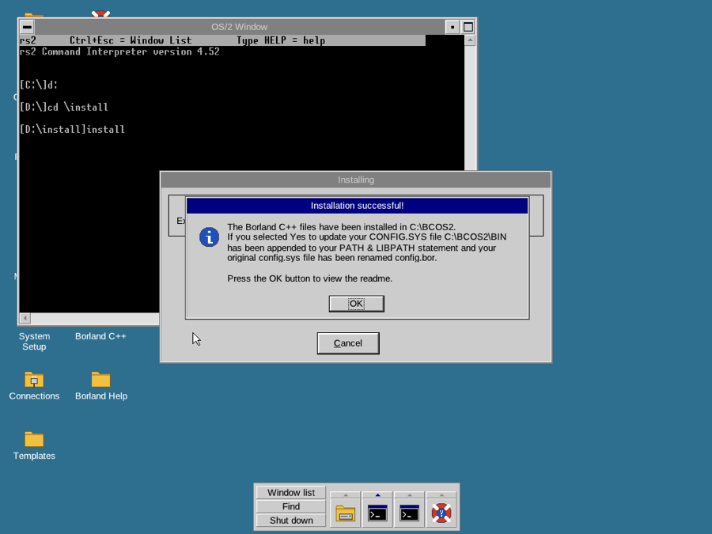
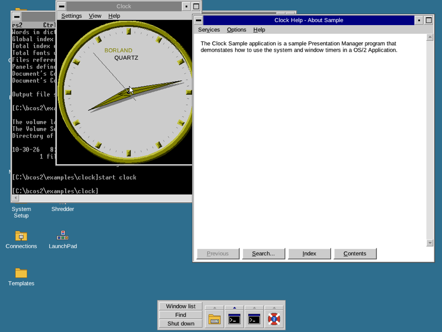

# Compatibility with original OS/2 programs

Text-mode (VIO) programs from OS/2 Warp 4.52 and the OS/2 Toolkit 4.5,
run unmodified under rs2 in QEMU. Presentation Manager programs run on
rs2's own PM DLLs (docs/PM.md); those tested are listed under
[Presentation Manager programs](#presentation-manager-programs).

The test setup is the development C: drive built from `work/modules.txt`:
IBM `CMD.EXE` as the shell, the programs under `C:\IBM` and `C:\TK`, the
REXX DLLs in `C:\OS2\DLL`, and `REX.MSG`, `REXH.MSG` in `C:\OS2\SYSTEM`
(the kernel's MSG code looks there and along `DPATH`). The IBM files are
test inputs only and are not part of the repository or the rs2 ISO. The
system message files (`OSO001.MSG`, `OSO001H.MSG` and the others) and
the help books are rs2's own, built into every image; see [Messages and
national language support](#messages-and-national-language-support).

Status: **works** = the tested function behaves as on OS/2;
**partial** = runs, but something tested is missing or differs;
**fails** = does not do its job.

## Command interpreter and REXX

| Program | Status | Notes |
|---------|--------|-------|
| CMD.EXE (IBM) | works | Interactive use, internal commands, pipes, redirection, `SET`, batch files (`FOR`, `IF`, `IF ERRORLEVEL`, `GOTO`, `SETLOCAL`/`ENDLOCAL`, `DETACH`), `DATE`/`TIME` set the clock, REXX `.CMD` files. |
| CMD.EXE (IBM) in a window | works | `START /WIN CMD`, the PM window list's "Command prompt (window)", or as the boot shell's window (`PMVIOWIN /SHELL`): DIR and long scrolling output, typing and the line editor, `MODE CO80,43`/`50` (the window follows), Ctrl+C, EXIT closes the window, Close ends it after asking, Alt+Home switches to the full screen and back, Mark/Copy/Copy All/Paste with other PM programs (E.EXE). The command history (`KEYS ON`, Up arrow) recalls only the last command, in a window as on rs2's full screen. |
| CMD.EXE (rs2) | works | Runs REXX `.CMD` files through REXX.DLL when it is installed, and the IBM utilities. |
| REXX (IBM's REXX.DLL, REXXAPI.DLL, REXXINIT.DLL) | works | `.CMD` files starting with `/* */` run through CMD. Tested: arithmetic, procedures/recursion, `PARSE`, `PULL` from the keyboard, the external data queue (`QUEUE`/`PUSH`/`PULL`/`QUEUED`), stream I/O (`LINEOUT`, `LINEIN`, `LINES`, `STREAM`), commands sent to CMD (`'dir'`, `rc`), `INTERPRET`, `SIGNAL ON SYNTAX`, `TIME('E')`, `RANDOM`, `VALUE(..., 'OS2ENVIRONMENT')`, error reports (`REX0040: Error 40 running ...`). A file with bare LF line ends gives REX0013, which is REXX's own behaviour. |
| REXXUTIL.DLL (IBM's) | works | `tests/rexx/RXUTEST.CMD` passes (203 checks; with the shell running, IBM's traps on its first PM call: it calls into PMWIN found by DosQueryModuleHandle without loading it, and rs2 does not map a DLL another process loaded). `SysIni` on real INI files through rs2's PMSHAPI; the values reach OS2.INI and other processes. |
| REXXUTIL.DLL (rs2) | works | rs2's own (`userland/rexxutil`), with IBM's 85 exports, ordinals and behaviour (result strings, stems, error 40 cases, SysFileTree's formats and attribute masks, SysIni's `ALL:`/`DELETE:`/`ERROR:`). `tests/rexx/RXUTEST.CMD` passes as with IBM's: files and directories, SysFileTree, SysFileSearch, EAs, drives, profiles, the stem functions, SysDumpVariables, semaphores, NLS, macro space, function packages, LIBPATH extensions, messages, time, the text screen; `RXUTEST KEYS` (SysGetKey, typed keys) and `RXUTEST WPS` under `WPSTEST SHELL RUN` (SysCreateObject, SysSetObjectData, SysDestroyObject, SysQueryClassList, SysQuerySwitchList, SysWaitForShell). Differences: SysNationalLanguageCompare on characters above 127 (IBM's indexes the collating table with a signed character), SysQueryClassList returns the number of classes (IBM's a stale stack address). |
| REXX (rs2: REXX.DLL, REXXAPI.DLL, REXXINIT.DLL, REX.MSG, REXH.MSG) | works | rs2's own classic REXX ([REXX.md](REXX.md)), with IBM's 32- and 16-bit entry points. `tests/rexx/RXLANG.CMD` (286 checks of the language, the built-in functions, streams, queues, conditions, commands, the environment) passes on it with IBM's CMD and with rs2's, as on IBM's REXX; IBM's 16-bit CMD.EXE runs procedures through REXXSAA and registers its CMD environment with RXSUBCOMREGISTER. Trace output and error reports are IBM's format (clauses rebuilt from their tokens, `REX0035: Error 35 running C:\X.CMD, line 30: ...`, the call traceback); the message texts are rs2's own. IBM's RXQUEUE and RXSUBCOM (RXQTEST), PMREXX.EXE and REXXUTIL.DLL (RXUTEST: 197 of 198; IBM's SysSearchPath returns a byte of stack garbage for a missing file where IBM's REXX happens to leave a zero) run on it; IBM's REXXTRY.CMD runs on it, though fed through a pipe it ends with a trap in IBM's CMD, as on IBM's REXX. Not done: the tokenized images IBM's REXX keeps in `.CMD` files' extended attributes (rs2 runs the source), 16-bit exits. |
| REXXTRY.CMD (IBM's) | works | With an expression on the command line and interactively. |
| REXXTRY.CMD (rs2) | works | rs2's own (`userland/rexx/REXXTRY.CMD`): instructions on the command line, or line by line with variables kept; `?` help, EXIT. |
| RXQUEUE.EXE (IBM and rs2) | works | `dir \| rxqueue`, then the queue read from another REXX process. rs2's own (userland/rexxcmds) behaves as IBM's: lines end at CR, LF or CR LF and are cut at 4096 characters, Ctrl+Z ends the input, `/FIFO`, `/LIFO`, `/CLEAR` (or `-`), `%RXQUEUE%` else SESSION, REX.MSG/OSO001.MSG errors on standard error with return code 0. `tests/rexx/rxqtest.cmd` (39 checks, RXQUEUE and RXSUBCOM) passes with IBM's (`RXQTEST C:\IBM\`) and rs2's. |
| RXSUBCOM.EXE (IBM and rs2) | works | `REGISTER`, `QUERY`, `LOAD` and `DROP` of a DLL environment, the return code being REXXAPI's (30 for an unknown environment, and for registering one twice); usage messages REX0115-0118/0125 with return code -1 (rxqtest.cmd). |
| Object REXX (IBM's: OREXX.DLL as REXX.DLL, OREXUTIL.DLL as REXXUTIL.DLL, OREX.MSG/OREXH.MSG as REX.MSG/REXH.MSG, REXX.IMG in `\OS2`, as SWITCHRX.CMD installs it) | works | `PARSE VERSION` gives `OBJREXX 6.00 18 May 1999`. `tests/rexx/ORXTEST.CMD` (52 checks): classes with class and instance methods and attributes, subclasses with `~msg:super`, classes made at run time, `::routine`, `::requires` of another file (public routines and classes), `USE ARG` (objects and stems by reference), `.array`, `.list`, `.queue`, `.directory`, `.table`, `.set`, `.bag`, `.relation`, `.stem`, `DO OVER`, string and number methods, `.true`/`.false`/`.nil`, `.local`, `.environment`, `.stdout`, `.stream` (`arrayin`, `query exists`), `SIGNAL ON SYNTAX`, `RAISE ... RETURN` caught in the caller (plain `RAISE` leaves the program, as IBM documents), `.message~send`, `START` on another thread with its result, `REPLY`, the external data queue, commands to CMD, `INTERPRET`, `VALUE(...,'OS2ENVIRONMENT')`, REXXUTIL (`SysBootDrive`, `SysFileTree`, `SysSearchPath`). It runs on rs2's SOM.DLL, SOMTC, SOMU, SOMIR and SOMD.DLL (a stub of IBM's DSOM client) with rs2's SOM.IR, or with IBM's SOMD (with SOMEM, SOMS, SOMSEC). Configuration: `SET SOMIR=C:\OS2\ETC\SOM.IR;C:\OS2\ETC\WPSH.IR;C:\OS2\ETC\WPDSERV.IR;C:\OS2\ETC\REXX.IR`, `SET SOMDDIR=C:\OS2\ETC\DSOM` (IBM's installer writes these). Its DLF checks need IBM's REXX.IR with IBM's OREXXSOM. ORXTEST, ORXSOM and ORXTEST run in one CMD hang at the second ORXTEST's START (a race in IBM's interpreter restart, see REXX.md); a command between them or a `CMD /C` for each avoids it. |
| REXXC.EXE (IBM) | works | Object REXX's tokenizer (`REXXC source output`); the tokenized program runs on IBM's Object REXX (ORXTEST.CMD). Its output is a flattened image of IBM's interpreter objects (`/*OBJREXX*/@REXX`...): rs2's Object REXX refuses it with Error 3.904 (REXX.md). |
| OREXXSOM.DLL (IBM's, as REXXSOM.DLL) | works | SOM classes from Object REXX: `.SOM~import('SOMObject')`, `::class x external 'SOM SOMClassMgr'`, methods with `somId` and object arguments, the DLF classes for INOUT/OUT arguments, SOMIR's Repository (`lookup_id`, `_get_name`): `tests/rexx/ORXSOM.CMD` (14 checks). Needed: SOM's own methods with IBM's descriptors (`::SOMClass::somGetParent`, which REXX looks up in the interface repository), the class manager's interface repository, somNew through the class's somRenewNoInitNoZero (SOMIR's M_Repository). |
| OREXXWPS.DLL (IBM's, as REXXWPS.DLL) with WPSINST.CMD, WPREXX.IMP, WPCLS.IMP, WPSINIT.WPS | partial | Scripting the Workplace Shell: WPSINST.CMD registers WPZORXINIT and WPZORX in rs2's running shell, whose REXX server then serves other processes' REXX programs: `.wpdesktop~wpQueryTitle`, `.wpfolder~new(...)`, `.wpprogram~new(...)`, `wpSetTitle`, `wpSetup`, `wpDelete` (`tests/rexx/ORXWPS.CMD`, 8 checks, run with `WPSTEST SHELL RUN C:\CMD.EXE /C ORXWPS.CMD`). Needed: a WPCONFIG.DLL (REXXWPS names it among its modules; rs2's forwards to PMWP's System Setup classes), handles for transient objects, `OPEN=` in setup strings, redispatch stubs for methods REXX overrides. WPREXX.IMP's WPZORXINIT `wpOpen` reports `Could not find routine "WPUSER"` in the shell; scripting works regardless. |
| OREXXSC.DLL | partial | Object REXX's OpenDoc scripting component, on rs2's OPENDOC.DLL, SOMUC.DLL and OREXX.DLL ([OPENDOC.md](OPENDOC.md#orexxsc-object-rexx-scripting-milestone-4)) with IBM's REXXCRT.DLL. REXX scripts compile, run, show their results, store, load, copy and report their errors through OSA (`ODTEST OREXXSC`). Through its ScriptableApp natives and rs2's terminology classes they send Apple events to the application: ODSHELL's Document/Run script sets the text part's text and plays an MMAudioPart. Object specifiers (`app~get(text~of(part~index(2)))`), named parameters, ScriptableApp's NOVALUE and AEResolve with object accessors work, and so do events between processes (a REXX program run by CMD drives a running ODSHELL). OSA recording records events without parameters. Not working: recording events with parameters; comparisons and enumerations. |
| MMODPTS.DLL (IBM's multimedia OpenDoc parts, disk 20) | partial | Runs on rs2's OPENDOC.DLL ([OPENDOC.md](OPENDOC.md#ibms-multimedia-parts-in-use)) with IBM's SW.DLL and MMPARTS.DLL. `ODTEST MMODPTS` registers MMAudioPart: its metaclass's four part kinds land in OS2.INI. It creates one by kind in a document, then saves and reopens it. In ODSHELL, an MMAudioPart made from DSK_STRT.WAV (`ODSHELL C:\MM.OD - MMODPTS MMAudioPart C:\MMOS2\SOUNDS\DSK_STRT.WAV`) imports the file into its storage unit through its own MMIO procedure, and plays it when clicked, through MCIAPI's play-file palette. An MMImagePart shows FLOWER.JPG. Needed: MMIO's mmioDetermineSSIOProc and compound element names, MDM reading such names through MMIO, MCIAPI's mciCreatePlayFilePalette. Also working ([OPENDOC.md](OPENDOC.md#settings-clipboard-drag-and-drop-help-milestone-3)): its settings notebook (MMSettingsExtension's pages); its Selected menu items, enabled and renamed by its AdjustMenus; the button-2 popup; Play with the palette's state notifications; copying and pasting the part. A DSK_STRT.WAV dropped from a WPS folder becomes an MMAudioPart. Its menu hints show on the status line, and Help index shows MMPARTS.HLP. Not tried: MMVideoPart (no AVI file on the CDs). |
| ODSHELL.EXE, OPENDOC.DLL (rs2) | works | rs2's own OpenDoc runtime and a simple document shell ([OPENDOC.md](OPENDOC.md)); `RS2\ODTEST.EXE` (89 checks) passes. |
| Object REXX (rs2: OREXX.DLL, OREXUTIL.DLL, OREX.MSG, OREXH.MSG, SWITCHRX.CMD) | works | rs2's own Object REXX ([REXX.md](REXX.md#object-rexx)), installed beside classic REXX; `SWITCHRX.CMD` makes it the system's REXX. `tests/rexx/ORXTEST.CMD` (52 checks) and `ORXLANG.CMD` (118: messages, classes, mixins, private methods, SETMETHOD/DEFINE/ENHANCED, UNKNOWN and NOMETHOD, the collections, conditions and RAISE, START/REPLY/GUARD/alarms on threads, the environment, streams, UNINIT, SAY/PULL/trace through redirected .OUTPUT/.INPUT/.ERROR, monitors, .RX_QUEUE/.STDQUE/.SYSTEM/.Stream_Supplier) pass with no IBM REXX file; ORXLANG passes on IBM's too (118). Errors are reported as IBM's (`REX0042E: Error 42 running ... line 8:` and the `Error 42.3:` secondary message); It has the native-method API and OSA calls IBM's OREXXSC uses. |
| REXXC.EXE (rs2) | works | `REXXC program [output] [/S]`: syntax check, and a tokenized program in rs2's form that rs2's Object REXX runs (ORXTEST.CMD). |
| REXXSOM.DLL (rs2's OREXXSOM.DLL) | works | `.SOM~import`, `::class x external 'SOM name'`, SOM methods by name with signatures for SOM's, the interface repository's and the DLF classes' methods, the DLF classes as SOM classes: `tests/rexx/ORXSOM.CMD` (14 checks; its interface repository checks pass with rs2's own SOM.IR). |
| REXXWPS.DLL (rs2's OREXXWPS.DLL) with WPSINST.CMD (rs2) | works | WPSINST.CMD registers WPZORXINIT/WPZORX with the running shell, which then serves REXX programs on a named pipe: `.wpdesktop~wpQueryTitle`, `.wpfolder~new(...)`, `.wpprogram~new(...)`, `wpSetTitle`, `wpSetup`, `wpDelete`: `tests/rexx/ORXWPS.CMD` (8 checks). |
| CALLREXX.EXE (Toolkit sample) | works | 32-bit program calling `RexxStart` with a function file. |

## Base utilities

IBM's utilities in rs2. rs2's own versions (which ship without IBM's files)
are listed in [UTILITIES.md](UTILITIES.md). IBM's RESTORE restores files with
EAs since rs2's 16-bit DosOpenL takes a 16-bit FEALIST, as DosOpen2.

| Program | Status | Notes |
|---------|--------|-------|
| ATTRIB.EXE | works | List and change attributes. |
| BACKUP.EXE | works | To a FAT disk (`--hdd` image). On QEMU's virtual FAT drive (the ESP directory) QEMU itself stops when the attribute of `\BACKUP\CONTROL.001` is changed right after it was written: its monitor no longer answers either, so the hang is in QEMU's vvfat driver, not in rs2. |
| RESTORE.EXE | works | Restores a deleted file from that backup set. |
| BLDLEVEL.EXE | works | |
| CACHE.EXE | works | Shows and sets the HPFS cache parameters (`DosFSCtl` 0x9001-0x9003); lazy writing is reported off, as rs2's HPFS writes through. |
| CACHEJFS.EXE, DEFRAGFS.EXE, EXTENDFS.EXE, CLRBBLKS.EXE | works | Report that there is no JFS (`DosFSCtl` to the JFS FSD fails with ERROR_INVALID_FSD_NAME). |
| COMP.COM | works | Including the Y/N prompts. |
| DISKCOMP.COM | works | Reports that it cannot use a hard disk (no diskette drive). |
| EAUTIL.EXE | works | Splits a file's EAs into a hold file (`/S`) and joins them back (`/J`) on FAT16, FAT32 and HPFS (16-bit `DosEnumAttribute`, `DosQFileInfo` level 3, `DosSetFileInfo` level 2). |
| EJECT.EXE | works | Usage text. |
| EXECMODE.EXE | works | Usage text. |
| FIND.EXE | works | |
| HELPMSG.EXE | works | Message and explanation from OSO001.MSG/OSO001H.MSG. |
| LABEL.COM | works | Shows and sets the volume label. |
| MAKEINI.EXE | works | `MAKEINI NEW.INI INI.RC` builds a full OS2.INI (39 KB, 26 applications, 366 keys) in 0.4 s and updates an existing one. It does not call PMSHAPI: it carries its own copy of IBM's profile code, so its output is an IBM-written INI file: `crates/inifile` parses it and re-serialises it byte for byte, and MAKEINI updates files rs2's PMSHAPI wrote. Its trace showed IBM's file replacement (`.!!!`, `.###`), which PMSHAPI now follows. An RC file without the ten empty strings at the start of the first STRINGTABLE (as in INI.RC) makes it fault (its own parsing). |
| MODE.COM | works | `MODE CO80`, `MODE CO80,43`/`50`/`60` (the 8x16, 8x14 and 8x8 fonts), `MODE COMn:baud,parity,databits,stopbits` and the COM status display. |
| MORE.COM | works | |
| PATCH.EXE | works | Usage text only. |
| PSTAT.EXE | works | `/C` processes and threads, `/L` libraries (via `DosQuerySysState`). |
| PSFILES.EXE | works | |
| PSSEMS.EXE | works | Shared event and mutex semaphores with their openers. |
| REPLACE.EXE | works | Add (`/A`) and replace. |
| SETBOOT.EXE | works | `/Q`: "Boot Manager is not installed". |
| SORT.EXE | works | |
| STRACE.EXE | works | Usage text (loads `DOSCALL1` by name). |
| TEDIT.EXE | works | Opens, edits (cursor keys, typing in the file and on the command line) and redraws through VIO and KBD. Also in a PM window (it is WINDOWCOMPAT) and switched to the full screen and back with Alt+Home. |
| SYSLEVEL.EXE | works | Finds `SYSLEVEL.OS2` and lists the component, version and CSD levels. |
| TREE.COM | works | `TREE [d:] [/F]`. |
| UNDELETE.COM | works | Reports the missing `DELDIR` setting. |
| UNPACK.EXE, UNPACK2.EXE | works | Unpack IBM packed files (UNPACK hands newer files to UNPACK2). |
| XCOPY.EXE | works | Including `/S /E`, wildcard targets. |
| XDFCOPY.EXE | works | Reports that XDFLOPPY.FLT is not loaded. |
| KEYB.COM | fails | Imports PMMERGE (Presentation Manager). rs2 has its own KEYB.EXE. |
| ANSI.EXE | works | |
| MKSYSLVL.EXE, LAPSDEL.EXE | works | (tested earlier) |

## Toolkit

| Program | Status | Notes |
|---------|--------|-------|
| ALP.EXE | works | Assembles a small source to an object file (needs ALP.MSG). |
| LINK386.EXE | works | Links that object file into an LX executable. |
| NMAKE.EXE | works | Builds a makefile target, running commands through CMD. NMMSG.MSG is not on the media, so error texts are missing. |
| EXEHDR.EXE | partial | NE files are dumped completely. On every LX file (ALP.EXE as well as the LINK386 output) it prints the header and object table, then its C runtime reports an internal error whose text is in DDE4.MSG (not on the media) and faults freeing a heap block whose header holds the text EXE (the VAC heap signature check at 0x2907D). No failing API call precedes it (every DosRead/DosSetFilePtr result checked); not resolved. |
| IMPLIB.EXE | works | |
| MAPSYM.EXE, MARKEXE.EXE | works | |
| MKMSGF.EXE, MSGBIND.EXE | works | Usage text only. |
| RC.EXE, RC16.EXE, RCPP.EXE | partial | RC16 binds a `.RES` into a 32-bit program (Borland's CLOCK example, see [Borland C++](#borland-c-for-os2-20)); RC.EXE needs LIBCM.DLL (VisualAge C runtime, not on the media). |
| GENCAT.EXE, RPCGEN.EXE, FWDSTAMP.EXE | works | Usage text only. |
| PACK.EXE, PACK2.EXE | partial | PACK.MSG is not on the media. |
| WORMS.EXE (sample) | works | Mouse pointer and clicks through MOUCALLS (Exit by clicking), also in a PM window (clicks reach it as cell positions). |
| TIMER0.EXE (sample) | works | Reports that the TIMER0$ sample driver is missing. |
| EAS.EXE (sample) | not tested | The EA editor sample is a Presentation Manager program. |

## Development tools

### Borland C++ for OS/2 2.0

From the user's CD (`BC_OS2.ISO`, Borland C++ 4.11 compiler, Turbo Link
1.5, MAKE 3.7, IBM's IPFC 2.1, the IDE, Resource Workshop, Turbo
Debugger), on a system disk with only rs2's files (`cargo xtask disk
--system --size 300`, booted with `--hdd IMG --boot-hdd --virtio-cd
BC_OS2.ISO`; the CD is drive D:).

| Program | Status | Notes |
|---------|--------|-------|
| INSTALL\INSTALL.EXE (the installer) | works | A 16-bit PM program built with Microsoft C 6 (multithread runtime). From a command prompt (`D:`, `CD \INSTALL`, `INSTALL`): its main window, the Tools and Library / Miscellaneous / Directory options dialogs, Install. A worker thread unpacks the 158 `.PAK` archives (about 64 MB, the "speedometer" counting up; some 7 minutes under QEMU), converts the `.HLP` files to `.INF` with HLP2INF, rewrites CONFIG.SYS (the original kept as CONFIG.BOR: `C:\BCOS2\BIN` added to LIBPATH, PATH, HELP and BOOKSHELF, `SET IPFC=C:\BCOS2\IPFC` added) and makes its groups with the OS/2 1.x program list calls (`PrfCreateGroup`, `PrfAddProgram`), which appear on the desktop as the folders "Borland C++" (Borland C++, Borland Debugger, Resource Workshop, with the programs' icons) and "Borland Help" (16 help books); "Installation successful!", then the README in its own MLE window, and it exits. Both folders are there after a restart. |
| BCC.EXE, TLINK.EXE | works | After the restart: `bcc hello.c` compiles and links a text-mode program, which runs. |
| MAKE.EXE, BRCC.EXE | works | `make` in `C:\BCOS2\EXAMPLES\CLOCK` (the PM clock example) runs BRCC on CLOCK.RC, BCC on the nine C files and TLINK. |
| RC.EXE (binding the resources) | partial | The examples' makefiles and the IDE bind `.RES` files with `rc FILE.RES FILE.EXE`, OS/2's own resource compiler (`\OS2\RC.EXE` on IBM's systems), which is not on Borland's CD and which rs2 does not have yet. Tested with the Toolkit's 16-bit RC16.EXE copied to `C:\OS2\RC.EXE` (the Toolkit's 32-bit RC.EXE needs LIBCM.DLL, the VisualAge C runtime, which is not on the media): the resources are bound and CLOCK.EXE runs (its dial, menus). |
| IPFC.EXE (IBM's IPF compiler 2.1, on Borland's CD) | works | `make clock.hlp` compiles the example's five IPF files; F1 in CLOCK shows the help in rs2's help manager. |
| HLP2INF.EXE | works | Run by the installer, and by hand. |
| BC.EXE (the IDE) | partial | Starts (its window, menu bar, speed bar, an editor window, the status line); menus open from the keyboard (Alt+letter, also from inside a document window: each frame's menu is asked during accelerator translation, as IBM's `FrameTranslateAccel`); Alt+F4 closes it. A click on the editor gives it the focus and typing goes into it (IBM's `WinDefWindowProc`: button messages activate the window's frame and go to the owner, here the MDI document frame, which comes to the top and gives the focus to its client). Project > Open project shows BC's own file dialog template (`FDS_CUSTOM`; BC's procedure keeps `WM_INITDLG`, so rs2's PMCTLS now sets the dialog up before it, as IBM's) with the drives, the owner-drawn directory list and the files; `STYLE.PRJ` from `EXAMPLES\STYLE` opens and its project window lists the files. Compile > Build all compiles the eight C files, runs BRCC (through BRCC2MSG on a pipe: DosStartSession with `SSF_INHERTOPT_PARENT` now passes the IDE's handles on) and links; binding the resources needs `\OS2\RC.EXE` (with the Toolkit's RC16.EXE copied there the step runs but the transcript reports one error, not looked at). Run > Run reports Success but no program window was seen. A pop-up menu of the project window stays shown at the bottom left of the screen (not looked at). |
| Integrated debugger (TDDEBUG.DLL) | partial | Loads with the IDE (after rs2 got PM's debugger calls, below) and runs its event loop (it polls its event queue with `DosQueryQueue` between `WinPeekMsg` calls); a debugging session was not started, as no project could be built in the IDE. |
| TD.EXE, TDOS2.EXE (Turbo Debugger) | not tested | Their imports resolve. |
| WORKSHOP.EXE (Resource Workshop) | not tested | Imports BPMCC.DLL's `BPMCCGETVERSION`, which the installer puts in `\OS2\DLL`. |

What it needed from rs2 (the suite that checks each is named; the huge
resources and the message box line breaks have no check):

- **WinCatch / WinThrow** (PMWIN 248/249, CTLTEST): 16-bit code with
  IBM's CATCHBUF (return address, BP, SP, SI, DI, DS, SS); `WinThrow` of
  0 returns 1. A throw from a 16-bit window procedure that PMWIN called
  leaves 32-bit thunk frames behind: thunk16 forgets them when the next
  call comes from as high or higher on the 16-bit stack.
- **The 16-bit program list calls** (`Prf16AddProgram` ... PMSHAPI 50-60,
  with IBM's 16-bit PROGDETAILS and PROGTITLE: byte-sized PROGTYPE, a
  16-bit SWP), and **program list groups and programs shown on the
  desktop**: a change to the user profile's list makes or removes a
  Workplace Shell folder or program object (WPSTEST).
- **NE resources larger than 64 KB** (the installer's 640x480 bitmap):
  consecutive segments with the same type and name, loaded into
  consecutive tiles (a huge segment), their total size reported.
- **16-bit `DosCreateThread` starts the thread with the creator's
  registers** (Microsoft C's and Borland's `_beginthread` pass the thread
  function in CX:DX and its argument in SI:DI), and **the local
  information segment's `tidCurrent` follows the running thread** (MSC's
  multithread `_chkstk` looks up the thread's stack limit by it; the
  installer's worker thread stopped with "R6000 stack overflow"). APITEST.
- **`WinDestroyWindow` only from the window's own thread**
  (PMERR_CALL_FROM_WRONG_THREAD, as IBM's): the installer's worker thread
  tries to destroy the progress dialog and later posts it its "done"
  message; rs2 had destroyed it and the installer never ended (CTLTEST).
- **Dialogs paint under their controls** unless their template has
  WS_CLIPCHILDREN, and frame statics draw only their outline: the
  installer's option dialogs and its gauge control showed other windows
  through them (CTLTEST).
- **`WinMessageBox` breaks long lines** at blanks (up to 2/5 of the
  screen wide, 2/3 high).
- **Guard pages raise `XCPT_GUARD_PAGE_VIOLATION` to the thread's
  handlers** before the default (the stack grows): TLINK grows its heap
  so, and without it reported "General error in module ..." (APITEST).
- **IBM's 16-bit suballocation** (`DosSubSet`, `DosSubAlloc`,
  `DosSubFree`): its own 8-byte header and 4-byte granularity; IPFC sets
  up 22-byte areas, which the 32-bit layout rs2 used refused ("125: Not
  enough memory") (APITEST).
- **PMWIN and PMGPI calls the IDE and its DLLs import**: `WinWaitMsg`,
  `WinGetClipPS`, `WinSetSysModalWindow`/`WinQuerySysModalWindow`, PM's
  debugger calls (`WinQueueFromID`, `WinQuerySendMsg`, `WinReplyMsg`,
  `WinThreadAssocQueue`, `WinLockInput`, PMWIN 990-995, not in the Warp
  4 Toolkit), PMWIN 328 (a 16-bit stub, as IBM's), `GpiPolygons`,
  `GpiQueryBitmapDimension`, `GpiQueryKerningPairs`,
  `GpiQueryFaceString`, `GpiFloodFill` (not done: GPI_ERROR).

Debugging aid added on the way: `apitrace=NAME` on the kernel command
line (`\RS2\CMDLINE`) traces only the programs whose module name
starts with NAME, with the paths of file calls and the offsets and sizes
of `DosSetFilePtr`/`DosRead`.

## Presentation Manager programs

On rs2's PMWIN, PMGPI, PMCTLS, PMSHAPI, PMDRAG, PMMERGE, LIBUNI and
HELPMGR. Tested with keyboard and mouse input from
`xtask run --type` and screenshots.

| Program | Status | Notes |
|---------|--------|-------|
| E.EXE (System Editor) | works | Opens a file from the command line and with File > Open (the standard file dialog); typing, cursor and selection keys, mouse selection; Edit > Cut/Copy/Paste/Clear/Select all, Alt+Backspace undo; Find and Change (MLM_SEARCH); Options > Set font (the font dialog; the MLE redraws in the chosen face and size), Set colors, Word wrap on/off (horizontal scroll bar when off); File > Save with E's "no file type" and Type dialogs (the file written, checked with TYPE), Save as; Autosave (spin button); the "File Changed" prompt when closing with changes. Copy in one E and paste in a second E or in another program's entry field. Needs `EHXDLMRI.DLL` (its resources) in LIBPATH. Help (with IBM's `EHXHP.HLP` along HELP): F1 (E's own help hook creates the help instance on the first request and leaves it to rs2's HELPMGR), Help > Help index, General help, Keys help; the help window's contents, index and search; Using help shows the contents (IBM's help library for help is not shipped). rs2 ships its own `C:\OS2\E.EXE` in its place ([PM.md](PM.md#the-system-editor-eexe)); keep IBM's elsewhere (e.g. `C:\IBM\E.EXE`) to run it. |
| VIEW.EXE, VIEWDOC.EXE (IBM's) | works | `VIEW CMDREF XCOPY`: VIEW finds the topic in the books with HELPMGR's unpublished ordinals and starts VIEWDOC, which opens CMDREF at the panel through WinCreateBookInstance; the contents, links, footnotes and Previous work. Keep them elsewhere (e.g. `C:\IBM`): rs2 ships its own `C:\OS2\VIEW.EXE` ([PM.md](PM.md#the-help-manager-helpmgrdll-and-viewexe)). |
| Toolkit IPF sample (`samples/pm/ipf`: IPF.INF, IPF.DLL) | works | In rs2's VIEW (`VIEW IPF IPF-Controlled`): the heading-placed panel at the left and, by its automatic dependent link, IPF.DLL's application-controlled viewport (`:acviewport.`, IPFMain) animating at the right; it sets itself as the object communication window through the panel window. |
| Programs started from rs2's desktop (RS2SHELL) | works | E.EXE (IBM's, and since then rs2's own) from its program object and with a text file as its parameter (README.TXT opened by its association), its "file changed" question at shutdown (`WM_SAVEAPPLICATION`/`WM_CLOSE`) and minimizing it into the Minimized Window Viewer; rs2's CMD.EXE in an OS/2 window from the Command Prompts folder (closed with its session at shutdown); Toolkit `hello.exe` from a program object made with the settings notebook and by double click in a directory window. |
| Toolkit `hello.exe`, `dialog.exe`, `template.exe`, `palette.exe` | works | As before (menus, accelerators, dialogs, palette animation); `template.exe`'s File > Open/Save as now bring up the file dialog. |
| Toolkit `controls/style.exe` | partial | Its MLE editor, the button, list box, combo box (simple, drop-down, drop-down list), entry field (MLE and entry field), static, slider, spin button (master and servant), value set (its icons drawn) and notebook dialogs (both pages, the tabs, the page buttons, Alt+PgUp/PgDn), the container dialog (its record in the icon, name, text and detail views, switched from the context menu that button 2 brings up), message boxes with their query, warning, information and action icons; the frame's icon (FCF_ICON) on the system menu button and when minimized, minimize and restore. Presentation parameters are ignored. |
| Toolkit `clipbrd.exe` | works | Selecting a rectangle with the mouse (WinTrackRect), Copy/Cut as CF_BITMAP and Paste stretched into another selection. |

### IBM VisualAge Smalltalk Enterprise 6.0 (development tools)

The user's media (`va600_co.zip` client, `va600_mo.zip` manager,
`va600_so.zip` server; an evaluation copy). Everything on them is 32-bit
OS/2 LX. The installer is IBM's own, written in Smalltalk:
`install_o\INSTALL.CMD` sets BEGINLIBPATH and starts `SETUP.EXE` (a VM
launcher) with `ESVM40.DLL` (the Smalltalk VM) and `SETUP.ICX` (a
packaged image). The development environment is `ABT.EXE` with the same
VM, `ABT.ICX` and the `ICSRUN` components, reached through VAWINDOW.CMD
(which sets BEGINLIBPATH and starts ABT.EXE with START /PGM). The source
code lives in the manager library `MGR60.DAT` (122 MB), opened through
`EMNTV50.DLL` (File I/O, standalone) or EMSRV over TCP/IP (team). The VM
calls OS/2 from Smalltalk (`PlatformFunction`: DosLoadModule and
DosQueryProcAddr by ordinal), so a missing API shows as a walkback
("Primitive failed ... OS error 182", written to `C:\TEMP\WALKBACK.LOG`)
rather than a loader error; rs2 logs `DosQueryProcAddr: MOD.n not found`
on the serial port.

Tested in QEMU with a FAT system disk, an HPFS data disk (D:, the client
needs HPFS for its long names) and both CDs as ISOs, the installers run
from an OS/2 window on the desktop.

| Part | Status | Notes |
|------|--------|-------|
| Manager installer (`cd_m\install_o\install.cmd`) | works | Welcome, licence (Accept), features, destination `C:\ibmvast\vast60`, program folder, copying; `MGR60.DAT` arrives identical to the CD. |
| Client installer (`cd_c\install_o\install.cmd`) | works | The same pages plus the folder dialog (Browse, typed `D:\vast60`), Code Management (Standalone, File I/O), the library path; files copied to D:, `ABT.INI` written, its WPS folder (Development Image, Command Prompt, Uninstall, Readme) on the desktop. |
| ABT.EXE (the development image) | works at 256 colours | Starts (trial notice; `ABTPAY60.DLL`, the licence DLL, is not on the evaluation media), asks whose image it is, connects the image to the library (about 10 minutes the first time), System Transcript, its menus (File, Edit, Tools, Help), File > New opens a Workspace where `3 + 4` displays `7` (Ctrl+D), the ENVY/Smalltalk Debugger opens on errors. Needs a 256-colour display, as on IBM's OS/2: `VIDEO=1024x768x256` in CONFIG.SYS, or Colors 256 in Display ([PM.md](PM.md#the-screen-damage-and-display-modes)); or only for ABT.EXE, with the desktop in true colour: 256 colors on its program object's Compatibility page (setup string `RS2COLORS=256;`), or `SET RS2COLORS=256` before VAWINDOW.CMD (tested that way: the Organizer and the Composition Editor open). Then the VisualAge Organizer opens with its Quick Start, and Create a new part opens the Composition Editor (parts palette, a Window part). In 16 million colours the Organizer stops with "Invalid icon depth": VisualAge builds its icons at the depth GpiQueryDeviceBitmapFormats gives first (the device's, 24) and its CgIcon takes 1, 4 or 8 bits; IBM's PMMERGE also lists the device's depth first. Not yet verified: the class browsers, building and running a part, File > Save Image. |
| Manager's EMSRV.EXE, EMADMIN.EXE | not tried | TCP/IP (SO32DLL, TCP32DLL) programs for team development: EMSRV serves the library over the network. |
| Server runtime (`server\`: ESVIO.EXE, ABTVSP40.EXE) | not tried | The headless VM for deployed images (DOSCALLS, ESVM40, a few PMWIN/PMGPI calls) and the Web Connection files; needs a packaged image. |

Fixed for it (each with a suite check): PMWIN `WinGetPhysKeyState`,
`WinWaitMsg`, `WinGetClipPS`; `GpiQueryDevice` of a screen PS (the
font server divided by a 0 resolution); every SYSCLR has Warp 4's default
(labels drawn in SYSCLR_WINDOWSTATICTEXT were grey on grey); a cached PS
gets the window's PP_FONTNAMESIZE font (as IBM's GetCe); combo box entry
fields sized after their selection scroll back; entry fields retry a
character after the owner answers EN_OVERFLOW (the 33rd character typed
was lost); `WinCreateMenu` without a template; submenus made with the
menu bar as parent (and action-bar style) drop down vertically on the
desktop; PMWP `WinQueryActiveDesktopPathname`; CMD's `SET BEGINLIBPATH`
is DosSetExtLIBPATH; keyboard layouts had lost "_"; the loader moves DLLs
flagged "internal fixups removed" that still carry them (EMNTV50,
ABTBMP50 and ABTICO50 are based at 0x10000) and starts a DLL no process
uses any more over from its file's shared data (ABTBMP50's C runtime);
PM's 256-colour display mode (8-bit capabilities and bitmap formats, a
palette-managed screen), with pointers' colour bitmaps in the device's
format (GPITEST checks both modes).

Testing it: the installed disks (system on FAT with the manager in
`C:\ibmvast`, client on an HPFS data disk D:) booted with `--vmware`
(the absolute pointer, for clicks through QMP), the client CD as a
virtio CD, `VIDEO=1024x768x256` in the disk's CONFIG.SYS and `CMD /K
C:\VA.CMD` (VAWINDOW.CMD with ABT.EXE) as the boot program; each start
reconnects the image to the library (about 10 minutes in QEMU).

### OS/2's PM applets (survey)

The PM programs of OS/2 itself (from the client CD, with their DLLs,
help files and data), booted one at a time (`xtask run --init`); what
they import that rs2 lacks was listed with `crates/os2-exe`'s
`lximports` example against rs2's export lists. Besides the program,
each needs the files named in its row in `work/modules.txt` (`--init`
starts programs in `C:\`, where IBM's program objects start them in
their own directory). The table also has the CD's other programs that
were tried, text-mode ones among them, including those of the optional
features under `\OS2IMAGE\FI` (system management, printer utilities).

| Program | Status | Notes |
|---------|--------|-------|
| KLONDIKE.EXE (Solitaire) | works | Deals, plays (stock, moves by dragging), menus, window list entry. Imports PM by PMMERGE's own ordinals (rs2's PMMERGE exports them). Needed: CARDSYM.FON on PATH (\OS2\APPS on OS/2), loaded with `GpiLoadFonts` (without it the program asks to continue with system fonts, and its pips use code page 850's suit characters); the frame sized only when first shown (it saves its position from `WM_SIZE`); `WinDrawPointer` into memory PSs; the Helv/Tms Rmn faces. Its opening movie (KLONDIKE.FLC) and sounds play through rs2's MDM.DLL (a memory playlist on the wave audio device). |
| OS2CHESS.EXE (Chess) | works | Set Players dialog, the 3D board, human moves (validated, "Illegal move" otherwise) and computer moves (computer against computer plays a game). CHESSRES.DLL is not on the media and not needed. Network play not tried. The opening movie plays through rs2's MDM.DLL. |
| MAHJONGG.EXE | works | Tiles (masks drawn with `CLR_TRUE`/`CLR_FALSE`), menus, help (MAHJONGG.HLP and DEFAULT.HLP, the layout's help file). Needed: TILEDEF.DLL (the tile set). Saving a game makes a shadow of it in Mahjongg's folder (`WinCreateObject` of a WPShadow with `SHADOWID=` in `<MAH_FOLDER>`, the folder the Games installation makes): with rs2's Workplace Shell running (PMSHELL, the default desktop) the call goes to the shell, which makes objects of any class in any folder, so the shadow is made (`WPSTEST SHELLREMOTE` makes such a folder and shadow from another process; not tried with Mahjongg itself). With RS2SHELL as the desktop only WPProgram objects on the desktop can be made, and the shadow fails quietly. Tiles are selected on WM_BUTTON1CLICK (PM's extended mouse messages); the opening movie and sounds play through rs2's MDM.DLL. |
| ICONEDIT.EXE (Icon Editor) | works | Edit grid, status line and preview (frame controls added through `WM_FORMATFRAME`), palette, drawing with the mouse. Needed: `hdc \| 1` as a PS, `DevQueryCaps` with a PS, `WinDrawText` `DT_QUERYEXTENT`. Saving and loading icon files not tried. |
| PMFORMAT.EXE | works | Needs a drive argument (`PMFORMAT A:`) and PMFORMAT.DLL (its resources; rs2's loader used to hand back the running EXE for that name). The Format dialog, the progress dialog (Stop) and help (WPHELP.HLP) work; formatting itself runs FORMAT.COM and was not tried on a real diskette. |
| AUTOUTL2.EXE (Auto Configurator) | works | Main panel and help; needs \OS2\AUTODRV2.SYS (the driver it configures, as a file) and AUTOUTL2.HLP in the current directory. No PC card scripts were tried. |
| PMREXX.EXE | works | Runs a REXX procedure (`PMREXX PROC`, which must start with a `/*` comment), shows its output and takes input for PULL. Needed: the frame passing PMREXXIO's messages (`WM_USER` and up) to its client, timers no faster than the clock (PMREXXIO asks for 0 ms), a dialog template whose window is an entry field. |
| PMREXX.EXE, PMREXXIO.DLL, PMREXXIO.HLP (rs2) | works | rs2's own (userland/pmrexx, userland/pmrexxio): the same window (output MLE, `Input:` line, File/Edit/Trace/Help menus with IBM's ids, the PMREXXIO RXSIO exit, handles 0-2 on pipes), PULL input, `/T` interactive trace with the Trace menu, Halt, arguments, Find, Font, Save as, its own help. IBM's PMREXX runs on rs2's PMREXXIO.DLL. Unlike IBM's DLL (whose window shows only when the procedure reads: it sends REXX_MAKE_VISIBLE to a window that does not exist), output shows the window, as IBM's documentation describes. Commands the procedure runs get no standard output ("Incorrect internal file identifier"): PMREXXIO marks handle 1 not inheritable, as IBM's does. |
| ATAMNT2.EXE | fails | Starts, then reports that PCMSSDIF.SYS (PC card socket services) is not loaded: rs2 has no PC card support. Its PM calls (window enumeration, `WinQueryClassName`) are there. |
| CLIPOS2.EXE (Clipboard Viewer) | works | Shows the clipboard's text as it changes (tried with CTLTEST putting text there) and metafiles (`CF_METAFILE`, copied from PICVIEW: played at their page size in pels, with scroll bars); the title names the format. Needed: WM_DRAWCLIPBOARD to a new viewer at once (WinSetClipbrdViewer), as IBM's PMWIN sends it; metafiles (GpiCopyMetaFile, GpiPlayMetaFile with RES_RESET and SUP_SUPPRESS to learn the page size); its help is CLIPVIEW.HLP. |
| EPM.EXE (Enhanced Editor) | works | Asks where to keep EPM.INI, then edits: opens a file from the command line, typing, the text cursor, menus, status and message lines, F2 saves ("Saved to C:\CONFIG.SYS"). Needs its DLLs (ETKE603, ETKR603, ETKC603, ETKUCMS, EPMMRI) in LIBPATH and its macros (`*.EX`) beside EPM.EXE. Needed: the text cursor (WinCreateCursor etc.), DDE, WinStoreWindowPos/WinRestoreWindowPos, PMSPL.DLL (rs2's: no printers), DosQueryProcAddr with `#n` names (its macros call DOSCALLS and PMWIN by ordinal), frames of a class derived from WC_FRAME with a client made by WinCreateWindow, per-character GpiQueryWidthTable, the cells' background for text drawn with increments. Spell checking needs LEXAM, which is not on the CD. File > Print file prints: formatted printing (its print thread draws each page on a `PU_TWIPS` presentation space of a queued DC) reached a host LPR listener as PostScript that Ghostscript renders as the editor shows the file. It needed frames to pass `WM_ACTIVATE` to their client (the edit window then tells EPM's common window it is the active one; the print dialog sent its print command, 0x1501, to that window's handle, which was 0, and printing never started) and `GpiQueryCharBox` to give the default box in world coordinates (EPM spaces lines by it; in pels on a twips space the lines overlapped). Raw ASCII text writes to the printer's port device, which rs2's kernel now hands to the spooler as a job when a printer prints to that port (docs/PRINTING.md; not tried with EPM). |
| PICVIEW.EXE (Picture Viewer) | works | Opens a metafile from the command line (`PICVIEW C:\OS2\BITMAP\AAAAA.MET`) and shows it fitted to the window: the CD's AAAAA.MET (gradients, polygons, outline text) and the Toolkit's graphic.met (patterned areas, arcs, logical fonts) and prtsamp.met; Edit > Copy puts it on the clipboard (CLIPOS2 shows it). Needs PICVIEW.DLL (resources), PICV.DLL (its drawing code) and PMPIC.DLL (PIF conversion) in LIBPATH. Needed: metafiles and retained segments ([PM.md](PM.md#metafiles-and-segments)), WinCpTranslateString, PMMERGE's AAB32GetReg/AAB32SetReg. File > Print prints the picture through the spooler (a PM_Q_STD queued DC; checked: AAAAA.MET to an LPD listener on the host, the PostScript rendered by Ghostscript as the screen shows it). PIF files (through PMPIC) and spool files (.SPL) were not tried. |
| GLOCALE.EXE (Locale) | works | On rs2's LIBUNI and UCONV ([PM.md](PM.md#locales-libuni-and-uconv)). Starts with its Country Palette; on the first start it makes the current locale (en_US) a user locale and writes `\LANGUAGE\LOCALE\USER.LOC`. Opening a locale shows its notebook: country/region (language, country, base locale, measurement, list separator), collation, numeric, monetary (`$1,000.11`, `($1,000.11)`), date and time formats with samples from UniStrftime. Create another (from the context menu) asks for a name and makes a new user locale; picking another base locale (de_DE) shows its values. Needs `GLOCMRI.DLL` (its resources) in LIBPATH; PMBIDI is not needed. The notebook shows two tabs at the window's default size and the Decimal digits spin button is empty (rs2's PM). |
| PMSEEK.EXE (Seek and Scan) | works | A 16-bit PM program (16-bit code in an LX module; about 60 of PMWIN's 16-bit ordinals) on rs2's 16-bit PM API ([PM.md](PM.md#16-bit-pm-programs-the-os2-1x-api)). Searches drives for files ("Search Complete... 1 file(s) found" with date, size and path), its menus, F1 help (it finds HELPMGR's `WINCREATEHELPINSTANCE` by name). Needs PMSEEK.DLL (its resources) and IBM's PMSHLTKT.DLL (disk 0) in LIBPATH. Its title comes from the shell's program title, so it is empty when started without one. Opening a found file in the editor and text search not tried. Needed besides the 16-bit entries: WinLoadMenu giving the menu FID_MENU (as IBM's PMWIN), so a dialog frame finds it on WM_UPDATEFRAME. |
| PMCHKDSK.EXE | works | 16-bit PM. "Check Disk - C:" (needs PMCHKDSK.DLL, its resources, and a drive argument) with its help instance (16-bit HELPINIT); Check runs `CHKDSK.COM drive /P` on pipes and fills "Check Disk - Results" (file system type, total and available space, usage pie chart) from rs2's CHKDSK, installed also as OS2\CHKDSK.COM, whose /P sends IBM's `MSG_<n>,<params>` lines (OSO001.MSG numbers). The legend labels stay black: rs2's static controls ignore PP_FOREGROUNDCOLORINDEX, which PMCHKDSK uses to colour them like their slices. "Write corrections" (/F with the lost-cluster question) is untested. |
| MPCPUMON.EXE (Pulse) | works | A moving graph of every processor's load (`--smp 2`), the legend, the grid. It reads the per-processor performance counters through DosConfigurePerf and DosAliasPerfCtrs (DOSCALLS 365, 364; kernel/src/api/perf.rs) and lays itself out with WinDrawText's DT_QUERYEXTENT. Its pop-up menu and dialogs were not tried; processors cannot be taken offline (DosSetProcessorStatus). |
| REGEDIT2.EXE (Registry Editor, disk 13 `OS2\SYSTEM`) | works | On rs2's PMWINX and REGISTRY.DLL ([PM.md](PM.md#open32-and-the-registry-pmwinx-registry)); IBM's PMWINX (Open32) forwards the registry calls to REGISTRY.DLL, and REGEDIT2 needs nothing else of it (PMDDEML neither). Shows My Computer with the two INI profiles and the HKEY_ roots, expands HKEY_LOCAL_MACHINE (SOFTWARE, CONFIG), lists a key's values, among them the ones a key maps (HKEY_CURRENT_USER\CONTROL PANEL\INTERNATIONAL: the locale's 125 items). It is an Open Class (VisualAge C++) program; what it needed of PM: IBM's upper-case HELPMGR export names (it loads HELPMGR and asks for WIN32CREATEHELPINSTANCE), a help instance made without libraries (the library list comes later; its own help, REGEDIT.HLP, is not on the CD, so its help is not available), `WinQueryQueueInfo(HMQ_CURRENT)` (a queue handle 1 made it believe it had a queue when it was not the first PM program), `WinQueryAnchorBlock` failing for no window, frames made with `WinCreateWindow` and FS_SIZEBORDER/FS_TASKLIST, a client found by its id after it was made, `WinFlashWindow`, `WinGetMaxPosition`, `WinGetMinPosition`, `WinQueryObjectWindow`, the pick aperture calls. |
| TEXTCON1.EXE (Text Converter, disk 1 `OS2\APPS`) | works | The Hebrew code page converter, on rs2's PMBIDI (layout objects: rs2's code pages are not bidirectional, so text keeps its order and shape) and PMMERGE's WinSetLangInfo ([PM.md](PM.md#bidirectional-languages-pmbidi)). Input and output file names, code pages and text types; Convert writes the output file ("Conversion completed successfully."). Its help is `TEXTCONV.HLP` (along HELP). |
| BDVIEWER.EXE (disk 1 `OS2\SYSTEM`) | partial | Loads and starts on rs2's PMBIDI, THAILIB and PMMERGE (WinSetLangInfo, WinSetKbdLayer and friends; WinCreateFrameControls). It is the bidirectional language viewer's helper: it signals the viewer (BDVIEW.DLL of the bidirectional editions, which makes `\SHAREMEM\VIEWER`), and without it reports "DosGetNamedSharedMem ERROR", as it would on a system that is not bidirectional. |
| COMETRUN.EXE (Comet cursor, disk 4) | partial | Calls the graphics engine directly (`Gre32Entry4`/`6`/`9`: GreSaveScreenBits, GreRestoreScreenBits, GreBitblt on a DC of the display opened with `OD_DIRECT`), on rs2's PMGRE ([PM.md](PM.md#the-graphics-engine-pmgre)). Needs COMETDLL.DLL (disk 3) and the comet turned on in OS2.INI (`PM_ControlPanel` `CometCursor`, which the Mouse settings write). COMETDLL is also an engine hook OS/2 loads at startup (`OS2_PM_DRV_ENABLE`), which rs2 cannot load, so COMETRUN has to be started as `COMETRUN force`; then its trail of comets follows the pointer over the desktop and windows and fades when the pointer stops. Without the hook a program drawing under a comet is not kept from it. The comets' small circles show GpiFullArc's rasterization (a pel out at the right). |
| ARACONV.EXE (Code Page Conversion, disk 20) | partial | Its main window (menu bar, scroll bars) comes up with CNVTRANS.DLL (an application DLL on disk 13 `OS2\APPS\DLL`, not a system one) in LIBPATH. Converting a file not tried. |
| REGCONV | fails | Its unnamed PMMERGE export (5475, IBM's `WinXxCreateHeap2`: a PM heap it makes and never uses) is there now (PMWIN 1072); it also needs NAMEFW.DLL (disk 7), not tried further. |
| SYSLOGPM.EXE (system log viewer, `\FI\SYSMGT\OS2`) | works | Opens and reports "Cannot open input file" without a log (rs2 has no FFST logging daemon). Needs SYSLOGPM.DLL, LFAPI.DLL, FFST.DLL; UniStrptime (LIBUNI). The older SYSLOGPM.EXE on disk 22 also loads. |
| DMIPM.EXE (DMI browser, `\FI\SYSMGT`) | works | Its window and toolbar; reports that the DMI service layer is not active (DMISL is not running). |
| PMDF.EXE (PM Dump Facility, `\FI\SYSMGT\OS2\PDPSI\PMDF`) | works | Its window and menus; no dump was formatted. |
| FFSTCONF.EXE, FFSTPCT.EXE (FFST configuration, `\FI\SYSMGT`) | fails | Need the FFST daemon's shared memory: FFSTCONF reports "Get shared memory error RC=123" (it asks for a name from an uninitialised buffer after creating `\SHAREMEM\FFSTMEM.DAT`), FFSTPCT that it cannot read the probe control table. |
| MV.EXE (Lexmark MarkVision, `\FI\PRTUTILS\MARKVIS`) | works | Starts from its directory with its full path (it cuts its own path at the last backslash of argv[0]) and reports that the spooler is disabled: rs2 has no printers. Needed: resource-only DLLs whose fixups were removed placed anywhere by the loader. |
| BACKPRN, CHGQUE, RESTPRN, RINSTPRN (printer utilities) | partial | Text-mode programs on PMSPL: BACKPRN `?` prints its syntax and the printers with their queues and drivers, read from OS2SYS.INI (`PRINTER1 PSPRINT PSCRIPT.Generic PostScript Printer`); backing up and restoring job properties and the other utilities were not tried. |
| LVM.EXE (Logical Volume Manager, text) | partial | Its full-screen panels and menus run; it reports the partition table of the QEMU disk as possibly corrupt and lists no volumes. FDISKPM.EXE says it was replaced by LVM.EXE and LVMGUI.CMD (Java). LVMALERT.EXE runs without a window. |
| RMVIEW.EXE, SVDETECT.EXE | fails | RMINFO.DLL fails to initialise: it needs the resource manager driver (RESOURCE.SYS), which rs2 does not have. |
| CALIBRAT.EXE (touch screen) | fails | FSGRAPH.DLL fails to initialise (touch support). |
| TRACEFMT.EXE | fails | Calls 16-bit DOSCALLS.119, which rs2 does not know. |
| MMBROWSE.EXE (Toolkit sample, `samples/mm/mmbrowse`) | works | IBM's sample image browser on rs2's MMIO: lists the installed I/O procedures from MMPMMMIO.INI (mmioIniFileHandler FINDPROC MATCHFIRST/MATCHNEXT), identifies a file (mmioIdentifyFile) and shows a JPEG read through rs2's JPEG I/O procedure with translation. rs2 needs none of IBM's multimedia files: its own I/O procedures, applets (MPPM, WEPM, CDPM, MMVOLUME, STPM) and Workplace Shell classes replace IBM's ([MMPM.md](MMPM.md)). |
| QRYMMCD.EXE | works | Ends at once (it checks for the multimedia CD). |
| STPM.EXE, MPPMNEW.EXE, MINSTALL.EXE, MMPARTS.DLL (multimedia installation, player and Workplace Shell classes) | partial | Multimedia Setup (STPM, with its DLLs from the CD: SW, MMPMCRTS, MIPM, MMPM, FILT, HHP, DIVE and STPMMRI in LIBPATH, and `MMBASE` set) shows the System page and a page for each of rs2's built-in devices (MDM answers MCI_SYSINFO_ITEM; changes are refused); MINSTALL shows its installation window (started with its path, as the installer does; there is no packed MMPM/2 source to install from). MPPMNEW (as `\MMOS2\MPPM.EXE`, with MMPARTS.DLL put together from its two pieces on the CD and IBM's Open Class runtime OS2OM30, OS2OOOC and OS2OOR3U) opens a WAV file in MMPARTS's player and plays it ([MMPM.md](MMPM.md#mmpartsdll-and-mppm)); MMPARTS's classes register in rs2's shell, take the files they claim and show their icons, and a WAV file's default view opens the audio editor, without its waveform ([WPS.md](WPS.md#ibms-multimedia-classes-mmparts)). Needed for MMPARTS: chained LX fixups whose targets lie past 1 MB of an object (OS2OOOC's vtables: the high bits come from the record's target), the workplace process (`WORKPLACE_PROCESS=YES`, a second PMSHELL as IBM's), PMWP's ShlSaveEnv/ShlExceptionHandler, WinWaitForShell and two exported variables, the classes' instance types and filters and icon data, WinStartApp, PMWIN's WinSetClipRegion, WinStretchPointer and IBM's private Win32BuildPtrHandle and Win32JiggleMouse, MDM's MM_MCIPASSDEVICE, position advise, COPY TO BUFFER and MCI_SYSINFO_ITEM 0x8000. Needed for STPM and MINSTALL: the circular slider (`WC_CIRCULARSLIDER`, PMCTLS 24), DLLs importing each other (MMPM -> FILT -> HHP -> MMPM: the loader recursed until the machine reset), frames passing every message from 0x213 up to their client (MINSTALL's secondary window sizes itself with 0x557 sent to its frame), the notebook placing a page after `BKN_PAGESELECTED` (STPM shrinks the new page's window there). |
| PMSPOOL.EXE, PMSHELL.EXE | fails | IBM's spooler process and Workplace Shell: rs2 has its own PMSPOOL (IBM's only calls PMSPL's SPL32QMINITIALIZE, which rs2's PMSPL has: [PRINTING.md](PRINTING.md)), and IBM's PMSHELL needs IBM's PMWP; rs2 has its own PMSHELL and PMWP ([WPS.md](WPS.md)). |
| JAVA.EXE, JAVAPM.EXE (Java 1.1, `\FI\PACKAGE`) | not tried | |
| CALC, NOTEPAD, CLOCK, WRITE and the other Windows programs (`disk_w*`) | works (in Win-OS/2) | Windows 3.1 programs: they run in Win-OS/2 (see below and docs/WINOS2.md), seamless as windows on the PM desktop. Natively (docs/WIN16.md, without Win-OS/2) stage 2 has the controls, dialogs, menus and resources they use, stage 3 COMMDLG, printing, DDE and the clipboard. |
| ATMCNTRL.EXE, FASTLOAD.EXE (disk 21), PROMIX.EXE, AUDIOVER.EXE | not supported | Also Windows 3.1 programs (NE modules for Windows, importing KERNEL, USER and GDI), not 16-bit PM ones: WIN-OS/2's Adobe Type Manager control panel, its fast loader and multimedia driver utilities. |

### rs2's own versions of the applets

rs2 ships its own programs under IBM's names in IBM's places, with
their desktop objects ([PM.md](PM.md#rs2s-pm-applets)), so none of
IBM's files is needed for them; IBM's still run (rows above) when
copied from the CD (APPINST no longer offers them). Each was studied in
IBM's binary and resources, and checked in QEMU with screenshots; most
have a `/SELFTEST` mode (PASS/FAIL lines on the serial port).

| rs2's program | Replaces | How far | Checked |
|---------------|----------|---------|---------|
| `OS2\CLIPOS2.EXE` | Clipboard Viewer | text, bitmaps, metafiles, owner-drawn data, Render, help | QEMU screenshots |
| `OS2\MPCPUMON.EXE` | Pulse | per-processor load from the performance counters, line and bar graphs, labels, grid, freeze, sample rate, colours (menus and Color Palette drops), processor status, pop-up menu, double-click to hide the frame controls, help | `MPCPUMON /SELFTEST` (0 failures, `--smp 2`); QEMU screenshots of both graphs, the dialogs, the pop-up menu and help |
| `OS2\PMCHKDSK.EXE`, `OS2\PMFORMAT.EXE` | Check Disk, Format | IBM's dialogs; CHKDSK /P and FORMAT /P on pipes with IBM's MSG_ protocol; Results window with the usage pie; Format Progress; help. Formatting needs FORMAT /P (not in rs2's FORMAT yet) | QEMU screenshots, /SELFTEST, RS2FORMATTEST script |
| `OS2\APPS\PICVIEW.EXE` | Picture Viewer | metafiles and spool files (pages), fit picture/page, backgrounds, IBM's Open and Save As windows, sequences, print, clipboard Cut/Copy/Paste, `/P`, `/S`, help; PIF files are not read | `/SELFTEST` (0 failures); QEMU screenshots of AAAAA.MET, the Toolkit's GRAPHIC.MET and PRTSAMP.MET (as IBM's shows them), a three-page spool file, Cut and Paste, help; printed AAAAA.MET to the host LPD listener (Ghostscript renders it as on screen) |
| `OS2\APPS\PMSEEK.EXE` | Seek and Scan Files | search by name and text on a second thread (Stop), drives, found text, Open/Process/Command, Save, Copy, settings, help | `PMSEEK /SELFTEST` (0 failures); QEMU screenshots: a search of `C:\*.CMD` for "say" with found text, Open in the editor, sizing, F1 help |
| `OS2\ICONEDIT.EXE` | Icon Editor | icons, pointers and bitmaps (1.1, 1.2, 2.0 and packed 2.0 files, bitmap arrays of device forms, 2 to 16M colours); drawing, selection tools, clipboard, palette editing, device list, test pointer, help | `ICONEDIT /SELFTEST` (round trips, tools); QEMU screenshots: drawing, Save as and reopening, IBM's MAHJONGG.ICO opened and its forms edited, every dialog, help |
| `OS2\GLOCALE.EXE` | Locale | the Country Palette of user locales, the notebook's eight pages with samples, Create another, Delete, Mark as default (OS2.INI, DEFAULT.LOC, WIN.INI), Undo and Default, help; Create java locale only says no (no Java) | `GLOCALE /SELFTEST` (0 failures); QEMU screenshots of the palette, every page, a change and Undo, Create another, the pop-up menu, Delete and help |
| `OS2\APPS\KLONDIKE.EXE` | Klondike Solitaire | IBM's menus, variations, scoring, Take back/Replay, Cheat, Auto finish, Auto play, settings (KLONDIKE.INI) and Settings notebook (Options, Card backs), own cards; no video or sounds | `KLONDIKE /SELFTEST` (56 checks); QEMU screenshots of dealing, dragging, auto play, the notebook, help |
| `OS2\APPS\MAHJONGG.EXE` | Mahjongg | play, IBM's menus/keys, numbered and solvable deals, hints, take back, replay, auto play, cheat, edit mode, `.MAH` files read and written (IBM's load), MAHJONGG.INI settings, own tiles and layouts, help; no sounds, tile set DLLs or background bitmaps | `MAHJONGG /SELFTEST` (33 checks), QEMU screenshots: play, hints, auto play to a won game, settings, edit mode, help |
| `OS2\APPS\OS2CHESS.EXE` | OS/2 Chess | 3-D (rotatable) and 2-D boards, human or computer for each side (five levels, book openings), all rules and draws, IBM's menus, dialogs, messages and help panels, save/load (rs2's own `.PMC` text format), printing (not tried on a printer); no network play or sounds | `OS2CHESS /SELFTEST` (perft, mates, draw rules) in QEMU; screenshots of play by mouse and keyboard, computer against computer to checkmate, save and load, Set position, Rotate, help |

## SOM class libraries

IBM's SOM libraries and their users on rs2's SOM.DLL, SOMTC, SOMU and
SOMIR ([WPS.md](WPS.md#rs2s-somtc-somu-and-somir)).

| Module | Status | Notes |
|--------|--------|-------|
| SOMTC.DLL, SOMU.DLL, SOMIR.DLL (IBM's) | works | Their classes work on rs2's SOM: all of SOMTEST's TypeCode, SOMU (SOMMBeforeAfter and SOMMTraced included, through SOM's private sister-class methods), SOMDesc/SOMArgList/SOMCommand and repository checks pass with them, as with rs2's and on IBM's SOM. IBM's SOMIR reads rs2's SOM.IR and the updates rs2's SOMIR writes, and rs2's reads IBM's (`SOMTEST IRW`). rs2 ships its own three. |
| SOMEM.DLL (event manager) | partial | Its SOMEEMan (a SOMMSingleInstance class) loads with SOMS.DLL on rs2's SOMU and SOM and makes its instance (`SOMTEST LOAD SOMEM SOMEEMan`); its event loop was not run. |
| SOMUC.DLL (SOM's collection classes, somf_*) | replaced | rs2 has its own SOMUC.DLL (`userland/somuc`: the 25 classes with IBM's names, ordinals and release orders; ODTEST checks them). IBM's classes also load on rs2's SOMU and SOM and make instances (`SOMTEST LOAD SOMUC somf_TSequence`). |
| SOMD.DLL (DSOM, with SOMEM, SOMS, SOMSEC) | partial | IBM's loads on rs2's SOM, SOMU and SOMIR, builds its classes and SOMD_Init makes its client objects (`SOMTEST SOMD`; it needed SOM to match a descriptor's scope against a class in a module, `CosSecurityAuthn::Vault::...`); no DSOM server or daemon (SOMDD, SOMDSVR) was run. rs2 ships its own SOMD.DLL, a stub with IBM's exports and classes whose methods raise NO_IMPLEMENT: Object REXX passes ORXTEST, ORXSOM and ORXWPS with it. |
| SOM.IR, WPSH.IR, WPDSERV.IR, REXX.IR (`\OS2\ETC`) | works | Read by rs2's SOMIR (`SET SOMIR=`): SOMTEST's repository checks give the same results as with IBM's SOMIR, and rs2's SOMMTraced prints arguments and results from them. rs2 ships its own four (generated from IDL, docs/formats/som-ir.md): SOM.IR (SOM's, SOMU's, SOMIR's and SOMD's interfaces), WPSH.IR (62 of the Workplace Shell's classes with the operations, parameters and types of IBM's, 58 of them with its modifiers too, and all 149 of its types), WPDSERV.IR (WPDServer, SOMDServer, Sockets, TCPIPSockets) and REXX.IR (REXXSOM's DLF classes as rs2 builds them); IBM's SOMIR reads them, and SOMTEST (0 failures), ORXTEST (52), ORXSOM (14) and ORXWPS (8) pass with only rs2's files. Left out of rs2's WPSH.IR: IBM's private classes that neither the Toolkit describes nor rs2 has (WPProgramGroup, WPFindFolder, WPCnrView, WPDiskCV, WPFolderCV, WPFilter, WPFinder, RWMonitor, ODwps, ClassAssociationManager, WPVault and their metaclasses); REXX.IR has no OrxSOMMethodInformation/OrxSOMArgumentList (IBM's OREXXSOM internals) and no DLFNumber, DLFStruct or DLFEnvironment, which rs2's REXXSOM does not build. |

## Workplace Shell classes

Class DLLs built for IBM's Workplace Shell, on rs2's SOM.DLL and
PMWP.DLL ([WPS.md](WPS.md#rs2s-workplace-shell-classes)).

| Class DLL | Status | Notes |
|-----------|--------|-------|
| WPSTUTOR.DLL with SHOWDESC.EXE (Toolkit sample, WPSTutorial) | works | Registered in the running shell with WinRegisterObjectClass (`WPSTEST REGISTER WPSTUTOR WPSTutorial`, as its INSTALL.CMD does with REXXUTIL) and an object made on the desktop. SHOWDESC.EXE (started by the class with DosExecPgm, in the shell's current directory) shows each method the shell calls, read from the class over a named pipe. The menu's Open tutorial, the tutorial view (its default view; opened again it comes to the front through wpSwitchTo), the settings pages. Needed: objects' use lists (wpAllocMem, wpAddToObjUseList, wpFindUseItem), wpSwitchTo, wpRegisterView, PMWIN placing frames made by WinCreateWindow with FCF_SHELLPOSITION. |
| CAR.DLL (Toolkit sample, Car) | works | Its methods and instance data, its menu items and its Dashboard and Horn Beep pages (`WPSHELL CAR`, `WPSTEST CLASS CAR Car`). |
| TEXTFLDR.DLL (Toolkit sample, TextFolder) | works | A WPFolder subclass (`WPSTEST CLASS`). |

## Network programs

rs2's own web browsers, WEBTEXT and WebRS2 (WEB.EXE), are described in
[BROWSER.md](BROWSER.md): HTTPS sites such as example.com and Wikipedia
load and render (no JavaScript).

On rs2's TCPIP32/SO32DLL/TCP32DLL/TNLS32/PMSHAPI DLLs (see
[NETWORK.md](NETWORK.md#the-os2-socket-api)), QEMU user networking
(`--net` e1000 or `--virtio-net`, also `--smp 4`), the host at 10.0.2.2
running a test FTP/line/echo server. The TCP/IP 4.x applications come
from `cid/server/tcpapps/install/base` on the client CD; MPTN's own
programs (IBM's PING, NETSTAT, IFCONFIG, ROUTE, ARP, HOST, the stack
DLLs) are not on the media, so rs2's own utilities take their place
(with TCP/IP 4.x's command syntax).

| Program | Status | Notes |
|---------|--------|-------|
| FTP.EXE | works | Login, `dir`, `get` (ASCII and binary, 300 KB), `put` (byte-identical on the host), `quit`; active-mode data connections (PORT, Raccept/Rbind/Rlisten). About 2-3 MB/s each way under TCG. |
| TELNET.EXE | works | Connects, shows the remote side (TNLS32 16-bit character conversion into its VT emulator), sends typed lines, ends when the host closes. Needed KbdSetStatus to accept binary mode with echo when switching from ASCII, and PMSHAPI for its profile reads (`%ETC%\TCPIP.INI` through `PrfOpenProfile`; still works with the INI-file PMSHAPI, also when that directory does not exist). |
| FINGER.EXE | partial | Runs; names resolve through DNS (10.0.2.3); no finger server was reachable to test the exchange. |
| RXSOCK.DLL (REXX) | works | SockInit, SockGetHostId, SockGetHostByName/ByAddr, SockSocket, SockConnect, SockSend/Recv (TCP echo through the host), SockGetPeerName, SockBind, SockSendTo/RecvFrom (UDP), SockSoClose. |
| PORTMAP.EXE, RPCINFO.EXE (with RPC32DLL.DLL) | works | `rpcinfo -p localhost` lists the registered programs (SO32DLL/TCP32DLL). |
| Toolkit tcps/tcpc, udpc, selects | works | TCP client/server, BSD `select()` server with TCP and UDP clients. |
| Toolkit accept/recv | works | `accept_and_recv()`; the client connects to INADDR_ANY. |
| Toolkit os2ioctl | works | SIOSTATCNTRT/SIOSTATRT routing table (the routes ROUTE added too), SIOCSSYN. |
| Toolkit sysctl | works | Reads IP forwarding, turns it on and back off (`sysctl()` over Rs2NetControl). |
| Toolkit rawex, geneserv/genesend | works | Sun RPC over UDP through the portmapper. |
| Toolkit rgs/rgc (rpcgen) | fails | The sample calls RPC32DLL's `_Optlink` `svcudp_create` with `_System` linkage (socket -1 pushed, EAX read): `svcudp_create - cannot getsockname`. |
| Toolkit echos/echoc (HPS) | works | `sysctl()` OS2_MEMMAPIO blocks, `sendmsg(MSG_MAPIO)` with the release semaphores (`-s`), memory and data verification (`-m -d`), 3 iterations of 240 KB each way over loopback. |
| SYSLOGD.EXE | works | Receives a UDP message (sent with RXSOCK to 127.0.0.1:514) and writes it to `%ETC%\\SYSLOG.MSG`. |
| TFTP.EXE | works | 16-bit, on rs2's TCPIPDLL and TNLS16: `status`, `binary`, `get` of 300 KB and a text file from QEMU's TFTP server, byte-identical. Retransmission: against `tools/scripts/tftplossy.py`, which drops a DATA block and an ACK, `get` and `put` of 300 KB finish byte-identical (`_alarm`/`_xsignal` interrupt the blocked `_recvfrom` and call TFTP's handler). |
| INETD.EXE | works | 16-bit; listens for the services of `%ETC%\INETD.LST` and starts the server with the accepted socket's number (tested with a REXX echo server on RXSOCK, reached from the host). |
| IBM clients against rs2's servers (`tools/socktests/ibmapps.cmd`) | works | FTP to rs2's FTPD (binary `get` of 300 KB, `put`, `dir`), TFTP to TFTPD (300 KB), REXEC to REXECD, RSH to RSHD (output of the command), LPQ to LPD (the queue's state), FINGER (a refused connection reported). |
| LPR.EXE, LPRM.EXE | fails | LPR: `LPR32.DLL won't initialize, rc = -20039` (not investigated); LPRM takes `-a agent` rather than rs2's `-` (usage only). rs2's LPR/LPRM do the job. |
| TELNETD.EXE, REXECD.EXE, RSHD.EXE, TFTPD.EXE, FTPD.EXE | starts | Print their usage (`-?`; REXECD notes that SECEXT.DLL, LAN Server's, is missing); not run as servers (rs2's own hold the ports). IBM's TELNETD's `-cp` takes table names (TCP8859, TCPDECMU), which rs2's TNLS32 and programs also accept. |
| LPD.EXE | fails | Imports the 16-bit spooler calls (PMSPL ordinals 1-8, 90-97: SPLQMOPEN... and DosPrint*), which rs2's PMSPL does not have; rs2's LPD replaces it. |
| BOOTP.EXE | fails | `ioctl error SIOSTATIF` (the interface statistics ioctl rs2 lacks). |
| TIMED.EXE, TIMEDC.EXE | fails | Need PMWSOCK.DLL, which is not on the media. |
| PING.EXE (TCP/IP's) | starts | A DOS program (runs in a DOS session); rs2's own PING is the OS/2 one. |
| SENDMAIL.EXE | not tried | `-?` did not return within the test's time. |

rs2 has its own FTP, FTPD, TELNET, TELNETD, LPR, LPQ, LPRM, LPD, FINGER,
TFTP, TFTPD, REXEC, REXECD, RSH, RSHD, TALK, TALKD and TCP/IP
Configuration notebook (TCPCFG2),
so none of IBM's are needed ([NETWORK.md](NETWORK.md#rs2s-tcpip-applications));
IBM's above still run in their place.

## LAN requester

rs2's own NET.EXE, NETAPI.DLL and NETAPI32.DLL ([LAN.md](LAN.md)) take
the place of IBM's File and Print Client.

| Server or program | Status | Notes |
|-------------------|--------|-------|
| tools/scripts/smbhost.py (SMB 2.1, 2.0.2, SMB1) | works | All dialects, signing, the NetBIOS session service and NBNS (host tests, and LANTEST/LANTEST.CMD in QEMU: NET USE, DIR, COPY, XCOPY, COMP, MD/RD, REN, ATTRIB, DEL, 5 MB files byte for byte, EAs, printing to a redirected LPT). |
| IBM's XCOPY.EXE, CMD.EXE's COPY/DIR/MD/RD/REN/DEL | works | On a network drive (LANTEST.CMD). |
| IBM NET.EXE (LAN Server 5.0 requester, 16-bit) | not working | Needs NETAPI internals rs2 does not provide (NetIMakeLMFileName for its NET.MSG path, NetISort, I_NetPathType) and IBM's NET.MSG. |
| Windows, Samba, macOS servers | not tried | No real SMB server was reachable from the tests. |

## Messages and national language support

rs2 ships its own system message files, written for rs2 and compiled
from MKMSGF source in `userland/msg` ([PM.md](PM.md#rs2s-own-messages-and-help)):
`OSO001.MSG` and `OSO001H.MSG` have every message number of OS/2's
(SYS0000-SYS3506) with OS/2's classes and insertion points (a host test
compares them with IBM's file when `work/` has it), and `PMWP`,
`REGISTRY`, `PMCTL`, `SYSLEVEL`, `XDF`/`XDFH`, `JFS`/`JFSH`, `PSERROR`,
`PSACT`, `PSCAUSE`, the `ULS*01` files and `UCDFS` the same for theirs.
Tested with them: IBM's HELPMSG (`HELPMSG SYS0005` prints rs2's message
and explanation), IBM's EAUTIL (SYS1003), IBM's CMD.EXE (its own
messages are bound into it, so they stay IBM's), rs2's CMD (SYS1041,
SYS0002, SYS1003, SYS1039 from the file) and HELP; APITEST checks
DosGetMessage on them.

Bound messages, tested with OSO001.MSG removed from the disk: XCOPY,
REPLACE (old-style stub with the header at CS:0), BACKUP, RESTORE and
HELPMSG (16-bit, version 2 segments) and XDFCOPY (32-bit, its own
component XDF) print their messages from the bound segment, as on OS/2.
Messages a program did not bind still need the file: SORT, and EAUTIL
for SYS1003, report `SYS0318: Message file OSO001.MSG cannot be found
for message  1003.` (DOSCALL1 inserts the number with a leading blank).

With `COUNTRY=049`, `CODEPAGE=437,850` and `DEVINFO=KBD,GR,...` in
CONFIG.SYS, IBM CMD.EXE's DATE and DIR use German formats (`dd.mm.yy`,
`10.19`), rs2 CMD's CHCP lists 437 and 850 and switches between them,
and the keyboard types the German layout (dead keys, AltGr).

| Area | Status | Notes |
|------|--------|-------|
| DosGetMessage, DosInsMessage, DosPutMessage | works | Bound segments first, then the file (as named, DPATH, root of the boot drive). Class `?` gives MR_MID_NOT_FOUND; E/W get the `SYSnnnn: ` prefix; `%1`-`%9` up to the count, other `%` sequences are kept (MKMSGF consumes `%0`); truncation ends with CR LF (316); the retriever's own SYS0316-0321 texts on errors. DosPutMessage breaks lines at 80 columns as DOSCALL1 does. |
| Message files | works | rs2's own (`userland/msg`, see above). The last message of a file ends at the extended header that MKMSGF puts after it when the file has several code pages. |
| DosQueryMessageCP | works | 16- and 32-bit (the stubs append the bound segment as a fifth argument; the 32-bit entry does not pop it). Code pages, language and sublanguage from the bound block or the file's extended header. |
| Country information | works | 87 countries (date order, separators, currency, decimals, clock, list separator). Compared with IBM's COUNTRY.SYS: 209 of 282 tables identical; the others differ in dummy entries of COUNTRY.SYS (country 1 with foreign code pages) and Arabic currency glyphs. |
| Case maps | works | 21 single-byte code pages (437, 850, 852, 855, 857, 860-866, 869, 874, 1125, 813, 819, 912, 915, 921, 1004); DBCS code pages map ASCII only. 263 of 282 identical to COUNTRY.SYS. |
| Collating sequences | partial | Western code pages match IBM's tables (country 1 group, Nordic and Spanish variants); Central European, Turkish, Cyrillic and Greek use alphabet-order weights that sort correctly but are not IBM's numbering (103 of 282 identical). |
| DBCS environment | works | Lead byte ranges for 932/942/943, 934/944, 936/938/946/948, 949, 950, 1381, 1386; empty for single-byte code pages (all identical to COUNTRY.SYS). |
| Code pages | works | DosQueryCp, DosSetProcessCp (prepared code pages only, ERROR_INVALID_CODE_PAGE otherwise), DosSetCp, VioSetCp, KbdSetCp/KbdGetCp, CONFIG.SYS CODEPAGE= and COUNTRY=. The screen shows all single-byte code pages above. |
| Keyboard layouts | works | US UK GR FR BE NL IT SP LA PO SG SF SV SU DK NO IS CF TR PL with AltGr (or Ctrl+Alt) and dead keys; DEVINFO=KBD,xx; rs2 KEYB.EXE. No Cyrillic, Greek or Hebrew layouts yet. |

## Console subsystems and character devices

What VIO, KBD, the device monitors and the character devices do, and how
it is checked (`rs2\apitest` runs the VIO/KBD/monitor/device checks;
`rs2\apitest keys` shows the packets a keyboard monitor sees):

- Text modes 40/80/132 columns by any number of rows that fits the
  framebuffer; the font is the largest of 8x16, 8x14 and 8x8 that fits
  (at 1024x768: 25 and 43 rows 8x16, 50 rows 8x14, 60 rows 8x8). The
  8x14 and 8x8 fonts are derived from unscii-16 (public domain) by
  `tools/scripts/mksmallfonts.py`. VioGetFont/VioSetFont (current and
  built-in fonts, user fonts).
- VioGetState/VioSetState: palette registers, DAC colour registers,
  border colour, blink versus background intensity (blinking is drawn),
  underline location, target display. Cursor shapes in scan lines or
  percentages, hidden cursor.
- VioGetPhysBuf and the SCREEN$ SCR_ALLOCLDT IOCtl map a "video memory"
  buffer with the session's cells in VGA layout; writes appear on the
  screen within a few ticks. VioGetBuf/VioShowBuf (logical buffer),
  VioScrLock/UnLock, VioSavRedrawWait/Undo and VioModeWait/Undo
  (notified on session switches and pop-ups), VioPrtSc/PrtScToggle and
  the PrtSc key (to LPT1: VioPrtSc as a print job when the spooler runs
  and a printer prints to LPT1, the key to the port).
- VioPopUp/VioEndPopUp: a separate pop-up screen over the foreground
  session (opaque or transparent), keyboard input goes to it, session
  switching is held off; the screen comes back unchanged. The kernel's
  hard-error pop-up (e.g. SYS0021 "The drive is not ready" when a CD is
  ejected) offers Retry, return the error, or end the program;
  DosError(0) turns it off for a process.
- VioWrtTTY ANSI support per session (VioSetAnsi): cursor movement and
  positioning, save/restore, erase display/line, attributes (bold,
  blink, reverse, concealed, colours, bright colours), `ESC[6n` (the
  cursor position report is typed into the keyboard buffer), screen
  modes and line wrap (`ESC[=7h/l`).
- KBD: per-session logical keyboards (KbdOpen/KbdClose, KbdGetFocus/
  KbdFreeFocus), KBDINFO per keyboard (echo, ASCII/binary, turnaround
  character, interim flags, shift reporting), KbdXlate, KbdSetCp/GetCp,
  KbdGetHWID. Line editing for KbdStringIn and cooked DosRead from CON:
  Left/Right, Home/End, Ins (insert/overwrite), Del, Backspace, Esc,
  F1/F3 (copy from the previous line); binary DosRead returns keys as
  typed. In ASCII mode Ctrl+C raises the signal and Ctrl+S suspends
  screen output until the next key; Ctrl+Break always signals. The
  shift state includes Insert and the lock keys held down; PS/2
  keyboards get LED and typematic commands (KBD_SETTYPAMATICRATE, `MODE
  CON RATE= DELAY=`), USB keyboards repeat at the same rate.
- Device monitors (MONCALLS): DosMonOpen/Reg/Read/Write/Close for KBD$
  (14-byte key packets, makes and breaks with the raw scan code) and
  MOUSE$.
- Replacement subsystems: VioRegister/VioGlobalReg/VioDeRegister,
  KbdRegister/KbdDeRegister, MouRegister/MouDeRegister route the chosen
  functions to a 16-bit entry point in a DLL (apitest registers a
  16-bit replacement in TESTDLL.DLL that answers VioGetCurPos and passes
  VioSetCurPos on to the base VIO).
- Devices: `COM1`-`COM4` (16550 UARTs; receive interrupt driven, DCB
  read timeouts; category 1 IOCtls for baud rate, line control, modem
  control, DCB, queues, errors; tested with QEMU's second serial port:
  `-- -chardev socket,id=c2,path=...,server=on,wait=off -serial
  chardev:c2`), `LPT1`-`LPT3` and `PRN` (the parallel port, with
  printer status IOCtls; while the spooler runs and a printer prints to
  the port, what a program writes is a print job: docs/PRINTING.md), `CLOCK$` (read/write the clock record), `MOUSE$`/`POINTER$`
  (category 7 queries), `KBD$` category 4 IOCtls (input mode, interim
  flags, shift state, typematic rate, read/peek, code page, translate,
  hardware ID). COM1 also carries the kernel log.

## DOS sessions

DOS programs run in DOS sessions (docs/DOS.md): full screen or in a PM
window, started from CMD (IBM's and rs2's), by DosStartSession, or from
desktop program objects. "dosrun" = on the host with `tools/dosrun`
(the same DOS machine); "QEMU" = in a DOS session of rs2.

| Program | Status | Notes |
|---------|--------|-------|
| rs2 COMMAND.COM | works | QEMU and dosrun: VER, DIR (/W /B /A), CD, MD, RD, COPY (wildcards, `+`), DEL, REN, TYPE, SET, PATH, PROMPT, ECHO, batch files (`%0`-`%9`, `%VAR%`, IF ERRORLEVEL/EXIST/==, FOR, GOTO, CALL, SHIFT, PAUSE), redirection and pipes, /C /K /P. As the "DOS Window" and "DOS Full Screen" desktop objects. |
| tests/dos HELLO.COM | works | QEMU: DOS and BIOS output, the command tail, file create/write/read/delete, the exit code. |
| tests/dos GFX.COM | works | QEMU: mode 13h (256 colours) and mode 12h (VGA write mode 2) full screen (scaled to the framebuffer) and in a window (resized to the mode), keys between them, Alt+Home both ways. |
| tests/dos MOUSE.COM | works | QEMU, full screen: INT 33h reset, the pointer shown, positions from the (VMware absolute) pointer scaled to the 640x200 virtual screen (centre 320,100), left and right buttons. In a window the pointer's position over the window is used. |
| tests/dos BENCH.COM | works | Speed: about 108 million instructions a second on dosrun (Apple M-series host, native), 5.7 million in a DOS session under QEMU's TCG on the same host (QEMU emulating x86-64 costs most of it; native x86 hardware runs VDM.EXE without that). |
| tests/dos SBTEST.COM | works | dosrun (`--wav` captures the output): Sound Blaster found at 220h (DSP reset), DMA channel 1 programmed, an 11025-sample block played at ~11 kHz by single-cycle 8-bit DMA, the IRQ 7 at its end; the recording is a 441 Hz tone of 1.0 s (doswav.py). |
| tests/dos SB16TEST.COM | works | dosrun: DSP version 4, mixer IRQ/DMA registers, a second of 16-bit signed stereo at 22050 Hz by auto-init DMA on channel 5, 10 interrupts acknowledged at 22Fh and one more after D9h; the recording has 1002 Hz left and 501 Hz right. QEMU (HD Audio, `--sound-wav`): right pitches, gaps (the guest's clock runs behind QEMU's audio clock under TCG). |
| tests/dos FMTEST.COM | works | dosrun and QEMU: AdLib found by timer 1, OPL3 found, 440 Hz on the left then 880 Hz on the right from the FM synthesizer (doswav.py; in QEMU with gaps, as above). |
| tests/dos VESAHI.COM | works | dosrun and QEMU (full screen): 640x480 with 16 bits (5:6:5) and 32 bits per pixel found through the mode list and 4F01h, colour ramps drawn through the banked window, shown dithered. |
| tests/dos DOSSET.COM | works | dosrun `--set` and QEMU from a program object: DOS_RMSIZE=512 gives INT 12h 512 and 128 KB less free memory, DOS_VERSION=DOSSET.COM,5,0,255 gives 5.0, DOS_BREAK=1 turns the check on; changing DOS_RMSIZE to 384 in the DOS properties dialog shows in the next start. |
| tests/dos VESA.COM | works | dosrun: VBE 2.0 controller and mode information, mode 101h (640x480, 256 colours) drawn through the banked window with 4F05h. Modes 100h, 101h, 103h, 105h; the linear framebuffer at E0000000h (DPMI 0800h maps it). |
| tests/dos DPMITEST.COM | works | QEMU, full screen and windowed, and dosrun: a 32-bit DPMI client (INT 31h 0300h output, LDT descriptors, a flat 4 GB selector, 1 MB block, 32-bit code segment, #DE exception handler, protected-mode INT hook, real-mode callback via 0301h, DOS memory, IRQ 0 hooked in protected mode arriving during a real-mode BIOS wait). |
| MEM.EXE (IBM, OS/2's DOS) | works | dosrun: MEM and MEM /C (MCB chain, UMBs, EMS, XMS, HMA). |
| DEBUG.EXE (IBM) | works | dosrun: register dump, D, U, A (assembling), G with INT 3; lowercase commands (it checks each character against DOS's DBCS lead-byte table, which the first memory block used to overlay). |
| EDLIN.COM (IBM) | works | dosrun: listing, editing a line, saving (E). |
| QBASIC.EXE (IBM) | works | QEMU, installed by APPINST from the CD and started from the Workplace Shell's QBasic object (DOS Programs folder): the editor in a DOS window, Shift+F1 help (QBASIC.HLP), Alt+F menus; the QBasic Full Screen object; the DOS Editor object (`QBASIC /EDITOR`, IBM DOS Editor) in a window. Earlier: a typed SCREEN 13 program's output in the window. dosrun: the full-screen editor, typing a program, F5: a SCREEN 13 program (LINE, CIRCLE, text in graphics); `QBASIC /RUN MORTGAGE.BAS` (IBM's sample: menus, floating point; the same figures with the x87 and with QBASIC's own floating point). |
| COMMAND.COM (IBM, OS/2's DOS) | works | dosrun: DIR, MEM (EXEC), `ECHO > file`, TYPE, EXIT. Not shipped (APPINST leaves rs2's COMMAND.COM in place); a test of the DOS kernel's internals. |
| DOSKEY.COM (IBM) | works | dosrun, with rs2's COMMAND.COM (which reads its lines through DOSKEY's INT 2Fh 4810h when DOSKEY answers 4800h) and with IBM's: installs resident, Up recalls commands. |
| GRAFTABL.COM (IBM) | works | dosrun: loads code page 437's graphics characters. |
| BASICA.COM, BASIC.COM (IBM) | fails | dosrun: loops setting the cursor (INT 10h 02h, row FFh); not in APPINST. |
| SUBST.EXE, JOIN.EXE (IBM) | fails | "Incorrect function" (they need DOS internals rs2's DOS does not have); not in APPINST. |
| Win-OS/2 (IBM's Windows 3.1 for OS/2: WINOS2.COM, OS2K386.EXE) | works | docs/WINOS2.md. Full screen, in a PM window and seamless (Windows programs' windows as PM windows beside OS/2 programs', in the window list, moved, activated and closed from either side), on rs2's display driver RS2DISP.DRV at any size, with IBM's WINSHELD (`useos2shield=1`) on rs2's VWIN. QEMU: Clock and Notepad seamless from program objects (about 2 minutes to start under TCG), keys and the absolute pointer. dosrun: Program Manager, Clock, Notepad, Calculator, Write, Paintbrush, File Manager, Control Panel, Cardfile. Printing: a Windows printer driver's output to `LPT1:` (or `LPT1.OS2`) goes through the DOS machine into the OS/2 spooler as a job (dosrun: Notepad's File > Print with the CD's TTY.DRV, `tools/scripts/winos2_tree.py --printer`). Not yet: clipboard/DDE with OS/2, sound, palette management (256-colour programs get a fixed palette). |
| tests/dos BEEP.COM | partial | dosrun and QEMU: the PIT channel 2 / port 61h tones are seen by VDM.EXE and played as a square wave through rs2's audio mixer when there is sound hardware (`--sound`); not yet listened to. |

APPINST's **DOS Programs** category copies IBM's QBasic (QBASIC.EXE,
QBASIC.HLP, MORTGAGE.BAS), DEBUG, EDLIN, MEM, DOSKEY and GRAFTABL from
the CD into `C:\OS2\MDOS` (on a DOS session's PATH) and makes the QBasic,
QBasic Full Screen and DOS Editor objects (WPProgram, PROGTYPE=WINDOWEDVDM
or VDM) in a DOS Programs folder in Programs. OS/2 Warp 4 has no EDIT
command; DOS Editor is QBasic's editor mode.

Windows 3.x programs also run without Win-OS/2, natively as OS/2
processes on rs2's WIN16.DLL (docs/WIN16.md): windows, painting, text,
message boxes, menus and accelerators, dialogs and the standard controls
(`RS2\HELLO16.EXE`, `RS2\MENU16.EXE`, `RS2\DLG16.EXE`, `RS2\NOTE16.EXE`,
`RS2\W16TEST.EXE`), bitmaps and DIBs with Windows' raster operations
and brushes, MDI as Windows does it (`RS2\MDI16.EXE`), regions, mapping
modes, font enumeration, Windows DLLs and profiles. Real programs run
too: Delphi 1.0 (the IDE, designing, compiling and running a program),
Calmira, PFE, Multipad, GNU Chess, ProShape (a Windows 2.x program) and
many CICA shareware programs;
the compatibility table is in docs/WIN16.md ("Real programs"). The common
dialogs, printing to rs2's printers, DDE and the clipboard's formats
work too (`RS2\PRINT16.EXE`, `RS2\DDECLI16.EXE`).

APPINST's **Win-OS/2** category copies IBM's Win-OS/2 from the CD into
`C:\OS2\MDOS\WINOS2`, makes rs2's display driver RS2DISP.DRV from its
VGA.DRV, sets SYSTEM.INI (RS2DISP, the OS/2 shield on), and makes WIN-OS/2
Full Screen, WIN-OS/2 Window (seamless) and WIN-OS/2 Desktop in a Window
in Command Prompts and a Win-OS/2 folder with the accessories, seamless
(docs/WINOS2.md).

Not yet: Sound Blaster 16 (16-bit/stereo), the OPL2/OPL3 FM synthesizer
(AdLib), VESA modes with more than 8 bits per pixel, direct disk access
(INT 13h, 25h/26h: they fail, with 25h/26h's flags left on the stack as DOS leaves them), the DOS settings page in the Workplace Shell's
program notebook (RS2SHELL has it).

## Open Watcom C/C++ 1.9 (OS/2 host)

`open-watcom-c-os2-1.9.exe`, Open Watcom's own OS/2 installer (an LX PM
program with the files in a ZIP appended), on a system disk with only
rs2's files (`cargo xtask disk --system --size 1000`, the installer copied
to `C:\OWSETUP.EXE`). The test programs and the BUILD.CMD that builds them
are in `tests/owatcom` (a second disk, `--virtio-disk`).

| What | Status | Notes |
|------|--------|-------|
| Installer, as the boot program | works | License, install directory, Full or Selective installation, the component pages, its progress window over the logo (copying the 200 MB of a Full installation takes about 6 minutes in QEMU), "Setup needs to modify CONFIG.SYS" (Make all the modifications: LIBPATH, PATH, HELP, BOOKSHELF, INCLUDE, WATCOM, EDPATH, WIPFC, `RUN=...\NMPBIND.EXE`; the old file kept as CONFIG.000), "Setup has completed". |
| Installer, from an OS/2 window on the desktop | works | The same, and it makes its desktop folders through WinCreateObject: "Open Watcom C/C++" (IDE, Source Browser, Profiler, the debuggers, the remote links, Getting Started, Read Me) and "Open Watcom C/C++ Tools Help" (the help books), both with WATCOM.ICO as their icon. |
| Installer, from the Workplace Shell | works | Double-clicked in the Drive C folder (OWSETUP.EXE shows its own icon); the same result. After the reboot the IDE starts from its program object in the folder. |
| After the reboot: `wcl386 -l=os2v2 hello.c` | works | Compiler (WCC386.EXE with WCCD386.DLL), WLINK; the program runs (argv, printf of a double, getenv). |
| `wcl386 -l=os2v2_pm pmhello.c` | works | The PM program opens its window on the desktop and closes itself (a timer). |
| `wcl -l=os2 -i=%WATCOM%\h\os21x hello16.c` | works | 16-bit OS/2 program (NE); it reports DosGetVersion 20.45. The installer's INCLUDE names the 32-bit headers only, so 16-bit builds need the `-i` (as on OS/2). |
| `wmake` | works | Builds the three programs from `tests/owatcom/makefile`. |
| `wd` (debugger) | works | `wd hello` (built with `wcl386 -d2`) loads the program through its trap file (STD.D32: DosStartSession with the trace option, then `DosDebug`), loads its helper DLL (WDSPLICE) into it, stops at `main` with the source and the locals, steps (F10, with DBG_C_SStep and breakpoints), shows the variables as they change, and runs the program to its end (F5: "The task has completed running"). Watchpoints work with the debug registers: a 4-byte break on write on `i` stops after `i = 0` and again after `i++` ("Break on write ... Old value=0 New value=1"). |
| `ide` (IDE) | partial | Starts with its menus (File, Actions, Targets ...), tool bar and status line; menus open with the mouse. Alt+letter does not open them (not followed up). Building a project from it is not tried. |
| `NMPBIND.EXE` (CONFIG.SYS `RUN=`) | fails | Imports `NAMPIPES`, OS/2 1.x's named pipe module, which Warp's kernel does not provide either (it is for remote debugging over named pipes). |

Fixed for it:

- Kernel: `DosDebug` (DOSCALLS 317) and the trace option of
  DosStartSession and DosExecPgm (EXEC_TRACE): connect, stop, go, single
  step, continue after an exception, read and write memory, registers
  and the FPU, thread status, freeze and resume, object and selector
  conversions, aliases, terminate; breakpoint, single step, exception
  (first and last chance), watchpoint, module load and free, thread and
  process notifications. Watchpoints (DBG_C_SetWatch, DBG_C_ClearWatch)
  use the debug registers, four per debuggee; global ones (every process)
  are not there. As on OS/2 the kernel's own modules (DOSCALLS ...) are
  reported as DLLs before the program starts: Open Watcom's trap file
  loads its helper DLL at that point and otherwise ran the program to its
  end. APITEST traces a child through it.
- PMGPI: `GpiPolygons` and `GpiFloodFill` (FF_BOUNDARY, FF_SURFACE);
  PMWIN: `WinWaitMsg` (GPITEST, PMXTEST).
- PMWIN: `CREATESTRUCT` begins with pPresParams, then pCtlData (rs2 had
  them the other way round; the Open Watcom GUI library finds its window
  data in WM_CREATE's pCtlData, and without it painted nothing).
- PMWIN, as IBM's (studied in PMMERGE): `WinProcessDlg` returns at once
  for a dialog dismissed before it (the installer measures a dialog font
  so); `WinCreateWindow` with parent NULLHANDLE makes a window that is
  never shown, `WinCreateStdWindow` and `WinGetPS` fail for it;
  `WinCreateMenu` without a template makes an empty menu, and
  MM_INSERTITEM makes an item of no type a text item and one with a
  submenu MIS_SUBMENU (the IDE's menu bar).
- PMWIN: the debugger-support calls `WinThreadAssocQueue`,
  `WinQueueFromID`, `WinQuerySendMsg`, `WinReplyMsg`, `WinWakeThread`,
  `WinLockInput` (IBM's 16-bit ordinals 304-309, 32-bit 994 and 995)
  that the debugger's trap file imports.
- Loader: an LX module with flag 0x10 (internal fixups applied for the
  preferred bases) that still carries its internal fixup records is
  relocated when those bases are taken (Open Watcom's DLLs are linked
  at 0x10000; WCCD386.DLL failed with error 8).
- CONFIG.SYS sets `USER_INI` and `SYSTEM_INI` as Warp's does (the IDE
  reads USER_INI and faulted without it).
- WPS: an object whose title cannot be its file name keeps the title in
  `.LONGNAME` ("Open Watcom C/C++" showed as "Open Watcom C_C++").
- File icons: an .ICO or .PTR file is its own icon (the folders'
  `ICONFILE=C:\WATCOM\WATCOM.ICO` gave a document icon), and an
  executable longer than 8 MB (the installer: 84 MB with its ZIP
  appended) still shows its icon (SHELLTST).

## GCC and kLIBC programs (the ArcaOS RPM ports)

Unmodified OS/2 builds from bitwiseworks' and netlabs' RPM repository
(GCC 4.9/9, kLIBC 0.1.14), on an HPFS test disk (UNIXROOT). How to get
them, the details and the fixes they needed: [BROWSER.md, OS/2
open-source browsers](BROWSER.md#os2-open-source-browsers).

| What | Status | Notes |
|------|--------|-------|
| coreutils 8.31, grep 3.4, unzip 6.0, curl 7.75 (`--version`) | works | Also with `LANG=en_US`. |
| bash 5.0 | works | Scripts, pipelines and `$(...)` (kLIBC's fork and spawn). |
| Firefox 45.9 ESR (bitwiseworks GA2) | works | Its window and UI, an HTTP page from the host with CSS and JavaScript, HTTPS to example.com. About 8 minutes to start under TCG. |
| Qt 5.15 Designer | fails | Qt and its OS/2 platform plugin load; it dies in QtCore on its second thread. |
| Dooble (QtWebEngine) | fails | Its RPM dependencies do not resolve with the public repository's PTHR01.DLL; QtWebEngine would need DLLs loaded above 512 MB. |

## Fixed while getting these to run

- Workplace Shell: REXXUTIL's `SysOpenObject('C:\MMOS2\SOUNDS', ...)`
  once opened the Multimedia Templates folder: a program's
  WinQueryObject of a path, done while the shell was starting, gave the
  path the file system handle number the shell had just given that
  folder (both read OS2.INI's handle table and took the first free
  number), and WinOpenObject found the folder by its number. Handles are
  now given out under a system-wide mutex and OS2.INI's table decides
  what a handle stands for ([WPS.md](WPS.md#persistence)).

- KbdSetStatus rejected binary mode with echo on in one call; OS/2
  judges the echo bit by the mode the call starts from (IBM TELNET sets
  binary, echo and shift reports together).

- Loader: DLL objects whose preferred base is below the shared arena (the
  linker default 0x10000 of application DLLs) are relocated into the
  shared arena instead of colliding with the process's private memory.
- Loader: resource objects of DLLs whose internal fixups were removed
  go anywhere in the shared arena (resource-only DLLs have base 0;
  MarkVision's failed with error 8).
- `DosQueryProcAddr`/`DosQueryProcType` take `#n` as the name of
  ordinal n, as OS/2's do (EPM's macros call DOSCALLS and PMWIN that
  way).
- Loader: a 16-bit selector fixup to a 32-bit object without the alias
  flag yields the flat selector; `THK32R3DS` (DOSCALLS.295) and
  `DOS32FLATDS` (370) are absolute exports. IBM's 16-to-32 thunks rely on
  both.
- Loader: `DOSHUGESHIFT` (135) and `DOSHUGEINCR` (136) are absolute
  exports; `DOSCALL1` names the kernel API module.
- DLL initialisation inside `DosLoadModule` runs on the caller's stack
  below its live frames (it used the top of the thread's stack and
  overwrote CMD.EXE's frames).
- Kernel stacks are 128 KB (the loader recursing through a chain of new
  DLLs overflowed 32 KB into the neighbouring heap block); the scheduler
  checks for overflow.
- Loader: DLLs that import each other (MMPM/2's MMPM -> FILT -> HHP ->
  MMPM; a DLL importing itself) load as on OS/2. A DLL's exports are
  listed as pending before its imports are loaded; a module importing
  it meanwhile resolves those imports, and forwarders into it (HHP
  forwards everything to MMPM), from the pending list and gets it as a
  dependency once it is loaded. The loader used to load the DLL again
  and again: started as the boot program, Multimedia Setup ran the
  boot stack into the kernel's page directory below it, and the
  machine reset with a triple fault (found with QEMU's `-d int` and a
  memory dump of the paused machine: `-action shutdown=pause`).
  APITEST checks a DLL importing itself.
- `DosExecPgm`/`DosLoadModule` report the failing module in the failure
  buffer; `DosExecPgm` looks for a bare program name along `PATH`.
- rs2 CMD's DIR panicked on volume labels longer than 11 characters (CD
  labels); the AHCI driver now reads the sense data after a failed ATAPI
  command, so a changed medium's unit attention is cleared.
- REXX API server: the PM shell normally loads `REXXINIT` at start-up
  (`SYS_DLLS LoadOneTime`). rs2 starts `SYSDLLS.EXE REXXINIT` (an rs2
  program that keeps the DLL resident) when REXXINIT.DLL is present.
- 16-bit `DosSetFilePtrL`, `DosOpenL`, `DosSetFileSizeL` take the 64-bit
  value low dword first (IBM CMD.EXE batch files did not run).
- Console input: a cooked `DosRead` from CON hands out the edited line in
  pieces, keeping the rest for the next read.
- The 32-bit `DosTrueGetMessage` receives the bound message segment as an
  extra first argument and pops it (`RET 4`).
- 16-bit `DosCreateThread` pushes a far return address below `pbStack`.
- The environment segment holds the program's full path between the
  variables and the command line and is exactly as long as its contents,
  as on OS/2 (IBM CMD.EXE's first `SET` corrupted the environment).
- rs2's own programs called `MSG.6` as if it were DosGetMessage; the
  os2 crate now has OS2386.LIB's stub (push the bound segment, let
  DosTrueGetMessage pop it), so HELP and the utilities get message texts.
- rs2 CMD wrote accented characters as UTF-8 (two bytes); user programs
  now write text one code page byte per character.
- `THK16_UNITHUNK` (DOSCALL1's generic register-based 16-to-32 thunk) and
  the register-based 16-bit `DosSelToFlat`/`DosFlatToSel`.
- New APIs: `DosSubSetMem`/`DosSubAllocMem`/`DosSubFreeMem`/`DosSubUnsetMem`
  and 16-bit `DosSubSet`/`DosSubAlloc`/`DosSubFree`, `DosSizeSeg`,
  `DosEditName`, `DosEnumAttribute`, `DosQuerySysState`, `DosCopy`,
  `DosForceDelete`, `DosMkDir2`, `DosReplaceModule`, `DosSetDateTime`,
  `DosAllocHuge`, `DosGetHugeShift`, `DosReadAsync`, `DosWriteAsync`,
  `DosQueryPathInfo` levels 4 and 6, `DosSetFileInfo`/`DosSetPathInfo`
  level 11.
- Extended attributes are stored: on FAT12/16 in `EA DATA. SF` as OS/2
  does, on FAT32 in FAT32.IFS-style `NAME EA. SF` files, on HPFS in the
  F-node or outside it, on JFS in the inode or an extent (see
  [formats/fat-ea.md](formats/fat-ea.md), [formats/hpfs.md](formats/hpfs.md)
  and [formats/jfs.md](formats/jfs.md)). Query/set with EAOP2 (and the
  16-bit EAOP) in `DosQueryPathInfo`/`DosQueryFileInfo` levels 2-4,
  `DosSetPathInfo`/`DosSetFileInfo` level 2, EAs at creation in `DosOpen`,
  `DosOpenL`, `DosOpen2`, `DosCreateDir`, `DosMkDir2`, `DosFindFirst`
  levels 2 and 3, `DosEnumAttribute`; `DosCopy` copies EAs and `DosMove`
  keeps them; CHKDSK checks EA references.

- `DosGetMessage`: an insertion table slot holding NULL made the call fail
  with ERROR_INVALID_ADDRESS; OS/2 only reads the strings the message uses
  (SYSLEVEL listed nothing).
- A text-mode program that initialises PM (REXXUTIL's `SysIni` calls
  WinInitialize in rs2's PMWIN) was moved into the PM session, so CMD.EXE
  never got another key after running RXTEST.CMD; only PM programs join
  the PM session now.
- Found by the stress test (`RS2\STRESS.EXE`, see below): every program
  run leaked its executable module and file image; thread IDs were never
  reused (1020 threads per process lifetime) and thread stacks never
  freed; a thread woken between marking itself blocked and blocking could
  sit on the run queue twice and a stale entry resume a dead thread;
  waits missed kills and signals that arrived before they went to sleep;
  a killed or signalled pipe writer waited for a reader forever and an
  interrupted pipe read returned end-of-file; waiters on a mutex whose
  owner died were not woken; semaphore waits interrupted by a signal
  returned ERROR_TIMEOUT; uncollected children stayed in the process
  table after their parent ended; DosKillProcess from another process
  skipped the exit list; DosSleep ended early on stray wake-ups; a
  program touching more memory than the machine has could starve the
  kernel heap (user pages now leave a 4 MB reserve); 16-bit timers wrote
  to the physical frame of a RAM semaphore even after it was freed.

## Missing or incomplete

- rs2 has no RC.EXE of its own (OS/2 ships one in `\OS2`); development
  tools that bind resources with it (Borland C++'s makefiles and IDE)
  need one.

- Extended attributes: `ERROR_NEED_EAS_FOUND` is only reported by
  `DosCopy` (critical EAs to a target without EA support); `DosOpen` does
  not refuse files with critical EAs to programs that are not EA-aware.
  The 16:16 EAOP2 of `Dos16OpenL` is assumed to point at an FEA2LIST
  (unverified). IBM's CHKDSK could not check rs2-written FAT volumes
  (`UFAT.DLL` is not on the media); the FAT32 EA flag values follow
  FAT32.IFS from memory and are unverified against a real disk.
- AVIO (VIO presentation spaces in PM windows): cells are always drawn in
  the 8-pixel-wide VIO fonts; PMVIOP.DLL has only `WinDefAVioWindowProc`
  of IBM's entries (the others are internals of IBM's VIO windows and
  Win-OS/2).
- Writing to QEMU's virtual FAT drive (the ESP directory) can hang QEMU
  itself (seen with BACKUP; QEMU's monitor stops answering too); FAT disk
  images are fine.
- IBM KEYB.COM needs PMMERGE; its KEYBOARD.DCP tables are not read (rs2
  has its own layouts and KEYB.EXE).
- Message files with DBCS text: DosPutMessage writes them unwrapped.
- File locks (`DosSetFileLocks`) are advisory: they conflict with each
  other but reads and writes are not checked against them.
- The `DosProtect*` functions hand out a file handle lock ID but do not
  check it.

