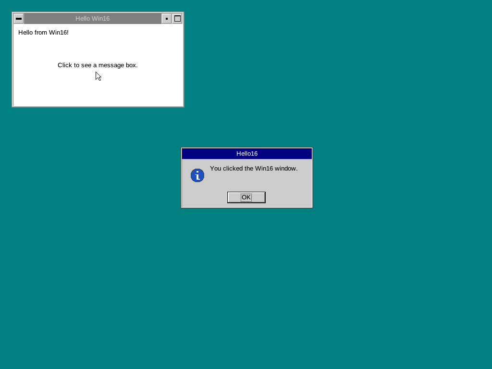
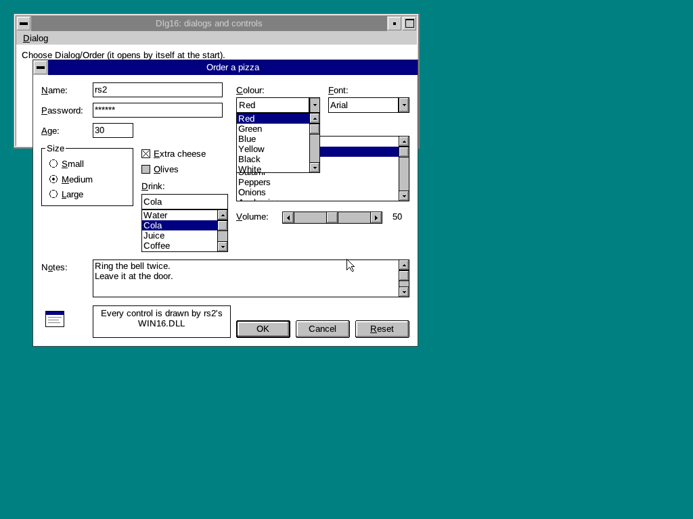

# Native Win16

rs2 runs Windows 3.x programs (16-bit NE executables) as ordinary OS/2
processes, the way Wine runs them on Unix: their KERNEL, USER and GDI
imports go to rs2's own WIN16.DLL, written in Rust on top of rs2's PM
(PMWIN) and GPI. No DOS session, no Win-OS/2, and no Microsoft or IBM
files are involved. This is the media-free alternative to Win-OS/2
(docs/WINOS2.md), which needs IBM's Win-OS/2 from the user's CD.

## Status (stage 3)

| What | State |
|------|-------|
| Loading Windows NE programs (target OS 2), imports from WIN16.DLL | works |
| InitTask, the instance data header, the local heap, the PSP | works |
| INT 21h from Windows programs (and DOS3Call): files, version, exit | works (the calls the C runtime makes) |
| Global and local memory, huge blocks (`__AHINCR`) | works |
| Window classes, top-level and child windows, the message loop | works |
| WM_PAINT, BeginPaint/EndPaint, TextOut, DrawText, FillRect, lines | works |
| MessageBox | works (PM's message box for now) |
| Moving, sizing, closing (Alt+F4, the system menu) from PM | works |
| The program's resources: strings, menus, accelerators, dialog templates, FindResource/LoadResource | works (stage 2) |
| Menus: menu bars, pop-ups, check marks, grayed items, WM_INITMENU(POPUP), WM_MENUSELECT, TrackPopupMenu | works (stage 2) |
| Accelerators (LoadAccelerators, TranslateAccelerator) | works (stage 2) |
| Dialogs: DialogBox(Param), CreateDialog(Param), the Indirect forms, DefDlgProc, IsDialogMessage (Tab, arrows in groups, Enter, Esc, mnemonics) | works (stage 2) |
| BUTTON, STATIC, EDIT (single and multi-line), LISTBOX, COMBOBOX, SCROLLBAR, drawn by WIN16 | works (stage 2) |
| Subclassing (SetWindowLong GWL_WNDPROC, CallWindowProc), window scroll bars, the caret, the clipboard (CF_TEXT, PM's) | works (stage 2) |
| CreateFont and the stock fonts, ellipses, polygons, clipping rectangles, SaveDC/RestoreDC | works (stage 2) |
| MDI, bitmaps (CreateBitmap, BitBlt, DIBs), regions, mapping modes, owner-drawn combo boxes, Windows DLLs, WIN.INI | later (stage 2 remainder) |
| COMMDLG: Open, Save As, Color, Font, Print, Print Setup, Find, Replace as WIN16 dialogs, with programs' hooks and templates; CommDlgExtendedError, GetFileTitle | works (stage 3) |
| Printing: printer DCs (CreateDC, CreateIC) on rs2's spooler and PostScript driver, Escape (STARTDOC, NEWFRAME, ENDDOC, ABORTDOC, NEXTBAND, GETPHYSPAGESIZE, PASSTHROUGH...), StartDoc...EndDoc, SetAbortProc, GetDeviceCaps, WIN.INI's printers | works (stage 3) |
| DDE between Windows tasks (WM_DDE_*, GMEM_DDESHARE, global atoms), to PM programs' DDE servers, DDEML | works (stage 3) |
| The clipboard: CF_TEXT, CF_BITMAP, CF_DIB, CF_METAFILEPICT, registered formats, delayed rendering, shared with PM programs | works (stage 3) |
| DPMI, MMSYSTEM, OLE, TOOLHELP, the compatibility tail | stage 4 |

Checked in QEMU: `RS2\HELLO16.EXE` (a classic hello world: a window
class, text painted in WM_PAINT, a MessageBox on a click) shows as a PM
window, moves, repaints and closes; `RS2\MENU16.EXE` (a menu bar from
its resources, check marks, a cascading pop-up, accelerators, a pop-up
menu on the right button), `RS2\DLG16.EXE` (a modal dialog with one of
each control, driven from the keyboard: mnemonics, Tab, a drop-down
list, Enter) and `RS2\NOTE16.EXE` (a Notepad on the multi-line edit
control: scroll bars, selection, the clipboard, undo, word wrap, saving
a file, a file name dialog) work; `RS2\W16TEST.EXE` checks KERNEL, USER,
GDI, the DOS calls and stage 2's resources, menus, accelerators,
dialogs and controls and stage 3's common dialogs, printing, atoms,
clipboard formats and DDE (`w16test done: 0 failure(s)`). Stage 3 added
the common dialogs to NOTE16 (Open, Save As, Print, Print Setup, Font,
Background Color, Find, Replace), `RS2\PRINT16.EXE` (a page of text and
graphics on the default printer, rendered with Ghostscript from the
PostScript the spooler writes) and the DDE pair `RS2\DDECLI16.EXE` (a
client in WM_DDE_* messages) and `RS2\DDESRV16.EXE` (a DDEML server) in
two processes. All are built from source with Open Watcom (below).
Screenshots: `work/progress/win16-native` (stage 1),
`work/progress/win16-stage2`, `work/progress/win16-stage3`.

## Windows programs are not OS/2 programs

Windows and OS/2 1.x share the NE ("new executable") format, so the
same loader reads both, but a Windows module differs in several ways.

- **Target OS byte** (NE header offset 0x36): 1 for OS/2, 2 for
  Windows (4 for Windows/386). OS/2 refuses Windows programs (and runs
  them in Win-OS/2); rs2's loader takes this byte as the sign to load
  the module with the Win16 layer. `DosQueryAppType` reports
  FAPPTYP_WINDOWSREAL (0x0200) for them.
- **Windows flags.** The program flags at 0x0C are read differently:
  0x0800 is *self-loading* (segment 1 holds the program's own segment
  loader, entered through a loader interface Windows' KERNEL provides;
  OS/2 reserves the bit), 0x0008 is "protected mode only", 0x0010-0x0080
  are the processor and coprocessor bits, and 0x0300 (OS/2's
  WINDOWAPI) marks a Windows GUI program. Windows adds an *other flags*
  byte at 0x37 (0x02: a Windows 2.x program that runs in protected mode,
  0x04: proportional fonts, 0x08: a gangload area), the gangload area at
  0x38/0x3A and the expected Windows version at 0x3E (0x030A for 3.10).
- **Instance data in DS.** A program's automatic data segment (DGROUP)
  holds its static data, then the stack (SS = DS, SP = data + stack
  size), then the *local heap* to the end of the segment. DS is the
  *instance handle* (hInstance): several instances of a program share
  the code and get a DGROUP each, and LocalAlloc allocates in the
  caller's DS. The first 16 bytes of DGROUP are the *instance data
  header* KERNEL fills in: a reserved word, the old SS:SP, pLocalHeap
  (0x06), pAtomTable (0x08), and the stack's top, minimum and bottom
  (0x0A, 0x0C, 0x0E, which compilers' stack checks read).
- **Start registers.** Windows enters a program with BX the stack size,
  CX the heap size, DI hInstance, SI hPrevInstance and ES the PSP;
  the startup code calls InitTask, which returns AX 1, ES:BX the command
  tail, CX the stack limit, DX nCmdShow, SI and DI the instances.
  These are register-based calls, not Pascal ones.
- **Exported procedures.** Window procedures and other callbacks begin
  with `push ds; pop ax; nop` (or `mov ax, ds; nop`), then `inc bp; push
  bp; mov bp, sp; push ds; mov ds, ax`: the callback's DS comes in AX.
  Windows' loader patches the first bytes of a DLL's exports to `mov ax,
  DGROUP`, and MakeProcInstance makes thunks that load AX with an
  instance's DGROUP. rs2 calls every callback of a program with DS its
  DGROUP (one task per process), so the prologue finds the right DS and
  MakeProcInstance returns the procedure itself; Windows DLLs (stage 2)
  get their prologues patched.
- **Resources.** The resource table at the header's resource offset is
  Windows' format (an alignment shift, then TYPEINFO records: a type ID
  with bit 15 set or a name offset, a count, and NAMEINFO entries with
  offset, length, flags, ID), not OS/2's list of (type, name, segment)
  pairs. The types are Windows': RT_CURSOR 1, RT_BITMAP 2, RT_ICON 3,
  RT_MENU 4, RT_DIALOG 5, RT_STRING 6, RT_ACCELERATOR 9, RT_GROUP_ICON
  14, RT_VERSION 16, each in Windows' own layout (dialog templates and
  menus differ from PM's).
- **Floating point fixups.** Relocation type OSFIXUP (in OS/2 a no-op)
  tells Windows where the program uses the emulator's INT 34h-3Dh, so
  that it can patch them to coprocessor instructions.
- **Task and module databases.** Windows keeps a *task database* (TDB)
  per task, a selector whose fields programs read or GetCurrentTask
  returns: the instance, the module, the message queue, the PSP, the
  module name and the "TD" signature. The *module database* is the NE
  header in memory: GetModuleHandle returns its selector, the usage
  count is at offset 2 and the segment table carries the segments'
  handles. TOOLHELP walks both. Stage 1 has neither (GetCurrentTask
  returns the instance, GetModuleHandle the instance or a fixed handle
  for a system module); stage 4 builds them for the programs that look.

## Loading

The loader is `kernel/src/loader/neload.rs`. For a module with target
OS 2 it

1. refuses self-loading programs (stage 4);
2. maps the imported module names through `WIN16_MODULES`
   (`kernel/src/loader/mod.rs`): the system modules are all
   implemented by one rs2 DLL, WIN16.DLL, and Windows ordinal *n* of a
   module is WIN16's ordinal *base + n*:

   | Windows module | rs2 module | WIN16 ordinals |
   |----------------|------------|----------------|
   | KERNEL | WIN16.DLL | 1000 + n |
   | USER | WIN16.DLL | 2000 + n |
   | GDI | WIN16.DLL | 3000 + n |
   | KEYBOARD | WIN16.DLL | 4000 + n |
   | WIN87EM | WIN16.DLL | 5000 + n (stage 4) |
   | SOUND | WIN16.DLL | 5200 + n (stage 4) |
   | SYSTEM | WIN16.DLL | 5400 + n (stage 4) |
   | COMMDLG, SHELL, MMSYSTEM, TOOLHELP, ... | later stages | |
   | any other name | that DLL, as for OS/2 modules | |

   One DLL keeps USER and GDI's shared state (windows, DCs, objects) in
   one place; the ordinal bases keep Windows' ordinals, so programs
   importing by ordinal (all of them) need no table. KERNEL's absolute
   entries (`__AHSHIFT` 3, `__AHINCR` 8, `__WINFLAGS`) are constants the
   loader puts in directly (`WIN16_CONSTANTS`);
3. makes DGROUP a whole 64 KB tile: the stack ends at the data plus the
   stack size, and the local heap has the rest, as LocalAlloc would grow
   DGROUP on Windows;
4. enters the program with Windows' start registers (BX, CX, DI, SI;
   `kernel/src/task/process.rs`).

The process is a PM process (the NE flags say WINDOWAPI), started like
any program (DosExecPgm, CMD, the kernel's `init=`; stage 1 checked the
last). Program objects and sessions of the Win-OS/2 types (PROG_31_*)
still go to Win-OS/2 when it is installed.

WIN16.DLL (`userland/win16`) exports `_pascal far` 16-bit entry points
made with thunk16's `entries16_pascal!` (the machinery of rs2's 16-bit
PM entry points): each stub calls the Rust code with the flat address of
its arguments and removes them with `RETF n`, n the argument size from
Windows' prototypes (`entries!` in `src/lib.rs` lists them). The names
and ordinals in `exports.def` come from Open Watcom's import libraries
(`tools/scripts/gen_win16_exports.py`). Callbacks into the program (window
procedures, timer procedures) go through thunk16's `PascalCall` with
the task's DS.

### Interrupts and faults

Windows programs execute software interrupts: INT 21h for DOS (the C
runtime's file I/O, its exit), DOS3Call, INT 2Fh, the emulator's INT
34h-3Dh. On OS/2 an INT in an application is a protection fault. A
process whose WIN16.DLL registered an interrupt handler (RS2API 420
`Rs2Win16SetIntHandler`, at the DLL's per-process initialisation) gets
them reflected instead (`kernel/src/api/win16.rs`): the kernel puts the
registers (INTREGS) on the program's stack and calls the handler, a
`_pascal` entry of WIN16, which changes them and returns through a gate
slot that loads them. WIN16's register-based KERNEL entries use the same
path: InitTask is `INT E0h; RETF`, DOS3Call `INT 21h; RETF`.

Protection faults in the program's code are reflected the same way. One
is fixed up: compilers load far pointers into ES before they know they
are pointers (Watcom loads `lParam` of every message into ES:BX on entry
to a window procedure), which on a 286 or 386 faults when the high word
is not a selector (WM_SIZE's height). WIN16 loads 0 into ES (or DS) and
goes on, decoding LES, LDS, MOV sreg and POP sreg. Faults it leaves alone
are delivered as the exceptions they were.

The DOS calls (`userland/win16/src/dos.rs`) are served on OS/2 files and
handles: open, create, read, write, seek, close, delete, directories,
date and time, version 5.0, IOCTL device information, exit (4Ch).

## Tasks and scheduling

Windows 3.x is cooperative: there is one system input queue, and a task
runs until it yields in GetMessage, PeekMessage, Yield or a dialog
loop. **rs2 runs each Windows task as an OS/2 process of its own, with
one thread.**

- PM already has the Windows input model: one system input queue with
  synchronous input processing (a keystroke is not delivered to the next
  window until the previous message was taken), activation and focus
  across processes. A Windows task that does not get its messages holds
  up input as it does on Windows, and rs2's PM hang handling (the
  "program not responding" dialog, End task) deals with it.
- Tasks are protected from each other: a program that faults ends alone
  (on Windows 3.1 it could bring the system down), its memory is its own,
  and PM cleans up its windows when the process ends.
- No Win16Lock is needed: USER and GDI state is WIN16.DLL's per-process
  data, used by the one thread; PM serialises what crosses processes.
- OS/2's tools work on Windows programs: the window list, End task,
  DosKillProcess, exit codes, CMD waiting for them.

What it costs, and how the later stages deal with it:

- **hPrevInstance is always 0**, so each instance registers its own
  window classes (they are per process here) and GetInstanceData has no
  other instance to copy from. Programs that refuse a second instance
  by looking at hPrevInstance start again; FindWindow, which is how
  most programs do it anyway, will have to find the first one's windows
  (it looks at the task's own windows so far).
- **Global memory passed between tasks** (DDE, the clipboard, pointers
  in messages to another task's window): GMEM_DDESHARE blocks will be
  shared memory at the same address in every process (rs2's shared
  arena, the selectors are tiled), and messages with pointers that go to
  another process (WM_SETTEXT, WM_GETTEXT, ...) are copied across the
  way PM does it for its own messages (stage 3).
- **Programs relying on not being preempted** (polling memory another
  task changes between yields) are rare; they would need tasks in one
  process.

All tasks in one process (a "Win16 machine", as Win-OS/2 is, or Wine's
Win16Lock over threads) would make the shared address space and
hPrevInstance exact, but one fault would end every Windows program, the
DLL's state would have to become per task, and the scheduler would be
WIN16's own. It stays possible as an option for programs that need it
(like Win-OS/2's common seamless session).

## Windows and messages

`userland/win16/src/user.rs`.

- **HWNDs.** A Windows HWND is a handle in WIN16's window table. A
  top-level window is a PM frame window, with the frame controls from
  the window style (WS_CAPTION: title bar and a window list entry,
  WS_SYSMENU, WS_THICKFRAME: sizing border, WS_MINIMIZEBOX,
  WS_MAXIMIZEBOX, WS_DLGFRAME, WS_BORDER) and a client window of PM class
  `Win16Wnd`; a child window is a `Win16Wnd` window in its parent's
  client. The Windows window's procedure, class, styles, ID and extra
  bytes live in the table; GetWindowLong(GWL_WNDPROC) returns the 16:16
  procedure and SetWindowLong subclasses.
- **CreateWindow** creates the PM windows, positions them (CW_USEDEFAULT
  cascades), then sends WM_NCCREATE and WM_CREATE with a CREATESTRUCT on
  the 16-bit stack, WM_SIZE and WM_MOVE, and shows a WS_VISIBLE window.
- **Sent messages.** PM's messages to the client (WM_SIZE, WM_MOVE,
  WM_ACTIVATE, WM_SETFOCUS, WM_CLOSE, WM_DESTROY, WM_PAINT from
  WinUpdateWindow) come to `pm_wndproc`, which translates them and calls
  the 16-bit window procedure.
- **Queued messages.** GetMessage and PeekMessage take PM's queue
  messages, return the ones for Windows windows translated (mouse
  buttons and moves, keys, WM_PAINT, WM_TIMER, messages the program
  posted) and dispatch PM's others (the frame's) on the way;
  DispatchMessage calls the window procedure. A program's PostMessage
  goes into PM's queue as PM message 10000h + the Windows message.
- **DefWindowProc.** While a translated PM message is being handled, the
  default for it is PM's (WinDefWindowProc with the PM message); the
  rest get Windows' defaults here: WM_CLOSE destroys the window (PM's
  would post WM_QUIT), WM_ERASEBKGND fills with the class brush,
  WM_SETCURSOR sets the class cursor, WM_PAINT validates, WM_SYSCOMMAND,
  WM_SETTEXT/WM_GETTEXT on the frame's title.
- **Input.** Mouse messages get the Windows button and key state bits;
  WM_SETCURSOR comes before them as Windows' input processing sends it.
  PM's WM_CHAR becomes WM_KEYDOWN/UP (WM_SYSKEYDOWN with Alt) with
  Windows' virtual keys, and TranslateMessage posts the WM_CHAR.
- **Coordinates.** Windows' y grows down from the client's top-left
  corner, PM's up from the bottom-left. With h the client height, a
  point (x, y) is PM's (x, h - 1 - y); a rectangle (l, t, r, b) is
  PM's (l, h - b, r, h - t) (Windows' bottom and right are exclusive,
  as PM's top and right). Screen coordinates flip with the screen
  height; ClientToScreen and ScreenToClient go through
  WinMapWindowPoints.

## Painting and GDI

`userland/win16/src/gdi.rs`. An HDC is a handle over the HPS of a window,
from BeginPaint (WinBeginPaint) or GetDC (WinGetPS), switched to RGB mode,
with the client height for the y flip. COLORREFs (0x00BBGGRR) become
PM's RGB (0x00RRGGBB). BeginPaint sends WM_ERASEBKGND and fills the
PAINTSTRUCT with the update rectangle in Windows coordinates. TextOut
puts the text's top at y (PM's baseline is h - y - the ascender) with
the DC's text colour and, in OPAQUE mode (Windows' default), its
background colour; DrawText draws line by line with WinDrawText
(alignment, DT_SINGLELINE vertical centring, word breaks, `&` mnemonics
as PM's `~`, DT_CALCRECT). Stock objects, solid brushes, pens,
MoveTo/LineTo and Rectangle are there; GetTextMetrics and GetTextExtent
answer from the PS's font. Stage 2 added Ellipse (GpiFullArc), Polygon
and Polyline, PatBlt with the solid raster operations, SetPixel and
GetPixel, IntersectClipRect and ExcludeClipRect, SaveDC and RestoreDC,
the text alignments (SetTextAlign), ExtTextOut, GetCharWidth, GetObject,
the indirect brushes and pens, and fonts (below); USER's InvertRect,
FrameRect and DrawFocusRect. The built-in controls draw with the same
functions from Rust (`gdi::fill`, `gdi::text_at`, `gdi::draw_text_bytes`).

## Controls, dialogs and menus

**Built-in controls.** BUTTON, STATIC, EDIT, LISTBOX, COMBOBOX (and its
list, COMBOLBOX) and SCROLLBAR are WIN16's own window classes, with
window procedures in Rust (`ctl.rs`, `edit.rs`, `listbox.rs`,
`scroll.rs`) that draw Windows 3.1-style controls through WIN16's GDI on
the control's DC, not PM controls. Windows programs depend on the
controls' Windows behaviour in detail: their messages (BM_, EM_, LB_,
CB_, the scroll bar calls) and notifications (WM_COMMAND with the code in
lParam's high word: BN_CLICKED, EN_CHANGE, LBN_SELCHANGE, CBN_DROPDOWN...),
WM_CTLCOLOR for colours (the dialog procedure can change a control's),
WM_SETFONT, WM_GETDLGCODE, owner-drawn buttons and list boxes
(WM_DRAWITEM with an HDC, WM_MEASUREITEM), and subclassing. Each
built-in procedure has a 16:16 address of its own (a WIN16 entry below
1000, not exported), so GetWindowLong(GWL_WNDPROC) gives programs a
procedure they can call with CallWindowProc or directly; calls from WIN16
to these addresses (and to DefWindowProc's and DefDlgProc's) go straight
to the Rust code. A control's state is the window's `data`; windows
destroyed while a built-in procedure runs are freed when none runs.

The EDIT control keeps its text in WIN16 (EM_GETHANDLE has no local
block to give): single-line edits scroll sideways, multi-line ones break
lines at CR LF (and at words unless they scroll sideways), with the
window's scroll bars, selection with the mouse and the shift keys,
Ctrl+X/C/V, Shift+Del, Ctrl+Ins and Shift+Ins through PM's clipboard, one
level of undo, password characters, read-only, tab stops, EM_LIMITTEXT.
A combo box is an edit control (CBS_SIMPLE, CBS_DROPDOWN) or a drawn
selection field (CBS_DROPDOWNLIST) with a list box: a child below it, or
a pop-up shown under it while dropped, the mouse captured by the combo
box meanwhile as Windows does.

**Plain windows and the non-client area.** A child window (or a pop-up
without a caption) with WS_BORDER, WS_DLGFRAME, WS_THICKFRAME or scroll
bars is a `Win16Frame` PM window that draws the border and holds the
client window and the scroll bars, so GetClientRect, the scroll bars and
the border are Windows'. A top-level window's scroll bars are WIN16's
`Win16Sb` windows with PM's frame IDs (FID_VERTSCROLL, FID_HORZSCROLL), so
PM's frame places them. Scroll bars (the SCROLLBAR control and window
scroll bars alike) draw and track in Windows 3.1's style: arrows that
repeat, page areas, the thumb (SB_THUMBTRACK, SB_THUMBPOSITION), a
window bar hidden by an empty range. Child windows go below their
siblings, as Windows creates them (the first control is the top of the Z
order).

**Dialogs** come from Windows dialog templates (RT_DIALOG, or in memory
for the Indirect forms) in dialog units of the system font (a quarter of
its average width, an eighth of its height; GetDialogBaseUnits). The
dialog is a top-level window of the dialog class (#32770, or the
template's) whose procedure is DefDlgProc, which calls the dialog
procedure (DWL_DLGPROC) first; WM_INITDIALOG focuses the first tab stop
when the procedure returns TRUE. DialogBox disables the owner and runs a
message loop with IsDialogMessage until EndDialog. IsDialogMessage does
the dialog manager's keyboard interface from WM_GETDLGCODE: Tab and
Shift+Tab through WS_TABSTOP controls (an edit control's text selected),
arrows within a WS_GROUP group (an auto radio button is checked), Enter
for the focused or the default push button (DM_GETDEFID), Esc for
IDCANCEL, Alt+letter and letter mnemonics (a static's mnemonic focuses
the next control). The default button's thick border follows the focus.

**Menus.** An HMENU is a PM menu window (WC_MENU): menu bars from
CreateMenu or RT_MENU templates become the frame's FID_MENU with SetMenu
(or the class's menu), pop-ups are hidden menu windows hung on their
items (MIS_SUBMENU, with IDs of their own: Windows' pop-up items have
none). PM's menus draw and track themselves, keyboard included (Alt,
F10, mnemonics); their notifications, which PM's frame passes to the
client, become Windows' WM_INITMENU, WM_INITMENUPOPUP (with the pop-up's
HMENU and position), WM_MENUSELECT and WM_COMMAND. "&" mnemonics are PM's
"~". TrackPopupMenu shows a pop-up at a point and returns when it closes.
Accelerator tables (RT_ACCELERATOR) are WIN16's: TranslateAccelerator
matches WM_KEYDOWN (FVIRTKEY entries, with the shift states) or WM_CHAR
(ASCII entries) and sends WM_COMMAND with lParam 1 << 16, unless the
command is a grayed item of the window's menu.

**Keys.** PM's WM_CHAR becomes WM_KEYDOWN/UP with Windows' virtual keys
(VK_OEM_ keys for punctuation, from the scan code) or WM_SYSKEYDOWN for
Alt combinations and F10; TranslateMessage posts WM_CHAR (Ctrl+letter is
a control character) or WM_SYSCHAR. A system key's DefWindowProc passes
the key to the top-level PM frame (its menu, Alt+F4); a child window's
other keys go nowhere.

**Resources** are read from the program's NE file when first needed:
LoadString, LoadMenu, LoadAccelerators, the dialog calls, FindResource,
LoadResource (a global block with a copy), LockResource, SizeofResource.
The program's own icons and cursors are rs2's application icon and the
arrow; DrawIcon draws the icon. MessageBox is still PM's WinMessageBox.

## Fonts and system art

Everything a Windows program sees is rs2's own:

- **Fonts.** The system font is rs2's system font (docs/PM.md, Fonts);
  OEM_FIXED_FONT, ANSI_FIXED_FONT and SYSTEM_FIXED_FONT are rs2's
  monospaced face ("System Monospaced"). CreateFont and
  CreateFontIndirect map Windows' face names to rs2's outline faces
  (Courier, Fixedsys and Terminal to Courier; Times, Tms Rmn and Roman
  to Times New Roman; the rest to Helvetica) at the requested height
  (negative: the em, positive: the cell), with bold, italic and
  underline; a font is a PM logical font of the DC (local ID 1) while it
  is selected. Font enumeration and Windows raster font files (.FON: NE
  modules with RT_FONT resources) added with AddFontResource are
  later.
- **Cursors.** The IDC_ cursors are PM's system pointers (rs2's own
  art): IDC_ARROW the arrow, IDC_IBEAM the text pointer, IDC_WAIT the
  clock, the IDC_SIZE* the sizing pointers.
- **Icons and bitmaps.** IDI_APPLICATION and the message box icons are
  rs2's; the OBM_ bitmaps the controls use (check boxes, radio buttons,
  scroll bar arrows, combo box buttons) are drawn by WIN16's own code.
- **System colours.** GetSysColor answers Windows 3.1's default scheme
  (stage 2 can follow PM's scheme instead).

## Common dialogs, printing, DDE and the clipboard (stage 3)

### COMMDLG

`userland/win16/src/commdlg.rs`. COMMDLG's imports go to WIN16 (6000 +
the ordinal). Each common dialog is a WIN16 dialog made from a template
built in Rust (dialog units of the system font, laid out like Windows
3.1's) whose controls have Windows' IDs from `dlgs.h` (edt1, lst1, cmb1,
chx1, rad1, psh1, stc1...), so a program's own template
(`*_ENABLETEMPLATE` from its resources, `*_ENABLETEMPLATEHANDLE` from a
global block) works with the dialog procedure here, as it does with
Windows'. That procedure is WIN16 entry 9 (a 16:16 address like the
built-in controls'); DefDlgProc calls it as any dialog procedure. A
program's hook gets every message first: WM_INITDIALOG with its
structure as lParam (after the dialog has been filled in), and returning
TRUE keeps the default handling from running. CommDlgExtendedError
answers the cderr.h codes (CDERR_STRUCTSIZE, FNERR_BUFFERTOOSMALL with
the size needed in the buffer, PDERR_NODEFAULTPRN...).

- **Open and Save As** (GetOpenFileName, GetSaveFileName): the file
  list of the filter's patterns (several, `*.cmd;*.bat`), the
  directory list as Windows 3.1 draws it (the path's parts, then the
  subdirectories, indented), drives with their volume labels, the
  filters, a typed pattern or directory changing the lists, Enter in the
  directory list opening it. OK checks the name as the flags ask
  (OFN_FILEMUSTEXIST, OFN_PATHMUSTEXIST, OFN_CREATEPROMPT,
  OFN_OVERWRITEPROMPT, OFN_NOREADONLYRETURN), adds lpstrDefExt, sends
  the hook FILEOKSTRING, and fills lpstrFile, nFileOffset,
  nFileExtension, lpstrFileTitle, nFilterIndex and the flags. The
  current directory follows the dialog unless OFN_NOCHANGEDIR. Names are
  lower case, as on Windows 3.1's FAT drives.
- **Color** (ChooseColor): the 48 basic colours and 16 custom colours
  as owner-drawn buttons (keyboard and mouse), "Define Custom Colors"
  opening the right half (CC_FULLOPEN: open at once): the hue and
  saturation spectrum and the luminosity bar (clicked), the colour,
  Hue/Sat/Lum and Red/Green/Blue in Windows' 0-240 and 0-255 scales,
  Add to Custom Colors.
- **Font** (ChooseFont): faces (Arial, Courier New, Times New Roman, MS
  Sans Serif, System, Fixedsys: the names CreateFont maps to rs2's
  fonts), styles, sizes, strikeout and underline, the 16 colours
  (CF_EFFECTS), a sample in the font; CF_INITTOLOGFONTSTRUCT,
  CF_USESTYLE, CF_LIMITSIZE, CF_FIXEDPITCHONLY, WM_CHOOSEFONT_GETLOGFONT;
  the LOGFONT, iPointSize, rgbColors and nFontType come back.
- **Print and Print Setup** (PrintDlg): the printers are rs2's
  queues (below). Print has the range (all, selection, pages with
  their check), copies, collate and print to file, and Setup... ; Print
  Setup the default or a specific printer, orientation, paper size,
  and Options..., which shows rs2's PostScript driver's job properties
  dialog (DevPostDeviceModes). hDevMode (a Windows 3.1 DEVMODE:
  orientation, paper, copies) and hDevNames (driver, device, port) are
  made or updated; PD_RETURNDC/PD_RETURNIC make the DC, PD_RETURNDEFAULT
  answers without a dialog.
- **Find and Replace** (FindText, ReplaceText): modeless; each button
  sends the owner FINDMSGSTRING ("commdlg_FindReplace", registered) with
  the FINDREPLACE's flags (FR_FINDNEXT, FR_REPLACE, FR_REPLACEALL,
  FR_DIALOGTERM, FR_DOWN, FR_MATCHCASE, FR_WHOLEWORD) and the texts.
  The program's loop calls IsDialogMessage for it, as on Windows.

### Printing

`userland/win16/src/print.rs`, on docs/PRINTING.md's spooler and
PostScript driver.

- **The printers are the spooler's queues.** A Windows printer's device
  name is the queue's description, its driver the queue's (PSCRIPT),
  its port the queue's name and a colon (`PSPRINT:`). WIN.INI is not a
  file: GetProfileString answers `[windows] device=` (the default queue:
  `PostScript Printer,PSCRIPT,PSPRINT:`), `[devices]` and
  `[PrinterPorts]` from the queues, which is how Windows 3.x programs
  find printers.
- **CreateDC** with a printer's driver, device or port is a queued PM
  DC (DevOpenDC OD_QUEUED, PM_Q_RAW: the driver writes the PostScript
  and the spooler sends it as it is, as Windows spools its drivers'
  output) with a presentation space in device pels; **CreateIC** an
  OD_INFO DC that answers queries. A DEVMODE in lpInitData (orientation,
  paper size, copies) changes the queue's job properties for the DC.
  GDI draws on the PS as on a window's, y flipped by the page height
  (the printable page: Letter is 2550 x 3300 pels at 300 dpi); the
  fixed mapping modes (MM_LOENGLISH...) are at 300 dpi; the system
  font, which printers do not have, is Helvetica 10 points (the fixed
  ones Courier). CreateDC("DISPLAY") is bitmap.rs's memory DC. DeleteDC
  closes the PM DC (a document still open is abandoned).
- **Jobs**: StartDoc (DOCINFO's name) or Escape(STARTDOC) is
  DEVESC_STARTDOC; EndPage, Escape(NEWFRAME) and NEXTBAND's last band
  are DEVESC_NEWFRAME; EndDoc and Escape(ENDDOC) DEVESC_ENDDOC (the job
  is queued); AbortDoc and Escape(ABORTDOC) DEVESC_ABORTDOC. The abort
  procedure (SetAbortProc, Escape(SETABORTPROC)) is called at each page
  and stops the job when it returns FALSE (SP_APPABORT); QueryAbort
  calls it. Other escapes: QUERYESCSUPPORT, GETPHYSPAGESIZE,
  GETPRINTINGOFFSET, GETSCALINGFACTOR, SETCOPYCOUNT, GETTECHNOLOGY
  ("PostScript"), FLUSHOUTPUT, DRAFTMODE, SETLINECAP/JOIN/MITERLIMIT,
  EPSPRINTING, and PASSTHROUGH and POSTSCRIPT_DATA (PostScript into the
  job as it is: DEVESC_RAWDATA).
- **GetDeviceCaps** of a printer: DT_RASPRINTER, 300 dpi (LOGPIXELSX/Y,
  ASPECTX/Y), the page in pels and millimetres, 8 colours, the curve,
  line, polygon, text and raster capabilities.

The PostScript can be looked at on the host: the default queue prints
to `C:\SPOOL\OUTPUT\JOBnnnnn.PS`, so `--init "CMD.EXE /K RS2\PRINT16.EXE
& PING -c 15 127.0.0.1 & TYPE C:\SPOOL\OUTPUT\JOB00001.PS"` puts it in
the serial log, and Ghostscript renders it (`gs -sDEVICE=png16m`);
`PRNTEST SETPORT` sends it to a host LPR listener instead
(docs/PRINTING.md).

### DDE and DDEML

`userland/win16/src/dde.rs`, `ddeml.rs`. Each Windows task is a process
of its own, so DDE between two of them crosses processes:

- **Windows of other tasks** are proxy HWNDs (0x1004 and up, below the
  task's own handles) for their PM client windows. SendMessage and
  PostMessage to a proxy send the message to that PM window as PM
  message `W16X | msg` (0x20000) with the sender's PM window in mp1
  when wParam is a window (the DDE messages) and lParam in mp2; the
  receiving WIN16 turns it back into the Windows message with a proxy of
  the sender. SendMessage(0xFFFF, ...) (WM_DDE_INITIATE) goes to the
  task's top-level windows and every other task's (their `Win16Wnd`
  client windows); IsWindow knows proxies.
- **Global atoms** (GlobalAddAtom, the atoms in DDE messages) are PM's
  system atom table, the same numbers in every process.
- **GMEM_DDESHARE blocks** are giveable shared memory: tiled, so a
  block's selector is the same in every process it is given to.
  WM_DDE_DATA's, WM_DDE_POKE's and WM_DDE_ADVISE's block (lParam's low
  word) and WM_DDE_EXECUTE's commands (high word) are given to the
  receiver (DosGiveSharedMem), which adopts them as its own global
  blocks (GlobalLock, GlobalFree work). GlobalFree clears the caller's
  saved DS and ES when they hold the freed selector, as Windows does.
- **PM programs' DDE servers**: a Windows task's WM_DDE_INITIATE also
  goes to PM's DDE (WinDdeInitiate with the atoms' names). A PM server's
  WM_DDE_INITIATEACK, WM_DDE_DATA, WM_DDE_ACK and WM_DDE_TERMINATE come
  to the Windows client as Windows' messages (DDESTRUCTs become
  GMEM_DDESHARE blocks and atoms), and the client's REQUEST, POKE,
  EXECUTE, ADVISE, UNADVISE, ACK and TERMINATE become DDESTRUCTs
  (WinDdePostMsg). A PM client of a Windows server is not bridged yet.
- **DDEML** is built on these messages, as Windows' DDEML.DLL is, so
  DDEML programs talk to programs that use the messages: an instance's
  hidden window answers WM_DDE_INITIATE for its services
  (DdeNameService, XTYP_CONNECT, XTYP_CONNECT_CONFIRM); each
  conversation has a window; DdeClientTransaction does XTYP_REQUEST,
  POKE, EXECUTE, ADVSTART (XTYPF_NODATA, XTYPF_ACKREQ) and ADVSTOP,
  waiting in a message loop of its own (or TIMEOUT_ASYNC, completed with
  XTYP_XACT_COMPLETE); DdePostAdvise runs XTYP_ADVREQ for the advise
  loops; XTYP_ADVDATA, XTYP_DISCONNECT; string handles are global atoms
  (DdeCreateStringHandle, DdeQueryString, DdeCmpStringHandles), data
  handles global blocks (DdeCreateDataHandle, DdeAddData, DdeGetData,
  DdeAccessData); DdeConnectList, DdeQueryConvInfo, DdeSetUserHandle,
  DdeEnableCallback, DdeGetLastError. Monitors (APPCLASS_MONITOR) and
  XTYP_REGISTER broadcasts are not done.

### The clipboard

`userland/win16/src/clip.rs`, on PM's clipboard (shared with every PM
program): CF_TEXT and CF_OEMTEXT are PM's CF_TEXT; CF_DIB is kept as it
is and also given to PM programs as a PM bitmap (a Windows DIB is an
OS/2 2.0 bitmap with a 40-byte header), and a PM bitmap is a 24-bit DIB
for Windows programs; CF_BITMAP is a GDI bitmap (bitmap.rs), a PM bitmap
with its picture for PM; CF_METAFILEPICT keeps the METAFILEPICT and its
metafile's bits; registered formats (RegisterClipboardFormat) are global
atoms, the same numbers PM programs get for the names; Windows' other
formats are PM formats named "Win16 format n". Data other than text
keeps its exact size. Delayed rendering is PM's: the owner (the window
that opened the clipboard when it was emptied) gets WM_RENDERFORMAT,
WM_RENDERALLFORMATS and WM_DESTROYCLIPBOARD, the viewer
WM_DRAWCLIPBOARD (PM has one viewer: SetClipboardViewer replaces it,
ChangeClipboardChain removes it).

### What stage 3 leaves

Multiple selection in the Open dialog (OFN_ALLOWMULTISELECT), the
LBSELCHSTRING, SHAREVISTRING and HELPMSGSTRING messages, Print to File
(the job goes to the printer's port), the printer driver's own entries
(ExtDeviceMode, DeviceMode, DeviceCapabilities: there is no PSCRIPT.DRV
module to load), WriteProfileString of `[windows] device=` (changing the
default printer), a PM DDE client talking to a Windows server, DDEML
monitors, metafiles drawn from CF_METAFILEPICT for PM programs (Windows
metafiles are not played), SHELL's drag and drop, and the messages with
pointers that cross tasks (WM_SETTEXT, WM_GETTEXT to another task's
window).

## Building the test programs

The test programs are C, built with Open Watcom v2's Win16 target
(`wcl -bt=windows -l=windows -zW`). Install Open Watcom from its GitHub
releases (the `Current-build` snapshot, `ow-snapshot.tar.xz`, has macOS
arm64 binaries in `armo64/`) into `~/opt/watcom`, or set `WATCOM`.
`userland/win16test/build.sh` builds every `*.c` there into
`userland/win16test/bin/`, and `cargo xtask build` (and `iso`) puts them
on drive C: as `C:\RS2\*.EXE` when Open Watcom is installed.

- `HELLO16.EXE`: the hello world (`hello16.c`).
- `MENU16.EXE`: menus and accelerators (`menu16.c`, `menu16.rc`).
- `DLG16.EXE`: a dialog with every control (`dlg16.c`, `dlg16.rc`).
- `NOTE16.EXE`: a Notepad on the edit control, with the common dialogs
  (`note16.c`, `note16.rc`).
- `PRINT16.EXE`: a test page on the default printer, through WIN.INI,
  CreateDC, StartDoc...EndDoc and the Windows 3.0 escapes; PASS/FAIL
  lines (`print16.c`).
- `DDESRV16.EXE`, `DDECLI16.EXE`: a DDEML server and a client in
  WM_DDE_* messages, two tasks (`ddesrv16.c`, `ddecli16.c`); `--init
  "RS2\DDECLI16.EXE"` starts the server (WinExec) and ends with
  `ddecli16 done: 0 failure(s)`.
- `W16TEST.EXE`: checks (`w16test.c`, `w16test.rc`); `cargo xtask run
  --release --headless --timeout 150 --init "RS2\W16TEST.EXE"` ends with
  `w16test done: 0 failure(s)`.

A program's resources are the `.rc` file of the same name, compiled and
bound by Open Watcom's `wrc -bt=windows` (Windows 3.x resource syntax:
CONTROL statements for the auto buttons). `tools/scripts/gen_win16_exports.py`
makes `userland/win16/exports.def` from the `entries!` list.

`SET W16TRACE=1` in CONFIG.SYS traces WIN16's calls (by WIN16 ordinal),
the DOS calls and fix-ups to the serial port.

## Later stages

**Stage 2: what is left.** MDI (MDICLIENT, DefFrameProc,
DefMDIChildProc), bitmaps (CreateBitmap, CreateCompatibleDC, BitBlt,
StretchBlt, DIBs, LoadBitmap), regions and clip regions, mapping modes,
pen and brush styles (hatches, patterns, dashed pens), owner-drawn combo
boxes and LBS_OWNERDRAWVARIABLE, multi-column list boxes, DlgDirList,
font enumeration, the non-client messages for programs that draw their
own frame, MessageBox as a WIN16 dialog, the program's own icons and
cursors, Windows DLLs of the program's own (LibMain, WEP, patched export
prologues), WIN.INI and private profiles (GetProfileString answers the
default for now).

**Stage 3** (COMMDLG, printing, DDE, the clipboard) is done; what it
leaves is listed above. SHELL (ShellExecute, drag and drop of files)
and messages with pointers that cross tasks remain.

**Stage 4: the compatibility tail.** DPMI (INT 31h for programs that
manage selectors or call real mode), the floating point emulator
(WIN87EM, OSFIXUPs, INT 34h-3Dh), MMSYSTEM (waveOut, midiOut, MCI on
rs2's MMPM, docs/MMPM.md), OLE 1 and 2 (OLECLI, OLESVR, COMPOBJ,
STORAGE, OLE2), TOOLHELP with the task and module databases, the BIOS
and video selectors (`__0040H`, `__A000H`...), self-loading programs,
Windows 2.x programs, SOUND and SYSTEM.

**Out of scope:** VxD calls (INT 2Fh 1684h finds no device), Windows
device drivers (display, printer and keyboard .DRV files), real-mode
Windows programs, and, for now, Win32s (32-bit PE programs).
